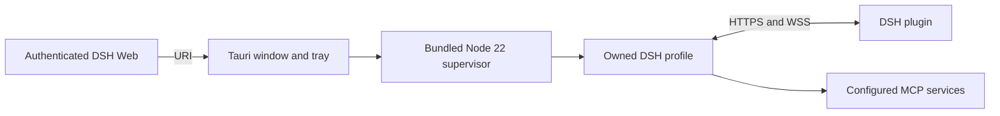

# DSH MCP Proxy

English | [中文](README.zh.md)

A Tauri desktop connector for local MCP servers and a separately installable DSH plugin.
The application shares one MCP list across multiple DSH connections while retaining call,
callback, cancellation and device ownership. Downstream MCPs perform file operations.
The Rust desktop shell supervises the existing Node/DSH core; the renderer receives only a narrow management bridge.



Start with [requirements](docs/requirements.md), [design](docs/design.md),
[configuration](docs/configuration.md) and [acceptance](docs/acceptance.md).
The [Tauri migration record](docs/migrations/tauri-2026-11-16.md) distinguishes implementation and verified platforms.
Historical Electron evidence does not establish Tauri acceptance.

## Develop

Use Node **22.x >=22.19** (recommended **22.23.5**), pnpm **>=10**, Rust and the native
[Tauri prerequisites](https://v2.tauri.app/start/prerequisites/) for the build host.
No consumer checkout or production credentials are required. See [development](docs/development.md) and [CONTRIBUTING](CONTRIBUTING.md).
For a new computer start with the [handoff checklist](docs/handoff.md), including native setup, commands and unverified cases.

```sh
pnpm install --frozen-lockfile
pnpm build:shared
pnpm typecheck
pnpm test
pnpm test:rust
```

There is no top-level `build`: native installers are built on their corresponding OS.
Scripts dispatch through `scripts/tasks.ts`; PowerShell is not a project prerequisite.
Windows archive operations select system tar explicitly, including when invoked from Git Bash.
Older pnpm 10 settings are mirrored in `package.json#pnpm`; later managers read
`pnpm-workspace.yaml`. The postinstall hook preserves a lock format readable by pnpm 10.0 and later, without changing dependency resolutions.

## Build

| Command | Host | Target/output under `release/mcp-proxy/` |
| --- | --- | --- |
| `pnpm build:win:32` | Windows | `win-32/` — x86 NSIS installer and x86 Node |
| `pnpm build:win:64` | Windows | `win-64/` — x64 NSIS installer and x64 Node |
| `pnpm build:win` | Windows | Both Windows architectures |
| `pnpm build:mac:intel` | macOS | `mac-intel/` — Intel DMG |
| `pnpm build:mac:arm` | macOS | `mac-arm/` — Apple Silicon DMG |
| `pnpm build:mac` | macOS | Both Mac architectures |
| `pnpm build:linux` | Ubuntu x64 | `linux/` — Debian package; Ubuntu 22.04 baseline |

Platform aggregates reuse one verified shared build and same-OS dependency closure.
Every target carries checksum-pinned Node **22.23.5**, matching native dependencies,
an immutable runtime inventory and third-party notices. Installers and executable/runtime
pairs are recorded together; a changed runtime is rejected rather than repaired during acceptance.
Mac builds retain the `.app` alongside DMG generation so the recorded executable comes from the actual bundle.
The read-only DMG is created directly with `hdiutil`, without Finder layout scripts.
Intel DMG verification is [deferred by user decision](docs/evidence/mac-intel-dmg-deferred-2026-11-16.md); build commands still produce DMG. Retry on another Mac or with the manual workflow input `mac_intel_runner`; a skipped lane is not acceptance.
Frontend assets use a project-relative Tauri directory and are embedded in the application; URL frontends are rejected at GUI startup.
Application version and npm scripts/dependencies are controlled by the root `package.json`;
Rust dependencies are locked in `Cargo.toml`/`Cargo.lock`.

`pnpm build:mcp-proxy` is the current-host compatibility entry. Optional public deployment
presets remain available through `--connection-presets <file>`. `pnpm build:mcp-plugin`
builds the independent DSH archive, installer, compatibility patch and licenses under
`release/mcp-plugin/`. Internal modules are bundled, not published separately.

## Install and use

Install the package for the machine/architecture. Windows installers can download and
install missing WebView2; Node is included and does not require a user installation.
Open the application, add MCP commands or HTTP/SSE endpoints, then choose “Connect this computer” in DSH Web.
Closing the window hides it; tray Exit waits for owned service/MCP cleanup without a second confirmation.
URI registration preserves unknown owners. Configuration, identity and user files are separate from installed binaries.
Windows uninstall removes the receipt-verified URI before deleting the bundled runtime; an ownership or cleanup error stops uninstall.
After a supervisor crash, Exit verifies the original service and drains only its owned process scope before releasing the desktop instance.

For the server, stop DSH **0.1.6-alpha.2**, then run against its package-manager installation root:

```sh
node release/mcp-plugin/install.mjs --dsh-root <dsh-installation-root>
```

Set `DSH_HOME` for a custom profile home and `MCP_PROXY_ORIGIN` to the public HTTPS deployment origin.
The installer preserves the existing authentication system and applies the documented
four-event Session patch when needed. Client builds additionally pin a Win32 ABI compatibility
patch for the fixed SDK; x64 widths and protocol semantics remain unchanged.

## Verify

`pnpm verify` runs Node/core checks without requiring native tools. `pnpm dev:doctor --packaging`
discovers native tools/libraries; discovery is separate from successful builds and GUI tests.
`pnpm verify --release --plan` previews the shared local/CI command plan; `--release` builds and verifies
Windows x86/x64, Mac ARM or Ubuntu on their host OS. Intel DMG requires explicit `--target mac-intel` on a Mac.
Headless Linux artifact execution uses Xvfb. Native CI also runs each host's default TS suite.
`pnpm test:product --target win-32`
or `win-64` binds an explicit build and requires all five Windows native cases; Mac/Linux run three profile cases.
`pnpm test:installer --target <target>` checks actual installed/extracted package payloads and cleanup.

Windows browser acceptance uses `pnpm test:browser --preflight`, followed by
`pnpm test:browser --target win-64` or `win-32`. It requires a real active desktop,
Chrome and Edge, Explorer, a free service slot and no existing URI registration.
Cold startup, pairing, both GUI pages, hide/restore, second launch, reconnect,
tray exit and owned cleanup remain mandatory. Preflight refusal and skipped cases are not passes.
Reports are in `.artifacts/ci`; profiles, credentials, private TLS keys and raw server logs are never uploaded.

Original additions use [Apache-2.0](LICENSE); adapted upstream code retains its [MIT notice](LICENSE-MIT-UPSTREAM).
See [third-party notices](THIRD_PARTY_NOTICES.md). Signing, notarization, release publication and the remaining product matrix require their own verification.
