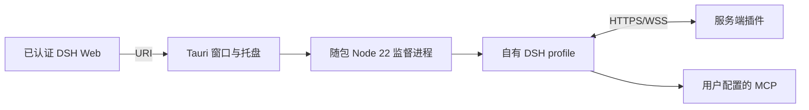

# DSH MCP Proxy

[English](README.md) | 中文

本项目提供 Tauri 本地 MCP 连通应用与独立的 DSH 服务端插件。Rust 负责窗口、托盘和系统集成，
随包 Node 22 继续运行既有 DSH/MCP 核心，保留多 DSH 连接、调用归属、取消、配对及文件所有权检查。
应用不提供文件工具，文件操作由配置的下游 MCP 完成。



后续开发从[需求](docs/requirements.md)、[设计](docs/design.md)、[配置](docs/configuration.md)与
[验收](docs/acceptance.md)开始。[迁移记录](docs/migrations/tauri-2026-11-16.md)区分已实现与实际验证；
历史 Electron 证据不能替代 Tauri 验收。

## 准备与开发

使用 Node **22.x 且 >=22.19**（推荐 **22.23.5**）、pnpm **>=10**、Rust 与对应宿主的
[Tauri 原生工具链](https://v2.tauri.app/start/prerequisites/)。不依赖消费项目源码或生产凭据，
操作及断点见[开发指南](docs/development.md)。
换机从[交接清单](docs/handoff.md)开始，按宿主准备工具并保留未验证项。

```sh
pnpm install --frozen-lockfile
pnpm build:shared
pnpm typecheck
pnpm test
pnpm test:rust
```

所有包脚本统一从 `scripts/tasks.ts` 分派，不需要 PowerShell。根 `package.json` 管理公开脚本、
应用版本和 npm 依赖；Rust 依赖由 Cargo.toml/Cargo.lock 管理。
为兼容早期 pnpm 10，必要设置同时保存在 package.json#pnpm 与 pnpm-workspace.yaml；
postinstall 只规范化补丁元数据，保留相同依赖版本和完整性。

## 构建

已删除顶层 `build`。不能在一个宿主上声称完成所有操作系统的原生打包。

| 命令 | 宿主 | `release/mcp-proxy/` 下的产物 |
| --- | --- | --- |
| `pnpm build:win:32` | Windows | `win-32/`，x86 安装包与 x86 Node |
| `pnpm build:win:64` | Windows | `win-64/`，x64 安装包与 x64 Node |
| `pnpm build:win` | Windows | 两个 Windows 架构 |
| `pnpm build:mac:intel` | macOS | `mac-intel/`，Intel DMG |
| `pnpm build:mac:arm` | macOS | `mac-arm/`，Apple Silicon DMG |
| `pnpm build:mac` | macOS | 两个 Mac 架构 |
| `pnpm build:linux` | Ubuntu x64 | `linux/`，以 Ubuntu 22.04 为基线的 deb |

平台聚合命令只编译一次共享内容，并复用同一宿主的依赖部署；各目标分别绑定官方 Node **22.23.5**、
对应原生依赖、运行时文件清单和许可证。验收按成功构建记录取安装包/程序/运行时，拒绝损坏或混用产物。
macOS 保留同次打包的 `.app`，直接用 `hdiutil` 创建只读 DMG，不运行 Finder 布局脚本；验收校验挂载后的程序和运行时。原生产物测试使用 `0600` 身份文件，保留 POSIX 凭据权限检查。
Intel DMG 按用户决定[记录并暂缓自动验证](docs/evidence/mac-intel-dmg-deferred-2026-11-16.md)，交付仍为 DMG。换 Mac 后执行原构建命令，或通过手工 workflow 的 `mac_intel_runner` 输入复测；跳过不算验收通过。
界面通过项目相对目录嵌入应用，GUI 启动拒绝 URL 型前端配置，避免 Windows 盘符被误识别为文件导航。
`build:mcp-proxy` 保留为当前宿主入口，`--connection-presets <file>` 可提供公开连接/CA 预设。
`build:mcp-plugin` 独立生成 `release/mcp-plugin/` 下的服务端归档、安装器、元数据、兼容补丁和许可证。

## 安装与运行

安装对应架构的包，再启动应用。Windows 安装器可自动补装缺失的 WebView2，首次可能联网；
所有目标内置 Node，不要求用户另装。通过 GUI 添加 MCP，然后在 DSH Web 点击“连接这台电脑”。
关闭窗口仅隐藏；托盘“退出”等待自有服务/MCP 清理，不再二次确认。URI 安装不会覆盖未知所有者。
配置、身份和工作文件独立保存，不随程序版本覆盖。
Windows 普通卸载先按安装记录验证并清除自有 URI，归属或清理失败则停止卸载；监督进程崩溃后的退出仍等待原服务及自有进程范围清理。

服务端固定为 DSH `0.1.6-alpha.2`。先停止服务，再对其包管理安装根目录执行：

```sh
node release/mcp-plugin/install.mjs --dsh-root <dsh-installation-root>
```

自定义 profile home 使用 `DSH_HOME`，公开 HTTPS 部署地址使用 `MCP_PROXY_ORIGIN`。
保留 DSH 既有鉴权和四项必须读取的 Session 事件。客户端为固定版本原生 SDK 附带 x86 ABI 补丁，
不改 x64 的结构尺寸、协议及业务语义。

## 验证

`pnpm verify` 执行 Node/核心检查，不要求原生工具；`dev:doctor --packaging` 另行发现原生工具和库，不能代替构建/GUI 验收。
`pnpm verify --release --plan` 预览本地与 CI 共用计划；`--release` 执行 Windows 两架构、Mac ARM 或 Ubuntu 宿主打包及验收。
Intel DMG 仅在 Mac 显式 `--target mac-intel` 时重试；Linux 无显示会话时自动用 Xvfb 执行产物检查。
原生 CI 同时运行各宿主的默认 TS 测试集合。逐步结果见 `.artifacts/ci/verification.json`。
`pnpm test:product --target win-32`／`win-64` 要求五项 Windows 原生产物测试零跳过，Mac/Linux 执行三项 profile 用例。
`pnpm test:installer --target <目标>` 单独检查安装包中的实际程序、运行时和清理。

Windows 的真实浏览器验收先运行 `pnpm test:browser --preflight`，再运行
`pnpm test:browser --target win-64`／`win-32`。要求活动桌面、普通 Chrome/Edge、Explorer、
空闲服务位和无已有 URI 注册；已有安装安全拒绝，不自动卸载。
保留冷启动、配对、GUI 两页、隐藏/托盘恢复、二次启动、重连、退出和清理，预检或跳过不算通过。
报告在 `.artifacts/ci`，不上传 profile、身份、私钥或原始服务日志。

原创增补使用 [Apache-2.0](LICENSE)，改编部分保留[上游 MIT 声明](LICENSE-MIT-UPSTREAM)。
见[第三方声明](THIRD_PARTY_NOTICES.md)。签名、公证、正式发布及剩余产品矩阵分别验收。
