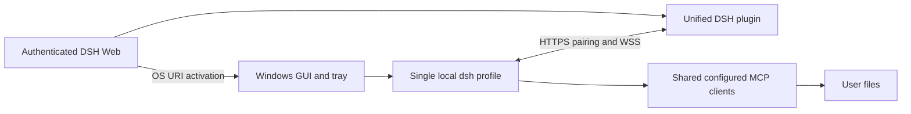

# Architecture overview

Two deliverables own the implementation: `packages/mcp-proxy` provides the Windows application; `packages/dsh-plugin` provides the server adapter. The seven private modules are bundled into these products. Authentication and model configuration remain with DSH, and downstream MCPs own file operations. Each invocation stays with its original authenticated DSH connection and generation.

The current detailed guides are maintained in Chinese. Read the [confirmed requirements and capability limits](requirements.md), [current design](design.md), [configuration and operations](configuration.md), and [acceptance evidence and remaining work](acceptance.md). The [historical baseline](history/README.md) retains the original complete requirements and Plan A in English and Chinese without a consumer checkout dependency.

The design guide owns process, pairing, protocol, Turn binding, callback and persistence details. The configuration guide owns paths, schemas, defaults and operational commands. The acceptance record owns verified results and pending scope; this overview does not claim complete product acceptance.
