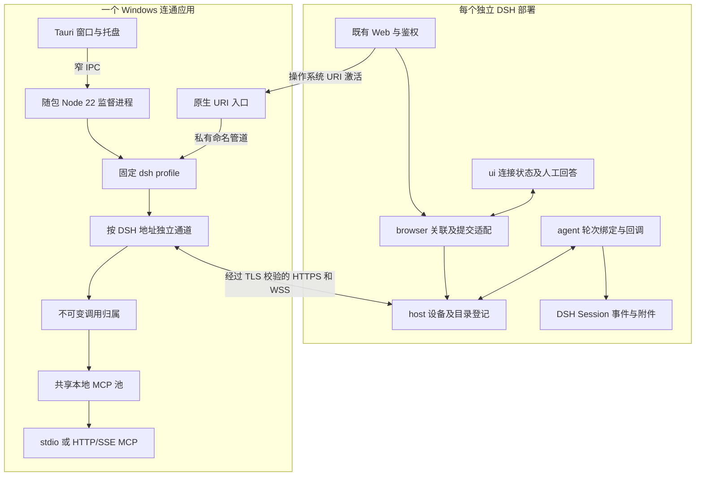
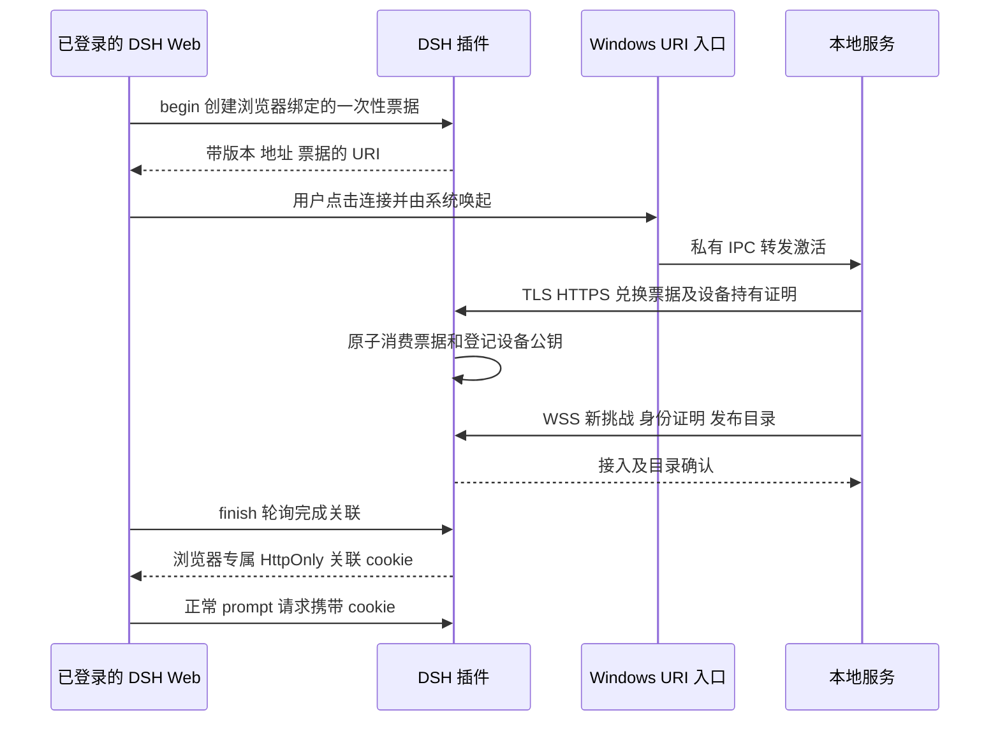

# 现行技术方案

本文描述独立项目当前实现及必须保留的设计约束，对应[需求 B1—B28、M1—M3](requirements.md)。历史方案 A 的完整中英文版本保存在[历史基线](history/README.md)；其中旧源码位置、包名、应用数据目录及旧式单服务器路线不作为现行接入说明。当前验收缺口集中记录在[验收记录](acceptance.md)。

## 部署与模块

| 实现位置 | 所有权 |
| --- | --- |
| `packages/mcp-proxy/src` | Node 监督进程、管理桥接、真实 profile 启停和共用界面 |
| `packages/mcp-proxy/src-tauri` | Rust 窗口/托盘、单实例、IPC 来源限制、资源完整性与原生打包 |
| `packages/mcp-proxy/modules/protocol` | ID、帧校验、身份挑战、目录、关联、调用及回调结算 |
| `packages/mcp-proxy/modules/local` | MCP SDK 适配、配置解析、共享池、串行调用、roots、管理事务与路由 |
| `packages/mcp-proxy/modules/runtime` | dsh profile、凭据、机器级控制入口、每 DSH 连接、配对、管理和恢复 |
| `packages/dsh-plugin/src` | 一个公开 Cordis 组合入口，拥有子插件的挂载与释放 |
| `packages/dsh-plugin/modules/host` | 接入、设备公钥登记、目录缓存、关联事务、调用与人工等待 |
| `packages/dsh-plugin/modules/agent` | 输入/轮次绑定、工具注册、sampling、elicitation 事件 |
| `packages/dsh-plugin/modules/browser` | 既有已认证 Connection 请求上的关联及 prompt 适配 |
| `packages/dsh-plugin/modules/ui` | 浏览器连接状态、设置入口和 elicitation UI |

仅两个产品交付。七个内部模块是私有 workspace 单元，随父产物打包。源码只依赖公共固定版本 DSH 包，不从消费项目解析实现。

## 桌面进程、运行时与单实例

Tauri 安装包内置官方 Node 22、真实 DSH CLI 和选定运行依赖，Windows 可补装 WebView2。
Rust 启动 Node 前按编译时内嵌摘要校验资源清单及所有文件；开发模式和原生产物验收不能混淆，验收不修复损坏运行时。
配置、身份、日志和工作文件在独立用户目录保存；Windows 保留原有数据位置。

Rust 通过私有 stdio 监督随包 Node 进程，Node 再启动固定 `mcp-proxy` profile；不在 WebView 或 Rust 重写 agent/MCP。
公共 app-boot API 初始化 profile，startup 在预算内检查必需提供方。退出等待自有进程清理，监督进程失联使用既有 DSH 信号关闭路径。
Windows Job 约束后代进程，x86/x64 使用匹配的结构尺寸；HTTP/SSE 外部服务不由应用停止。

GUI 的 Tauri 单实例机制复用窗口。后台服务通过固定机器命名管道 `\\.\pipe\dsh-mcp-proxy` 的首实例所有权排他；不以 PID 超时抢占，也不监听固定本地 TCP 端口。B3 要求跨工作目录、profile 和操作系统登录会话成立；跨 Windows 用户的排他性及管道权限仍需专门产品验收，不能把同用户测试当作已完成证明。

窗口关闭隐藏到托盘，菜单显示连接状态与退出，退出不二次确认。WebView 没有 Node API，
Rust 只接受本地 main 窗口来源的固定管理命令；前端不能派发 native activation 或任意 shell。
保留 CSP、导航限制、配置校验和管理回复脱敏。托盘交互另按平台原生环境验收。

## Web 激活、配对及本机关联

设备登记不需要 sessionId，可以早于会话创建。Web 不扫描局域网或本机端口；它通过操作系统 URI 把一次性事务送给这台电脑的唯一服务，服务器只有验证该设备和原浏览器事务后才建立关联。新建会话、重开会话都使用该浏览器的有效关联提交输入。

新 GUI 地址使用 device 模式：每个规范 HTTPS origin 独立持久 Ed25519 身份，配对请求证明覆盖来源、票据及公钥；重连使用新挑战，不以声明 endpointId 代替认证。首地址激活自动连接，不增加应用内允许/拒绝对话框。仍遵守浏览器/操作系统自身提示及 DSH 既有鉴权。

URI v2 包含 `mcp-proxy://associate/<一次性票据>?v=2&origin=<编码的HTTPS来源>`，不携带秘密、MCP 命令、路径或工具参数。激活只授权本地连接该来源，不证明是哪一个网站触发了操作系统唤起。部署者必须理解自动连接的信任选择；TLS 不关闭，激活不能携带 CA。

配对成功才发布服务器条目。手动断开持久保存 `enabled:false` 并隔离更早的未完成激活；只有后续新激活可以重新启用。其他服务器和共享 MCP 池继续运行。原始单服务器配置及无版本 URI 只用于显式 legacy 兼容路径，不是 GUI 默认部署方式。

## 输入与轮次绑定

browser 子插件仅在已认证的正常 prompt 提交中解析关联，在请求生命周期内登记 admission。agent 从实际 `agent/inbox/inserted` 取得消息 ID 记录输入绑定；不改核心请求结构、消息来源类型或 agent-loop。

`turn/start` 观察下一输入；`agent/inbox/claimed` 在模型组装前同步选择已经就绪的 endpoint、连接 generation 和不可变 catalog revision，追加轮次事件并注册工具。这里不发网络请求。明确选择但设备不可用时失败；无关联的普通输入不获得本地工具。排队消息保留自己的绑定，另一电脑打开页面不改变已执行轮次。

后续轮次可以使用另一电脑及其目录。同一轮次内引导继续使用原设备，不能用当前浏览器覆盖原调用。工具执行器再次检查 live Agent、固定状态、代际、目录和服务 incarnation；模型可见过滤不能代替执行校验。已删除服务即使使用相同别名重新添加，也不能承接旧轮次的调用。

## 多 DSH 及共享 MCP 路由

每个 DSH 条目拥有独立来源、socket、认证代际及确认目录，不存在“当前 DSH”全局执行目标。远端调用按 DSH 连接、代际、远端调用 ID 共同索引，并分配唯一的本地 invocationId。sampling/elicitation、取消、迟到结果均沿不可变原归属返回，不能仅按远端 ID 分发。

同一 MCP 服务跨所有 DSH 串行执行，确保下游回调可归属；不同服务相互独立。取消需要隔离下游客户端时，先淘汰/清理该实例再恢复，排队调用等待，已派发调用不重放。此策略可能影响共享该客户端的其他已接收操作，必须按未知结果如实结算，而不是承诺所有取消对其他 DSH 都完全无感。

新增 MCP 先校验和协商，失败不发布。删除先阻止新调用，持久化移除并取消受影响操作，等待自有客户端退出。变更发布完整不可变目录，各通道确认后才能将其用于新轮次。旧轮次保留日志中的定义；定义、实例或目录已不可用时明确拒绝。下游自发目录变更的透明通知不属于已交付保证。

## 聚合协议与失败语义

WSS 上的 JSON 聚合协议当前为 `v:1`；URI 的 `v=2` 是另一项版本，二者不能混用。帧定义以 [protocol.ts](../packages/mcp-proxy/modules/protocol/src/protocol.ts) 为准，解析先校验字节上限、版本和字段，再修改状态。

| 帧类别 | 含义 |
| --- | --- |
| challenge/register/ready | 新代际身份挑战和准入 |
| catalog/catalog-accepted/catalog-rejected | 带 revision 的完整目录及确认 |
| invoke/result/failure/cancel | generation、revision、ID、服务、工具、参数、deadline、结果及取消 |
| callback/callback-result/callback-failure/callback-cancel | 父调用、回调 ID、代际、sampling/elicitation 及响应 |
| association/ping/pong | legacy 关联及存活检测 |

| 情况 | 必须保留的行为 |
| --- | --- |
| 派发前不可用 | 拒绝，不换设备 |
| 可能已派发后断线/超时 | 结果未知；不自动重发，不保证副作用未发生 |
| 重复 ID 或迟到结果 | 保留原代际单次结算，不重复执行或改写终态 |
| MCP `isError` | 保留协议错误，不当作成功 |
| 页面关闭 | 移除观察者，不取消已接收的服务端任务 |
| 手动断开/删除/退出 | 取消受影响调用和回调，清理拥有资源，不停止外部 HTTP 服务 |

聚合结果保留原始允许 JSON。模型原生投影复用公共 DSH MCP helper，并受其内容/附件及模型模态约束；不以聚合层数据保留推断所有元数据都传给模型。

## 客户端回调

sampling 直接调用 DSH LLM 服务，采用当前会话 provider/model 和受限 token 参数，不创建递归 agent 轮次、不附加全部会话历史、不按下游偏好切换凭据。记录请求、模型流及终态，父调用取消同时取消 sampling。支持的消息模态见[能力表](requirements.md#能力范围)。

elicitation 的 live 等待由 host 的内存 `ElicitationStore` 拥有，Session 记录其请求及结果。页面关闭后存活等待继续，重开页面可按会话查询并回答；表单校验及单次结算防止多个标签页重复回答。URL 模式只向当前已认证页面提供 live URL，Session 历史移除其 URL 认证材料。**目前没有单独的历史待回答归约器或可恢复的持久 continuation 数据库**；重启后的历史展示、终态标记和完整回放仍需核验，不能声称重启后继续原等待。

roots 在本地初始化阶段即可回答，不要求已有会话。每服务固定目录转为 file URI；不选择服务端路径，不作为权限沙箱。支持任务式执行和现代 input-required 的具体协商由锁定 SDK 适配器负责，不通用转发所有 MCP 方法。

## 持久化与恢复

插件声明四个必须读取的 Session 事件：`mcp-proxy/input`、`mcp-proxy/turn`、`mcp-proxy/sampling`、`mcp-proxy/elicitation`。工具调用/结果、模型上下文与附件复用 DSH 既有事件。cookie、可复用连接凭据和私钥不写入这些事件。

恢复历史不恢复活连接权限。agent 读取绑定事件重建状态，但新调用必须再次满足当前存活连接、代际和目录检查；缺少绑定时不猜测设备。重启不制造旧外部操作，不重新调用模型或打开 URL。连接端设备公钥存储独立于 Session，浏览器关联的内存状态在服务端重启后需要重新建立。

公共 DSH `0.1.6-alpha.2` 的已知事件集合不认识上述四项，故采用用户已批准的最小补丁，只增加四个名字。开发安装由本项目 pnpm patch 应用；发布安装器检查**目标 DSH 安装实际解析的 session 包**，必要时在其包管理根目录应用补丁，再用公开 `dsh plugin add` 安装。已有任意 session 补丁时拒绝静默覆盖。该白名单修复不等于两个 SDK 的完整序列化、历史 UI 或版本升级验收已经完成。

## 构建及依赖

开发环境通过[原生开发入口](development.md)初始化项目专用状态，复用公共 DSH CLI/profile API。
调试 sourcemap 和 Tauri debug 分发不进入默认发布流程，身份、证书与 profile 不提交。

依赖和完整性由 package.json、pnpm/Cargo lockfile 与构建运行时锁文件管理。项目统一 Node 22；必要时使用隔离的已校验构建 Node，不改全局环境。共享编译只执行一次，各 OS/架构分别部署匹配 Node 与原生依赖，产物清单见迁移记录。

构建本地 EXE 前编译原生 URI helper，物化运行依赖、解除硬链接、验证真实公开模块导入，并生成哈希清单；不携带开发源码或依赖消费仓库解析。服务端归档在独立暂存位置合并私有模块并提升外部依赖，拒绝越界成员路径。额外 Node profile 归档仅供消费侧产物测试。

发布安装器、归档、元数据、许可证及兼容补丁一起组成服务端 release 目录。启用/禁用父 Loader 条目必须同时管理 host/agent/browser/ui 的路由、监听器和资源。安装、配置、停止及移除操作见[配置指南](configuration.md)，不另造 DSH 核心启动器。
