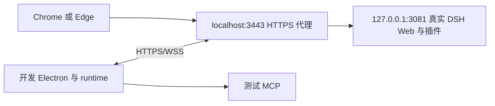

# Windows 原生开发与调试

本指南从完整源码 checkout 开始。支持 Windows x64；推荐 Node **24.21.0**（见 `.node-version`）、pnpm **11.7.0**、PowerShell **7**。基础开发与无密钥检查不需要其他源码仓库、生产 DSH 或模型账户。macOS/Linux 桌面交付仍不在本期范围。

## 准备工具链

安装 Git 和 Node 官方 Windows x64 发行版（保留附带 LICENSE）。PowerShell 7 可使用 `winget install --id Microsoft.PowerShell --exact`，Node 可通过自己的版本管理器按 `.node-version` 安装，或从 [Node 官方发行目录](https://nodejs.org/dist/v24.21.0/)获取。在新的终端执行：

```powershell
npm install --global pnpm@11.7.0
git clone https://github.com/j-show/dsh-plugin-mcp-proxy.git
cd dsh-plugin-mcp-proxy
pnpm install --frozen-lockfile
pnpm dev:doctor
pnpm build
pnpm typecheck
pnpm test
```

需要联网下载 npm 包及第一次使用的构建二进制；网络代理按自己的包管理器配置设置，不能提交认证信息。`pnpm install` 根据仓库版本声明安装全部依赖，包含真实 DSH Web 的显式 peer 依赖；不需要 DSH 消费项目。默认测试不启动用户的桌面应用。

Windows 打包另需系统 `tar` 和 .NET Framework 4.x 编译器：

NSIS 便携打包会在 T:—Z: 中临时申请一个未占用盘符，将本次构建输出映射成短路径，完成或失败后仅释放自己仍拥有的映射。这用于兼容深 checkout 路径；不移动源码，不修改已有盘符。至少保留一个可用盘符。

```powershell
pnpm dev:doctor --packaging
```

预检失败时依次确认 `node --version`、`pnpm --version`、`pwsh --version`、`tar --version`，以及 `%WINDIR%/Microsoft.NET/Framework64/v4.0.30319/csc.exe`。恢复缺失的 Windows .NET Framework 组件；不要从未知站点复制编译器。若 Node 分发未附 LICENSE，换用完整官方发行版，或给开发打包传入 `--node-license <对应Node发行版的LICENSE>`。受影响的 Windows Node 24 自动切换仓库锁定并校验的私有 Node，其 LICENSE 随发行包取得。预检不会安装工具或修改全局环境。

## 初始化

```powershell
pnpm dev:init
pnpm dev:check
```

初始化在 `.artifacts/dev/` 创建自己的服务端/客户端 DSH home、工作目录、v2 settings、日志、开发 CA 和 localhost 服务器证书。Windows ACL 将生成状态限制为当前用户和 SYSTEM。重复初始化保留配置、身份与证书；发现非本 checkout 拥有的目录、目录链接或不完整证书会失败，要求人工检查。若移动了整个 checkout，先保留旧开发数据，再在新位置重新初始化自己的空目录，不能复用另一机器的身份。

```text
.artifacts/dev/
  owner.json                  checkout 所有权记录
  server-home/                独立 Web profile、个人开发模型设置
  client-home/                本地 runtime profile
  local-app-data/             开发 Electron 状态
  tls/ca.pem, server.pfx       本机生成的 90 天开发证书；含私钥的 PFX 不提交
  settings.json               测试 MCP、目录及配对后的本机身份引用
  connection-presets.json     只包含 localhost 的公开 CA 预设
  workspace/                  下游测试 MCP 工作文件
  logs/                       server/runtime/desktop 日志
```

此目录由 `.gitignore` 排除；不要将其作为 CI 产物上传。仓库测试 MCP 仅供开发，不作为发布产品的默认文件能力；它有 append/read/sample/ask 等工具，**没有文件权限沙箱**，只在受控工作目录使用。

## 运行和断点



终端一：

```powershell
pnpm dev:server --inspect
```

终端二：

```powershell
pnpm dev:desktop --inspect
```

这两条命令默认重新构建源码，生成 sourcemap；已有匹配构建时可加 `--skip-build`。Electron 开发分发放在新的 `.artifacts/dev/desktop-*/`，不覆盖 release，不执行便携缓存引导，不自动注册 URI。初始化只写配置，只有显式执行 desktop 命令才打开 GUI。

使用 Chrome/Edge `chrome://inspect` / `edge://inspect` 配置 `localhost:9230` 连接服务端，`localhost:9231` 连接 Electron 主进程。renderer 使用调试器中的 Electron 页面目标打开 DevTools；sourcemap 指回当前 checkout。改代码后正常停止、重新执行启动命令；本期不承诺所有模块热重载。

如需单独调试本地 runtime，先退出开发 Electron，再运行：

```powershell
pnpm dev:runtime --inspect
```

在 `localhost:9232` 连接，断点可设于 `modules/runtime/src/index.ts`。这是同一公共 dsh CLI/profile 的前台运行方式。机器只允许一个本地 MCP 服务；启动遇到已有应用时会拒绝，不抢占、不结束未知进程。

Web ready 以正常登录引导后 HTTPS 首页返回 200 且 DSH 日志无必需插件失败为准，不能以“TLS listener”打印为准。使用终端打印的 `https://localhost:3443/?token=...` 完成 DSH 自身的登录引导；未登录的根路径返回 401 是正常鉴权行为。第一次使用时先在 Windows 当前用户的受信任根证书管理界面，**显式导入本 checkout 的 `tls/ca.pem`**。初始化不操作系统证书存储。可先用 `certutil -dump .artifacts/dev/tls/ca.pem` 核对指纹，结束开发后从 `certmgr.msc` 按相同指纹移除。不要关闭 TLS 检查；不同 checkout 同名 CA 必须按指纹区分。登录引导 URL 和 server.log 都可能包含本地访问令牌，不共享原始日志。

DSH 使用其已有的浏览器来源检查与登录界面；回环部署的信任策略沿用固定版本默认行为，开发脚本不增加账户体系或绕过认证。需要模型时在 Web 的模型设置中选择自己的提供方，或按 DSH 支持的环境变量设置个人开发密钥于 `server-home/.env`。不要将真实密钥写入示例、命令记录或 PR。无模型密钥时可以检查 UI/配对/协议；真实模型执行仍需个人配置。

开发分发不注册 URI，也不显示注册按钮。日常源码调试可在服务端页面取得一次性 URI 后，执行 `pnpm dev:associate --uri '<一次性URI>'`，该命令使用项目客户端 profile/settings 转发到已启动的开发服务，不需要改注册表。URI 包含一次性票据，不保存到 issue 或共享日志；注意清理个人终端历史。普通浏览器自动唤起必须使用 release 产物按配置指南另行验收。

## 停止、重置与诊断

- Electron 通过托盘“退出”停止自有 runtime；关闭窗口只隐藏。前台 Web/runtime 在各自终端按 Ctrl+C。检查退出状态，再关闭终端。
- 不要用 taskkill /F 或机器级 stop 命令结束不认识的服务。GUI URI 注册属于显式外部副作用；移除时按[配置指南](configuration.md#管理命令与移除)使用对应开发分发及本项目 settings/home，仅移除所属入口。
- 重置前停止所有本开发环境进程，核对 `owner.json` 和实际路径，保留 workspace 文件及需要保留的身份。将自己的 `.artifacts/dev` 改名备份，再执行 init。没有自动递归 reset 命令。
- 证书过期/损坏时先停止环境并备份，显式移除旧开发 CA 信任，将自己的开发状态改名重建；已有证书不会被初始化静默替换。
- 3443/3081 或 9230—9232 被占用时正常退出对应进程后重试。首次库构建和 DSH 启动需要时间；日志在 `logs/`。502 表示后端未就绪或已失败，检查 server.log，不关闭 TLS 来修复。

`dev:check` 运行无密钥的初始化、TLS、插件组合、关联及本地工具集成测试。它不代替真实模型、Chrome/Edge URI、跨用户、两台机器和两个独立 DSH 的产品验收。参见[验收记录](acceptance.md)。

## 独立性与交付检查

CI 从新的 checkout 使用 frozen lockfile 执行构建、类型检查、默认测试和两端打包，记录提交与产物哈希。新机器不复制 node_modules、lib、release、.artifacts 或用户 profile。完整源码必须经过提交和推送后才能被其他人拉取；本地暂存不构成开源交付。

原生产物验收使用 `pnpm test:product`，在 `pnpm build:mcp-proxy` 成功后自动绑定该次构建。
release CI 也运行它；服务位占用时先正常退出自己的开发 Electron/runtime。
入口不会停止未知服务，要求全部 5 项实际通过，并记录服务位和测试目录清理结果。

## 真实浏览器和桌面验收

先执行 `pnpm test:browser --preflight`。必须同时安装普通 Chrome/Edge，Windows 会话 active，输入桌面与进程桌面一致，
Explorer 托盘可用，机器服务位及用户/系统合并的 `mcp-proxy://` 注册均空闲。已有安装时安全拒绝，不自动卸载。
完整入口 `pnpm test:browser` 使用本次产物记录、服务端插件归档及独立 profile，临时导入
测试 CA 并由真实产品注册 URI，逐个浏览器操作协议确认框、配对、窗口与托盘。
使用现有公开工具链和 UIA/CDP，无额外浏览器框架或宿主 AI 插件依赖。

成功要求两种浏览器全部场景和回收检查通过。CI 先做桌面预检，再在 release 验证中执行；
不支持交互桌面的 runner 会明确失败，需要配置具备该能力的 runner，不能改成 headless 后宣称通过。
报告及经秘密检查的界面图位于 `.artifacts/ci/browser-*`；私有 profile、CA 私钥及原始日志
保留在 `.artifacts/browser-e2e`，不会上传。实际通过状态以对应 commit 的 CI 为准。

完整入口先执行冷启动矩阵：每浏览器 3 套全新 DSH 安装（独立 npm cache、home、临时目录），
每套 3 个全新浏览器进程/profile，正常访问引导页并打开本机连接设置；记录 CDP 与 Web 启动耗时。
任一次失败立即中止，不能重试掩盖。`pnpm test:browser --startup-only` 可单独执行该矩阵，
只需本次构建的服务端归档，不启动桌面产品、不检查或操作已有 URI owner/机器服务。
它仍要求交互桌面、两种浏览器，并按指纹回收新导入 CA，按创建身份回收自有进程。
冷浏览器窗口需按创建身份验证后获得前台，且页面 visible/focused；系统拒绝前台切换时明确失败，
不将隐藏标签页中无效的点击误报为插件启动失败。
冷启动报告为 `.artifacts/ci/browser-*-cold*.json`，不等价于完整配对/托盘矩阵通过。

Windows 导入或移除根证书可能出现安全确认；测试仅处理本轮 helper 的创建身份与测试 CA
匹配的窗口。普通原生按钮通过 UIA 执行，托盘指针操作先核对命中对象，遮挡时失败而不误点。

### 浏览器验收实现约束

修改 `scripts/browser-*.ts`、`scripts/test-browser.ts` 或原生 probe 时按本节核对。流程见[设计](superpowers/specs/2026-11-13-browser-desktop-e2e-design.md)，已验证范围见[固定证据](evidence/browser-desktop-e2e-2026-11-13.md)。

- **构建与归属**：校验成功构建记录的 EXE/runtime 哈希和完整清单，服务端归档复制后绑定哈希。私有路径从 checkout 派生，拒绝链接目录、已有 URI owner 和占用服务位，不选择“时间最新”目录或停止未知进程。
- **进程**：通过有限权限句柄查询映像，避免启动期 MainModule 缺失；动作绑定 PID 与创建时间。SDK 标记可能来自已退出的协商进程，只接受当前自有子树中的存活实例。挂起 fixture 按 CreateProcess 返回的句柄终止/等待子进程，finally 关闭进程、线程及查询句柄。
- **协议上下文**：Open 应用名或 plain Open/打开必须位于最小原生子树，含品牌、预期 HTTPS authority 和唯一 Cancel。拒绝 Document 祖先/子树、Omnibox；必须在深度上限内明确到达自有窗口根。复选框可隐藏，状态不变；确认、消失检查、截图共用定位器。
- **输入**：UIA 身份去重只合并同一控件，不合并不同同名按钮。协议确认先等待焦点、前台和边界稳定，尊重 Chromium 输入保护及系统双击间隔，再派发一次输入。禁止提示抑制、证书校验关闭、原生事件回调注入或用管理 API 成功替代真实 UI。
- **不重放**：仅明确的输入前拒绝可重试，并保留最后原因。UIA Invoke/SendInput 后异常、超时或缺少可信结果均不确定；尝试释放已按下的键/鼠标键，停止后续托盘 UI 回收，转入自有配置/创建身份校验的服务停止和进程回收。证书确认门在成功或不确定后停止派发，只等待真实存储操作结果。
- **托盘范围**：窗口须属当前 Shell_TrayWnd 进程；现代 overflow ID 优先，兼容本地化标签。通用 XAML 弹层中的目标还需已知通知图标 ID，Name/HelpText 精确匹配品牌。UIA FromPoint 可返回祖先；仅通知图标可在物理 HWND 根匹配、受限祖先链和无交叠可操作控件时接受，派发前重查身份/边界/光标。
- **菜单与回收**：右键一次后读取 GUI 自有可见窗口中的唯一、非空 Exit MenuItem，等待菜单而不重发右键。退出后检查隐藏通知区，关闭本次检查打开的弹层；核对 GUI/服务/MCP 创建身份已退出、服务位 idle、URI 卸载及新导入 CA 指纹移除后，才删除自有状态。
- **拒绝回归**：每浏览器在自有 blank tab 构造深层可访问 HTML 伪确认，测量 Document 深度超过原生上限并验证拒绝，再导航真实 DSH。托盘实际点击前用本轮顶层遮挡窗验证拒绝并销毁；矩阵缺少任一 guard 证据即失败。正向场景仍使用真实产品与浏览器操作。
- **引导与诊断**：正常点击非约束性 Continue 和可选 Configure later，先验证网页点击命中。诊断只保留清洗后的错误、固定阶段/查询外路径/状态码、控件类别和 RuntimeId；记录 profile/CLI 解析的公共框架版本及同源 JS source hash，不将本地依赖版本当作实际加载版本。
- **隐私**：不上传 profile、身份、私钥、原始服务日志或认证 URL/headers。协议截图只裁剪已验证子树，扫描 Name/Value 敏感内容并排除地址栏；页面截图需通过 token 检查。只能确认本轮 helper 创建身份、映像及测试 CA 文本都匹配的证书警告。
