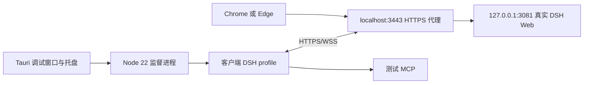

# 跨平台开发与调试

从完整源码 checkout 开始，使用 Node 22.19+（推荐 `.node-version` 中的 22.23.5）、pnpm >=10、
Rust/rustup 及对应宿主的 [Tauri 原生前置依赖](https://v2.tauri.app/start/prerequisites/)。
不需要其他源码仓库、生产 DSH 或模型账户。Windows 打包需要 MSVC、Windows SDK、系统 tar
和 .NET Framework 4.x 编译器（仅用于既有 URI 桥接与 UIA 测试）；不需要 PowerShell。
macOS 需要 Xcode/Command Line Tools；Ubuntu 以 22.04 x64 为基线，需要 WebKitGTK 4.1、GTK、AppIndicator 等原生依赖。

```sh
pnpm install --frozen-lockfile
pnpm dev:doctor
pnpm build:shared
pnpm typecheck
pnpm test
pnpm test:rust
```

依赖和初次构建运行时需要联网。脚本以 Node.js 分派，不改全局 Node，必要时在 `.artifacts/`
准备已校验的 Node 22。实际打包按目标使用同一版本官方 Node，保留 LICENSE。
根 package.json 管理 npm 版本、应用版本与公开命令；Cargo.toml/Cargo.lock 管理 Rust。
pnpm 10.0 所需设置在 package.json#pnpm 保留兼容镜像；修改后须与 pnpm-workspace.yaml 一致。
postinstall 仅把补丁锁定元数据规范为兼容格式，不升级依赖或改变完整性。

## 平台构建

没有顶层 `build`。在 Windows 调用 `build:win:32`、`build:win:64` 或 `build:win`；
macOS 调用 `build:mac:intel`、`build:mac:arm` 或 `build:mac`；Ubuntu x64 调用 `build:linux`。
各平台聚合只调用一次共享编译，校验源码/输出清单后复用，同一 OS 的部署依赖也只准备一次。
Rust target 由构建命令按需准备；不同 OS 的目标明确拒绝，不能通过跳过目标声称全部成功。

输出在 `release/mcp-proxy/<目标>/`，包括 NSIS、DMG 或 deb 及对应构建记录。
`build:mcp-proxy` 是当前宿主兼容入口；服务端使用 `build:mcp-plugin`。
`--connection-presets <file>` 保留公开 HTTPS origin/CA 预设功能，不能包含私钥。
原生工作目录在 `.artifacts/build-*`；开发分发位于 `.artifacts/dev/desktop-*`。
应用与 Node 的位宽必须匹配，不能把 32 位界面加 64 位运行时称为 Win32 支持。

## 初始化与运行

```sh
pnpm dev:init
pnpm dev:check
```

初始化在 `.artifacts/dev/` 创建服务端/客户端 DSH home、工作目录、v2 settings、日志、
本机 CA 与 localhost 服务器证书。Node.js 生成 PEM/PFX，不操作系统证书存储。
Windows ACL 将状态限制为当前用户和 SYSTEM；重复初始化保留配置、身份与证书，拒绝未知所有者、链接或不完整证书。

```text
.artifacts/dev/
  owner.json                  checkout 所有权记录
  server-home/                独立 Web profile、个人开发模型配置
  client-home/                本地 runtime profile
  local-app-data/             开发应用状态
  tls/ca.pem, server.pfx       90 天开发证书；PFX 含私钥
  settings.json               测试 MCP 配置与本机身份引用
  connection-presets.json     localhost 的公开 CA 预设
  workspace/                  受控测试 MCP 工作目录
  logs/                       私有进程日志
```

此目录不提交、不上传。测试 MCP 仅供开发，没有文件权限沙箱。



在两个终端分别执行：

```sh
pnpm dev:server --inspect
pnpm dev:desktop --inspect
```

调试分发使用 sourcemap，不发布安装包、不自动注册 URI、不接管机器服务。
Chrome/Edge 的 `chrome://inspect`／`edge://inspect` 可连接 9230（服务端）、9231（Node 桌面监督进程）。
Rust 桌面层通过原生 Rust 调试器调试；WebView 开发工具与 Electron renderer 调试方式不同。
单独调试 runtime 时先退出开发桌面应用，再运行 `pnpm dev:runtime --inspect`，连接 9232。
改代码后正常停止并重启；不承诺所有模块热重载。

Web ready 要求正常登录引导后的 HTTPS 首页 200，且日志没有必需插件失败，不能以 TLS listener 打印为准。
使用终端给出的 `https://localhost:3443/?token=...` 登录；未登录根路径 401 属于正常鉴权。
浏览器测试前显式信任本 checkout 的 `tls/ca.pem`，按指纹区分同名证书，结束后移除自己导入的 CA；
不要关闭 TLS 校验。登录引导 URL 和原始 server.log 可能含令牌，不能共享。
无模型密钥可检查 UI、配对和协议；真实模型任务仍需个人开发配置，密钥不写入示例或提交。

开发分发不注册 URI。日常源码联调可使用 `pnpm dev:associate --uri '<一次性URI>'`
向自有已启动服务转发，避免改注册表；票据不保存到 issue 或共享日志，注意终端历史。
普通浏览器 URI 自动唤起使用构建产物单独验收。

## 停止与诊断

- 桌面窗口关闭仅隐藏；托盘“退出”等待自有服务和 MCP 清理。Web/runtime 前台终端用 Ctrl+C，桌面开发命令转发自有退出请求。
- 不结束未知服务，不使用强制进程清理代替成功退出。3443/3081、9230—9232 被占用时先由所有者正常退出。
- 重置前停止本环境，核对 owner.json 和路径，备份 workspace/身份；将自有状态备份后重新初始化，没有自动递归 reset。
- TLS 过期/损坏时显式移除旧 CA 并备份重建；不会静默替换证书。502 表示后端未就绪或失败，查私有日志。
- GUI 原生前台操作被系统拒绝时属于环境失败，不能把隐藏页面中无效的点击认定为插件故障。

## 自动化与产物验证

`pnpm verify` 运行核心检查，`pnpm verify --release` 增加当前宿主打包及原生产物/安装包验证。
`test:product --target <目标>` 从构建记录校验程序、安装包和完整运行时，不找“最新目录”，不修复损坏产物。
Windows 五项用例、Mac/Linux 三项 profile 用例分别要求零跳过；服务位占用时安全拒绝。
`test:installer` 检查真实安装/卸载或挂载/解包后的程序；Windows 要求没有已有安装记录、自启或 AppID 集成，拒绝未知所有者。
报告明确说明实际安装与仅提取检查的区别，不能把 deb 提取当作已执行系统安装。

真实 Chrome/Edge 测试先用 `test:browser --preflight`：要求 active 会话、输入桌面与进程桌面一致、
Explorer、两种浏览器、空闲服务位及无已有 URI 注册。原有安装不会自动卸载。
`test:browser --target win-32`／`win-64` 包含每浏览器三套新 DSH 环境、每套三个独立浏览器进程/profile，
另执行二十次新文档启动及七个生命周期场景；任次失败立即终止，不重试掩盖。
`--startup-only` 仅执行冷启动，不操作已有 URI 或机器服务；仍要求可见且可获得前台的真实窗口。

公共诊断在 `.artifacts/ci/`，私有 profiles、CA 私钥、身份和原始日志保留在自有测试目录且不上传。
当前平台实测状态及未完成的真实模型、跨用户、多设备验收见[acceptance](acceptance.md)。

### 浏览器验收实现约束

- **构建绑定**：校验同次安装包、应用程序和完整 runtime 的哈希及清单；服务端归档单独绑定哈希。拒绝链接目录、已有 URI owner、占用服务位，不停止未知进程。
- **进程归属**：用有限权限句柄查询映像，绑定 PID 与创建时间。Tauri GUI 按本轮 launcher 的创建身份查找，不按 app-data 下的 Electron 缓存路径猜测。已退出的协商 PID 不归属于新进程。
- **协议上下文**：确认控件必须在最小原生子树内，含应用品牌、预期 HTTPS authority 与唯一 Cancel。拒绝 Document、Omnibox；有限祖先链必须到达自有根。复选框状态不变。
- **输入与不重放**：验证焦点、前台、命中和稳定边界，尊重 Chromium 保护间隔。仅明确输入前拒绝可重试；派发、超时或结果不明后不得重放，尝试释放按键，使用自有配置/创建身份恢复。
- **托盘与菜单**：只操作当前 Explorer 根下精确品牌的通知图标；检查物理命中、重叠控件和 RuntimeId。遮挡拒绝；右键仅一次，再读取 GUI 自有可见窗口的唯一非空 Exit MenuItem。
- **拒绝回归**：每浏览器执行深层 HTML 伪协议确认拒绝，测得 Document 深度超过祖先上限；实际点击托盘前验证本轮遮挡窗拒绝并销毁。保留七场景和两个 guard 的独立证据。
- **退出清理**：等待已捕获 GUI、监督进程、服务、MCP 和浏览器创建身份退出；检查服务位、URI、测试 CA、托盘和私有状态。Tauri/Node 在分发目录运行，不能仅扫描 app-data 映像路径。
- **诊断隐私**：仅保留脱敏错误、查询外路径/状态码、控件类别和版本/hash。原生截图只裁剪已验证子树并扫描敏感内容；页面截图检查认证 URL、票据和私钥。只确认本轮 helper 身份、映像及 CA 文本匹配的证书提示。
- **分层结论**：预检、源码/模拟、真实浏览器、原生产物与产品验收分开记录。Node/Tauri 迁移和连续绿灯不证明历史启动异常根因已修复。
