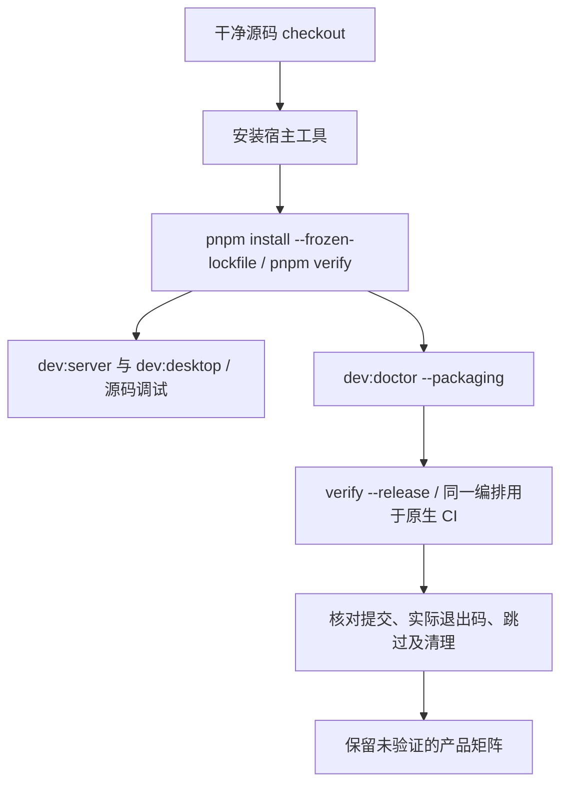

# 换机开发交接

适用本次 checkout；先记录 `git rev-parse HEAD` 和 `git status --short`。不要复制旧电脑的
`node_modules`、`.artifacts`、`release`、个人 DSH home 或证书。联网获取公共锁定依赖；不承诺离线构建。

## 目标与入口

仓库只有 packages/dsh-plugin、packages/mcp-proxy 两个交付包。modules/ 下无独立 package.json 或版本，组件通过父包子路径加载，共享协议源码分别编入两个产物。构建只打包父包，浏览器模块元数据在服务端父包登记一次。已有本地 runtime profile 的旧 bundle 引用在初始化时迁移，身份和用户配置保留；这些变更不关闭后文暂缓/待验事项。

按 [requirements](requirements.md) 的 B/M 编号确定行为，[design](design.md) 和
[configuration](configuration.md) 说明实现；[acceptance](acceptance.md) 列出未完成产品验收。
M4 已取代旧 Electron、单 EXE 和平台暂缓技术限定。历史测试只能证明其对应提交。



## 环境准备

- Git、Node **22.x 且 >=22.19**（推荐 `.node-version`）、pnpm **>=10**。当前兼容矩阵验证 10/11/12，不预先保证未来主版本。
- 仅核心 TS 开发不要求 Rust/桌面。安装 Node 后可执行 `npm install --global pnpm@10`，也可自行使用 >=10 的版本。
- 原生开发安装 rustup；在仓库根目录执行 `rustup show`，由 `rust-toolchain.toml` 选择 1.94.1。构建按需下载目标库。
- Windows：Visual Studio Build Tools，选择 Desktop development with C++、MSVC x86/x64、Windows 10/11 SDK；安装 WebView2 Evergreen。启用 .NET Framework 4.x 编译器，保留系统 tar。SDK 预检按标准 Windows Kits/10 路径检查。
- macOS：`xcode-select --install`，完成必要的工具选择/许可设置。保留系统 `hdiutil`；默认只在 ARM 宿主选择 ARM 产物。
- Ubuntu 22.04 x64：按以下命令准备原生依赖；其他发行版和 Linux ARM 尚未验证。

```sh
sudo apt-get update
sudo apt-get install -y build-essential pkg-config libwebkit2gtk-4.1-dev libssl-dev libxdo-dev libayatana-appindicator3-dev librsvg2-dev patchelf dpkg-dev xvfb xauth
```

原生前提依据 [Tauri](https://v2.tauri.app/start/prerequisites/)；Windows Runtime 探测依据
[Microsoft WebView2 注册项](https://learn.microsoft.com/en-us/microsoft-edge/webview2/concepts/distribution#detect-if-a-suitable-webview2-runtime-is-already-installed)。
预检读取工具/库/注册项，Linux xdo 在自有临时目录做编译/链接烟测并清理，不运行探针；不安装软件、修改证书信任或接管服务。
发现成功仍不证明整个应用构建、GUI 或调试正常。

## 初始化、开发、测试

```sh
pnpm install --frozen-lockfile
pnpm verify
pnpm dev:doctor --packaging
```

`verify` 依次运行核心预检、隔离初始化、共享构建、类型检查、默认 TS 测试和开发检查。
默认 TS 测试有按平台和显式产品入口的跳过；产品入口单独要求对应五项或三项零跳过。
初始化/重复初始化/停止与证书信任方式见 [development](development.md)。不自动导入 CA。

两个终端启动 `pnpm dev:server --inspect`、`pnpm dev:desktop --inspect`。
服务端 9230、桌面 Node 9231；单独 runtime 使用 9232，须先正常退出开发桌面。
Node 在浏览器 inspect 工具中连接后，根据 sourcemap 对本次 checkout 的 TS 下断点并触发对应动作。
Rust 调试需宿主原生调试器；目前没有已验收的跨平台 Rust 调试配置，也没有三平台全新机器的断点证据。
WebView 开发工具与 Node inspector 是不同调试对象，不能把服务端断点命中算作桌面层命中。

```sh
pnpm verify --release --plan
pnpm verify --release
```

- `--plan` 只输出计划，不初始化、不构建、不运行验收。
- Windows x64 默认构建并分别验收 x64/x86，含两组 Chrome/Edge；需要活动桌面、Explorer、两种浏览器、空闲服务位和无既有应用/URI 集成。拒绝是环境不满足，不能删除未知 owner 后自动继续。
- Mac ARM 默认仅 ARM；Intel 按用户决定暂缓。换机后显式 `pnpm verify --release --target mac-intel` 重试；不会因默认命令跳过而算通过。
- Ubuntu 默认 linux；无 DISPLAY/WAYLAND_DISPLAY 时自动通过 `xvfb-run -a` 执行安装包/产物用例。它不证明真实桌面交互。
- `--target win-32`、`win-64`、`win`、`mac-arm`、`mac-intel`、`linux` 显式选择同宿主目标；不同系统目标拒绝。
- `--native-only` 给已完成共享构建的 CI 使用：原生预检、宿主默认 TS 集合、Rust、构建、插件包、各目标安装包/产物及 Windows 浏览器。新机器直接使用 `--release`。

检查 `.artifacts/ci/verification.json` 的提交、dirty、计划和每步退出码。`status:passed` 只覆盖记录的计划。
`doctor-core.json`/`doctor-native.json` 记录预检范围。安装包报告明确区分 Windows 真实安装卸载、Mac 只读挂载和 Linux deb 提取。
报告引用的构建目录与产物绑定本机路径和哈希；换机重新构建，不迁移旧 receipt 冒充本机构建。
验证日志在 `logs/verify/`，报告中的 log 路径相对于 checkout 根目录；`logs/` 不提交。私密开发/运行时日志保留原隔离路径。

## 已验证基线与剩余边界

基线 `039dd66` 的 [CI 43855401293](https://github.com/j-show/dsh-plugin-mcp-proxy/actions/runs/43855401293)
六项启用任务全部通过，包含 Windows x86/x64 双浏览器、Mac ARM、Ubuntu。
本次编排变更的结果必须核对它自己的 [Actions 提交记录](https://github.com/j-show/dsh-plugin-mcp-proxy/actions)，不能继承基线绿灯。
Actions 从源码 checkout，但使用预装工具/公共缓存；未证明完全冷缓存、全新普通用户电脑按文档走通全部调试链路。

| 项目 | 当前状态/继续条件 |
| --- | --- |
| Intel DMG | 用户暂缓，保留 DMG；更换 Mac 或手工 workflow 的 mac_intel_runner 后重测 |
| 原生 32 位 Windows | 已验 WoW64，不等于真实 x86 操作系统验收 |
| macOS/Linux GUI、URI、托盘 | 原生编译、CLI/profile 有自动入口；完整真实桌面 E2E 尚无覆盖 |
| Mac 安装/Linux 系统包生命周期 | 目前只读挂载/提取，不等于 LaunchServices、系统安装升级卸载通过 |
| Tauri 调试/全新设备 | 本轮预检与命令可复现；各层源码断点、三平台人工桌面仍待单独留证 |
| 历史 Chrome/Edge 启动异常 | 冷启动回归保留；未确认历史根因，不关闭调查 |
| A1—A7 | 真实模型、多设备/多 DSH、跨用户、历史恢复、插件升级禁用、故障矩阵及正式发行仍按 acceptance 保留 |

选定 A 项及对应 B/M 后再开发；记录 OS/工具版本、提交、实际命令、退出与脱敏副作用证据。
当前不创建分支、不发布 release，不扩大暂缓范围；macOS/Linux 验证在对应设备或 Actions 原生 runner 执行。
