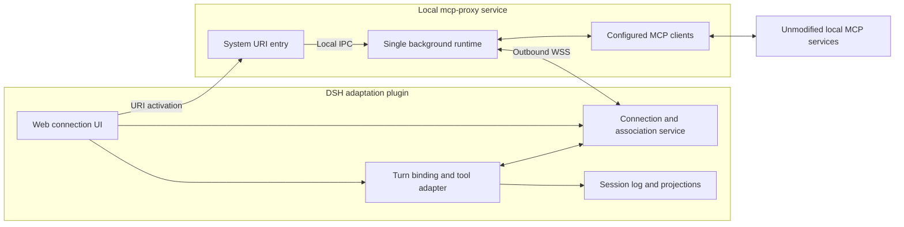
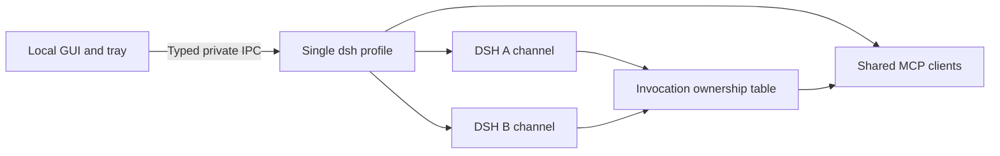
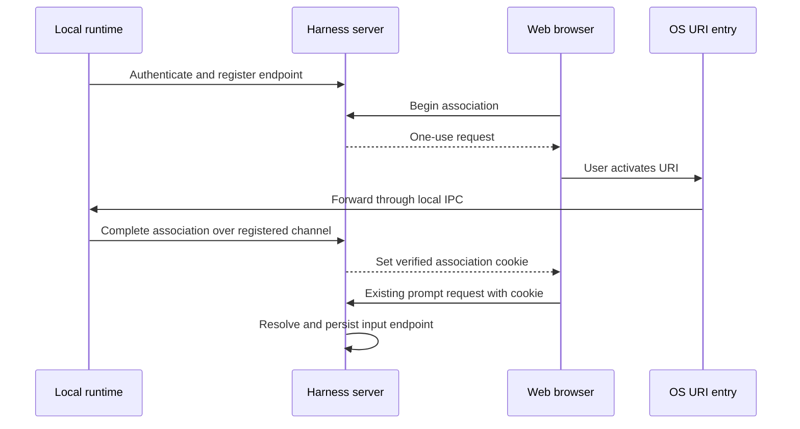
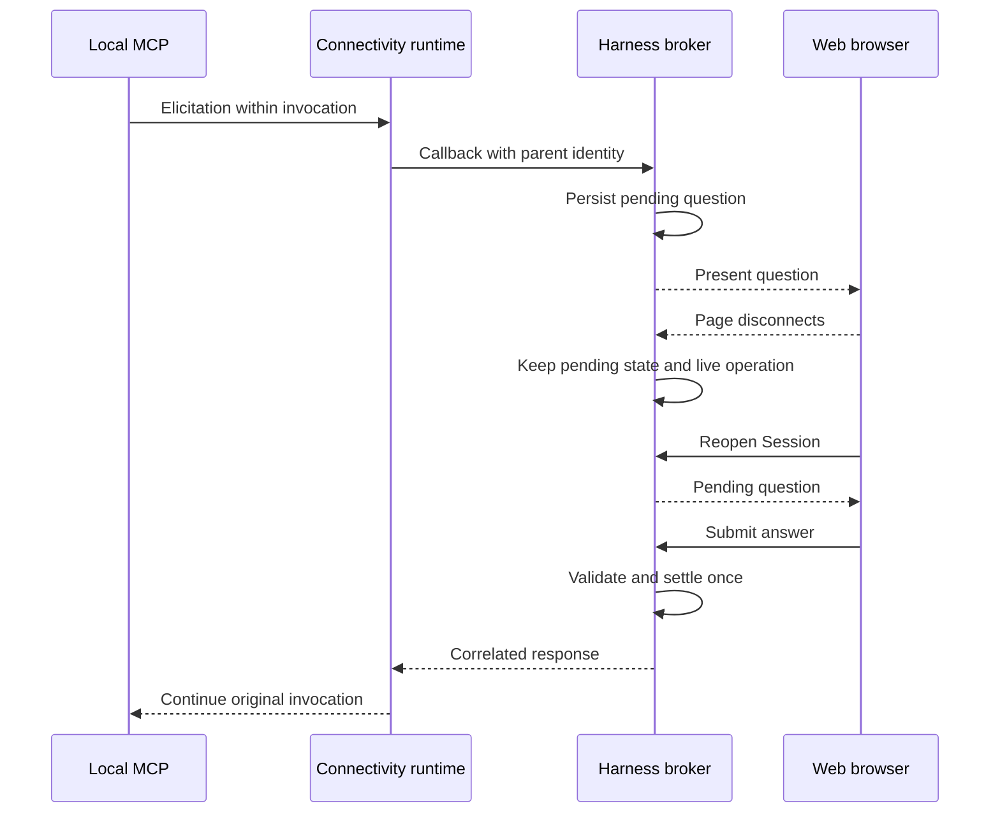

> Historical baseline imported on 2026-11-07. The confirmed text is retained in full; old source links are rendered as historical paths and project guides use local links. Old names, locations and superseded design choices are not current implementation instructions. Continue from the [current requirements](../../requirements.md), [design](../../design.md) and [acceptance record](../../acceptance.md).

# TK-20261102-local-mcp-access — Proposal A

English | [中文](proposal.zh.md)

## Summary

The local mcp-proxy application and server-installed DSH adaptation plugin remain two complete deliverables. B1–B22 have prior implementation approval. The [Windows GUI and multi-DSH extension](#desktop-control) covers B23–B28, approved on 2026-11-05; its requirements are not implementation claims.

## Contents

- [Scope and approach](#scope)
- [Existing implementation](#existing)
- [Components](#components)
- [Complete deliverables and packaging](#deliverables)
- [Windows GUI and multiple DSH connections](#desktop-control)
- [Plugin integration](#plugin-integration)
- [Local runtime and installation](#local-runtime)
- [Association and transport](#association)
- [Turn ownership and tools](#turn-ownership)
- [Results and failure handling](#results)
- [Tool-initiated client requests](#client-requests)
- [Persistence and compatibility](#persistence)
- [Delivery and validation](#validation)
- [Requirement coverage](#coverage)
- [Decisions and approval](#approval)

## Scope and approach

The local runtime owns downstream MCP negotiation and execution. Harness owns browser association, message admission, Turn selection, model-facing tools, and durable results. No new account system, resources/prompts proxy, cross-device file synchronization, or remote substitute for local deliverable creation is introduced.

Local aggregation is selected because the agreed scope is tool discovery and invocation, and one local owner can manage working directories, child processes, and downstream transports. Per-service transparent tunneling was considered: it reuses a separate server-side MCP client for each downstream service, but also distributes protocol-session and reconnect ownership across the network. It is not the selected implementation path.

The connector-to-Harness channel is a versioned aggregation protocol over an outbound authenticated WSS connection. This channel is not presented as a standard MCP transport. The connectivity MCP exposes local MCP tool capabilities through the Harness adapter; downstream MCP services continue to use their original protocols and require no code changes.

## Existing implementation

| Existing owner | Evidence and implication |
|---|---|
| MCP client (`historical: ../../packages/mcp/mcp-client/src/index.ts`) | Configures stdio or Streamable HTTP and registers tools in a scope. Its transport does not provide the reverse connection required here. |
| Tool adapter (`historical: ../../packages/mcp/mcp-client/src/tools.ts`) | Provides deterministic naming and content/image projection, but rejects task-required execution and reduces errors to text. The new plugin owns the complete adapter where public helpers are insufficient; this plan does not modify the existing client. |
| Session commands (`historical: ../../packages/api/session-controller/src/commands.ts`) | Admissions already carry a request ID and preserve message identity through queue edits. Plugin-owned events associate that accepted input with a device without changing the request or message-source types. |
| Agent preparation (`historical: ../../packages/core/agent-loop/src/agent.ts`) and inbox (`historical: ../../packages/core/agent-loop/src/inbox.ts`) | `turn/start` precedes claim; synchronous `agent/inbox/claimed` precedes prompt assembly. These existing points allow binding from a cached catalog before the first model request without adding a loop hook. |
| Connection (`historical: ../../packages/client/connection/src/index.ts`) and Gateway (`historical: ../../packages/api/gateway/src/index.ts`) | Own authenticated Web requests and Remote streams. Association APIs use these existing services; connector traffic uses a distinct upgrade route and lifetime. |
| Application launch (`historical: ../architecture.md`) | Supported Node applications enter through `dsh` profiles. The connector must use a profile rather than a new package executable. |
| User questions (`historical: ../../packages/interaction/user-questions/src/types.ts`) | Defines option/free-text questions and an answerer waterfall, not an arbitrary MCP form schema or durable continuation guarantee. Reuse compatible UI primitives without assuming this service alone satisfies elicitation. |

## Components

The following packages are internal modules of the two complete deliverables. The local product contains its runtime and installation/startup composition; the DSH plugin contains host, agent, API, Web and enablement composition. The shared protocol library is a dependency of both.

| Proposed owner | Responsibility |
|---|---|
| `packages/mcp/mcp-proxy` | Branded endpoint, connection-generation, catalog, association, and invocation IDs; wire schemas; shared service definitions and errors. No filesystem, browser, or model policy. |
| `packages/mcp/mcp-proxy-local` | Single local runtime, downstream clients, catalog generations, local configuration, roots, callback correlation, invocation settlement, and outbound connection. |
| `packages/mcp/mcp-proxy-host` | Connector admission, endpoint registry, association transactions, catalog cache, invocation/callback routing, persistent elicitation state, and expiry. |
| `packages/mcp/mcp-proxy-agent` | Per-Turn binding, scoped tool registration, executor checks, model context, sampling execution, and Session events/projections. |
| `packages/api/mcp-proxy-controller` | Plugin-owned authenticated Fetch routes for browser association cookies, plus typed status and elicitation-response methods through existing Remote services. |
| `packages/client/ui-mcp-proxy` | Localized connect action, status, errors, prompt submission binding, and elicitation interaction; no routing authority in browser storage. |
| Connector bundle/profile and platform installer | Compose the local runtime under `dsh`; install URI handling, machine ownership resources, and local IPC as one product. Exact package grouping remains an implementation choice. |

## Complete deliverables and packaging

The product has two deployment entries. Internal workspace packages are implementation units; neither a shared npm library nor a set of source modules is a finished product.

| Deliverable | Proposed composition owner | Packaging and activation |
|---|---|---|
| Local mcp-proxy service | `apps/mcp-proxy` distribution, composing `@deepseek-ai/dsh-mcp-proxy-app` through the shipped `mcp-proxy` profile | Package Node, the real dsh CLI, selected runtime dependencies, configuration loader, identity storage, singleton, outbound connection, URI registration and IPC together. Windows users receive one EXE that automatically releases its internal runtime into a validated user cache and keeps settings, workspace and state separately; no additional Node installation or separately managed helper is required. |
| DSH adaptation plugin | `packages/bundle/mcp-proxy-server`, published as `@deepseek-ai/dsh-mcp-proxy-server` | Declare dsh.bundle.patch and package the host, agent, API and Web plugins with their dependencies and client artifacts. One documented installation and enablement path mounts the whole adaptation; internal package names do not become separate deployment instructions. |

The shared packages/mcp/mcp-proxy library is a dependency of both deliverables, not their public installation entry. The local service is the product called mcp-proxy; the DSH bundle is its adaptation plugin. The [local distribution guide](../../../packages/mcp-proxy/README.md) owns packaging and local commands; the [server plugin guide](../../../packages/dsh-plugin/README.md) owns server configuration. Release acceptance consumes these artifacts.

The versioned local configuration owns shared downstream services, working directory and registered DSH entries as defined in [desktop management](#desktop-control). The server plugin owns its public origin, pairing/device admission, routes and resource budgets. Downstream secrets stay local. Preconfigured single-server origins and deployment credentials remain explicit legacy compatibility inputs.

The legacy local settings reader accepts strict JSON fields `server.origin`, `server.credentialRef`, `directory`, `identityFile` and `services`. The directory and identity filename resolve against the configuration file; downstream relative paths resolve against the local directory. Reading configuration neither launches MCPs nor creates identity material. The local application bundle composes the reader, managed credential provider, singleton and outbound runtime. Its runtime row owns validated lifecycle and resource limits; its startup row owns foreground startup, `--start`, `--stop`, association and platform-install modes. Background startup waits for its own PID and acknowledged catalog, preserves the invocation's environment precedence, and cleans up its process scope when cancelled before ownership transfer. Diagnostics use fixed failure stages without raw secrets.

Ship separate instructions for local installation/configuration/start/stop/uninstall and server plugin packaging/install/configure/enable/disable/uninstall, plus one joint test procedure. The server instructions state prerequisites for starting DSH itself; this feature supplies the adapter rather than another DSH core service. Local diagnostics distinguish invalid configuration, downstream startup, server admission and URI registration failures; server diagnostics distinguish plugin load, association and invocation failures without exposing secrets.

The documented workflow starts DSH with its adaptation plugin, installs/configures/starts the local service, observes endpoint registration before any Session, activates connect-this-computer from Web, creates or reopens a Session, then invokes a local tool and verifies the actual deliverable file. It also covers page reopen, device change, disconnect, restart and owned-resource cleanup. Tests consume built/packaged entries; the recorded Web regression (`historical: ../../apps/web/tests/mcp-proxy/README.md`) compares the actual Session and an independent local-file oracle. Native desktop/browser acceptance remains separate from HTTP client regression.

## Windows GUI and multiple DSH connections

B23–B28 were approved on 2026-11-05. B1–B22 retain their existing approval. The GUI uses the same Windows single EXE and separately delivered DSH plugin; macOS/Linux desktop delivery remains deferred. This section owns the new desktop lifecycle, multi-server configuration and pairing design. Single-server settings and deployment-secret admission described elsewhere are legacy compatibility paths, not the first-origin GUI flow.

### Approach and ownership

The recommendation is one background dsh profile with a shared local MCP pool and an independent authenticated channel for each DSH. Separate workers and MCP pools per DSH were considered but duplicate stdio servers and complicate shared lifecycle. Embedding the runtime in the renderer bypasses the supported profile launcher and exposes credentials; it is excluded. The user selected multiple server addresses, a shared MCP list and Web-initiated connections; the shared-pool design is the author's recommended implementation.

`apps/mcp-proxy` owns the permanent-cache Electron main process, local renderer, preload and tray. The main process supervises the real packaged dsh profile; it does not execute agent or MCP operations. The profile owns machine-wide exclusivity, configuration, credentials, connection channels, MCP children and invocation routing. Electron's second-launch lock only reuses the window and cannot replace machine-wide service ownership. A second ordinary launch shows the existing GUI; URI launches forward their activation to the same owner.

The GUI loads packaged local assets with context isolation, sandboxing and Node integration disabled. Its narrow preload exposes only status subscriptions and validated management operations. The main process checks IPC senders; the renderer receives redacted status/configuration views, never reusable DSH credentials, identity keys or arbitrary filesystem/process access. Downstream environment/header values are accepted through the MCP form but are masked after storage. Interface text is locale-owned. Rendering and tray menus use the same runtime status snapshots.

First interactive launch initializes an application-owned profile with empty server and MCP lists, installs the owned URI entry and shows the GUI. The control service can remain ready without an admitted DSH or configured MCP. Missing configuration is initialized only in the new managed location; an invalid existing file is reported and preserved. Legacy `--config` selects its existing profile and validated migration path. A failed URI installation remains visible with a retry action and cannot be reported as a ready browser connection.

The proposed defaults are `%LOCALAPPDATA%/CurrentAgent/mcp-proxy/data/settings.json`, its sibling `dsh` profile home, and `mcp-proxy-workspace` beneath Electron's resolved user Documents directory. Create that workspace only for a fresh managed configuration and show its resolved path in the GUI. Explicit legacy configuration retains its existing directory and identity paths. No JSON file or command line is required before the first GUI launch; an empty server/MCP registry means running but disconnected, not startup failure.

A deployment-specific build may carry validated public CA presets for canonical HTTPS origins. The executable applies them from its verified payload in the launching user's configuration before starting the profile, preserving explicit trust, identity and disconnect choices. New preset origins remain disconnected until Web activation. Browser activation cannot supply certificates. End users run only the executable and use the Web connection action; environment preparation does not require separate scripts or registry commands.

### GUI and tray behavior

The Connections page shows canonical HTTPS origin, live state, safe failure information and an independent Disconnect action. Catalog acknowledgement is required for connected. Web activation automatically redeems and registers a new origin without a GUI confirmation; failure is shown and never falls back to another DSH. No manual DSH-address form is added.

The Local MCP page shows stable alias, transport and readiness, with Add and Delete. Add validates the existing stdio/Streamable HTTP/SSE fields: command/arguments or URL, optional environment/headers, cwd and roots. Validation and negotiation finish before publishing the service; failure leaves the active list unchanged and shows a safe diagnostic. Delete describes its effect on every DSH and affected calls before execution. Working directory is editable through local configuration; this GUI increment does not add automatic downloads or package installation for downstream MCPs.

Closing the window hides it; left-clicking the tray shows and focuses it. The tray context menu lists origins and their actual states, provides a way to show the GUI, and includes Exit. Exit starts without a second confirmation, stops new admissions, cancels all calls/callbacks, closes channels, joins owned stdio children, releases IPC and tray resources, then exits. Externally hosted HTTP/SSE MCP servers are not stopped. CLI installation, removal, start and stop remain supported; default interactive launch opens the GUI, while explicit background start retains the tray without opening the window.

### Settings, trust and first pairing

Use versioned settings with one shared `services` list and a `servers` list. Each server entry has a branded local connection ID, canonical HTTPS origin, enabled/manual-disconnect intent, and references to its persistent device identity; optional custom CA paths stay local. Persistent identities and trust survive application restart; live sockets, call ownership and pending activations do not. Migrate the existing unversioned `server` entry to one legacy server entry through validated copy and atomic publication, retain a backup, and never silently rewrite invalid settings. Pairing and management updates serialize and re-read the latest committed state before applying changes.

A versioned URI carries canonical HTTPS origin and an opaque short-lived ticket, never account/deployment credentials, MCP commands or tool arguments. Validate it, verify HTTPS without cross-origin redirects, redeem the ticket and automatically connect. Destination TLS and device proofs do not attest the identity of the site that launched the OS URI; activation is the local authorization event under the automatic-connection policy. Persist a server entry only after successful redemption. Manual Disconnect persists disabled intent and invalidates older pending activations until a later explicit DSH activation.

The authenticated DSH Web begin route creates a one-use ticket bound to its browser transaction. On activation, the connector creates or loads a per-origin Ed25519 device identity and redeems the ticket over verified HTTPS with proof covering origin, ticket nonce and public key. The plugin atomically binds ticket consumption, public-key registration and the existing browser transaction. Only that browser receives the association cookie after confirmed channel admission; opening a URI is not success. Failed persistence or expired/replayed/rejected tickets leave the connection untrusted. Ticket lifetimes, pending-ticket/activation limits and request sizes are validated configuration budgets. Ticket validity is rechecked under the registry lock immediately before atomic publication; a transaction accepted at that commit point is not subsequently reported failed merely because the response completes after expiry.

Registered device public keys and revocation state are durable plugin-owned server storage, independent of Sessions. Reconnect proves possession through a fresh origin-bound challenge before catalog admission. A claimed endpoint ID alone provides no authentication. Store local private identities through the existing protected credential provider; do not give the desktop renderer key material. Retain deployment-secret admission only for explicitly configured legacy entries; existing unversioned association URIs can target only their preconfigured single-server entry. A server lacking the new pairing capability reports upgrade-required; do not silently fall back to unauthenticated connection. Neither account login nor generic DSH core authentication changes.

### Shared clients and strict DSH routing

The runtime keeps a connection registry keyed by local DSH connection ID; each live record owns its verified origin, endpoint identity, generation, socket, channel and catalog acknowledgements. No mutable current-server variable participates in execution. Every admitted call creates a fresh local invocation ID and an immutable owner record containing DSH connection ID, authenticated generation, remote invocation ID, pinned catalog revision, MCP alias and client generation. The GUI may display a different row without affecting that owner.

Index remote requests by the full DSH connection/generation/remote-ID tuple, not by remote invocation ID alone. Validate the owner at admission, before entering the MCP queue and again before dispatch. The downstream request uses the original tool arguments; no DSH identifier is injected into arguments or MCP request metadata. Use the unique local invocation ID for pool callback correlation. Resolve results, cancellation and sampling/elicitation only through that recorded owner, checking the same connection generation again before delivery. Late replies from a drained generation are discarded or settled unknown for their original caller; they never attach to a replacement channel. Legacy task IDs, callback caches and request-ID deduplication use the same ownership scope. Tests deliberately reuse IDs across two DSH servers and reverse completion order.

One MCP service retains serialized invocation ownership across all DSH channels, while different services remain independent. A channel disconnect closes only its owner records and callbacks; it must not close the shared MCP pool. If cancellation requires retiring a shared MCP client to prevent late callbacks, finish that client's cancellation cleanup before recovering it; queued calls from another DSH wait for recovery, and no admitted call is replayed. MCP startup/recovery excludes the union of every DSH deployment/device credential reference from inherited child environments.

Adding a service validates and publishes a complete immutable catalog to every enabled channel. Deletion first blocks new admissions for that alias, atomically persists its removal, cancels affected queued/running calls and joins the removed owned client; unrelated services remain available. Existing Turns retain logged tool definitions, and calling a removed definition fails explicitly. Extend local attachment to retain bounded catalog revisions, matching the host's revision-aware registry; new Turns use acknowledged replacements without tearing down unrelated channels. If publication fails for one DSH, that connection remains visibly unsynchronized and cannot start a Turn with the new catalog until acknowledgement. No implicit alias reuse changes an already-admitted invocation's client generation.

Every catalog revision also binds each service alias to a non-reusable service incarnation, carried in the aggregation metadata and included in revision calculation. Re-adding the same alias with identical tool schemas still produces a new incarnation and revision. Validate that mapping for calls issued later by an old Turn, not only already-admitted calls. Removal invalidates all old revisions' access to that incarnation immediately. If bounded revision retention evicts a mapping, reject its requests as unavailable; never resolve an unknown or retired revision through the current alias table. Do not inject incarnation data into the downstream tool definition or arguments.

### Implementation and acceptance

The implementation updates the desktop assembly, local settings/control/runtime/client ownership, shared channel types as needed, and the existing DSH host/API/Web plugin. It preserves downstream MCP implementations, core agent loop and generic Session API. New model-visible routing/catalog decisions remain reconstructable from plugin-owned session events; neither released log generations nor committed fixtures are overwritten to conceal incompatible data. Document schema/protocol compatibility and update every consumer, TypeScript/Python projections and localized UI where affected.

Acceptance covers two distinct real DSH server instances connected simultaneously to the same installed Windows EXE, one shared stdio child, duplicate invocation/callback/task IDs, reversed and late results, independent disconnect/reconnect, automatic first-origin activation without an application confirmation, expired/replayed tickets, plugin restart and stored device identity, and manual disconnect across application restart. Add/delete tests cover discovery failure rollback, all-channel catalog publication, pinned old Turns, deletion during calls and unaffected services. Validate tray/window/second-launch/Exit behavior, ordinary Chrome/Edge URI activation, actual local read/write effects, packaging without external Node, keyless model-visible snapshots and a real-model desktop/Web demonstration. Temporary directories, ports, IPC and process teardown are owned by each test. Update the affected READMEs and AGENTS during implementation.

## Plugin integration

Mount the host, agent, API, and UI plugins through an opt-in bundle/profile overlay. Their services, routes, tool definitions, prompt contributions, projections, and UI entries are registered through existing public APIs and `ctx.effect()`/`ctx.on()` disposers. New plugin package manifests, dependency wiring, generated catalogs/type registrations, tests, and documentation are in scope; modifying the core loop, `SessionPromptRequest`, generic Session admission, shared MCP client implementation, or base composer implementation is not part of this design. Do not monkey-patch methods or replace the global fetch function.

| Existing extension | Plugin use |
|---|---|
| `connection.fetch.register` and Web server upgrade registration | Own association endpoints and the connector channel under the existing authentication/TLS composition. |
| `connection/request` waterfall | Resolve the browser's association cookie and establish a request-local admission context, then delegate with `next()` to the unchanged Web API. |
| `agent/created` and `agent/inbox/inserted` | Install scoped listeners; record the actual admitted message/request identity and verified device in plugin-owned Session events. |
| `session/event` for `turn/start`, followed by `agent/inbox/claimed` | Capture the intended initiating message from the public inbox, then synchronously bind/register the cached tools when that message is claimed. |
| `system-prompt/assemble`, `agent/pre-step`, and tool executors | Reject incomplete or inconsistent plugin preparation before model execution and enforce the recorded route on every call; never switch schemas late in `agent/pre-step`. |
| Tool, prompt, Session event/projection, Remote, and locale registries | Publish plugin-owned behavior and persist its required facts without changing core ownership. |
| Existing conversation input/status slots and keyed conversation renderers | Add connection controls, state, and elicitation views without replacing the base composer submission path. |

On unload, stop new work, settle or cancel owned pending work, await quiescence, then dispose all registrations. Ordinary unbound Sessions remain usable without the plugins. Historical plugin-bearing Sessions retain the repository's required-on-read rules: an incompatible reader must not silently discard execution facts merely to claim that uninstall is transparent. Pin the event-order assumptions in real-composition tests; a failed assumption is a reported extension-point gap requiring a separate design decision, not permission to edit core code implicitly.

## Local runtime and installation

### Windows single-file executable

B22 replaces the user-facing portable directory with one `mcp-proxy.exe`. Use the repository-pinned Electron and electron-builder portable target. The existing complete dsh directory is an intermediate dependency closure; the final EXE embeds Electron and that closure without a standalone Node executable. The main process validates a persistent runtime and starts the packaged CLI using Electron Node mode; users install neither Node nor a separate extraction utility. All agent execution still starts the real packaged `dsh` CLI with the fixed `mcp-proxy` profile.

Release the payload into `%LOCALAPPDATA%/CurrentAgent/mcp-proxy/runtimes/<payload-sha256>`. Each portable invocation has a private temporary extraction directory. Publish verified persistent copies by atomic rename; concurrent losing publishers verify the winner and remove only their own staging directories. Validate archive member paths, refuse links and paths outside the owned staging directory, and verify manifest file hashes before atomically publishing a complete cache. Reject incomplete, replaced or damaged caches rather than executing unverified files. Do not delete a cache containing a running service during repair or upgrade.

Retain explicit legacy CLI operations and the GUI lifecycle defined in [desktop control](#desktop-control). Forward arguments without a command shell and retain exit status, invoking directory and shutdown ownership. Keep configuration, credentials/installation identity, logs and user work outside the version cache. This delivery adds no automatic update service or Windows SCM service.

Use a stable profile/state directory across payload versions. URI installation reuses the owned native bridge and receipt, records GUI or legacy Node launch mode, and points to the persistent runtime; it does not depend on keeping the original downloaded EXE at its original location. Install and verify the protocol in the actual Windows desktop user's execution environment. A successful registry lookup inside a test or isolated execution environment does not establish visibility to an ordinary desktop browser.

Acceptance starts from the single EXE copied into a fresh directory, without an adjacent Node executable or dependency tree. Cover clean and cached launch, concurrent extraction, invalid archive paths and cache corruption, paths containing spaces, existing configuration/identity retention, background start/stop and child exit, ordinary-browser URI association and owned uninstall. Run the packaged Web regression against the extracted runtime as well as an installed single-EXE flow; internal extraction tests alone do not complete B22.

The installer supplies the runtime and a `dsh` connector profile, registers the system URI handler, and provisions a machine-wide singleton resource. URI activation is a short-lived entry that forwards its request to the existing runtime; it does not start another serving connector. If no runtime is available, the Web reports unavailable with a start/retry action. Repeated ordinary launches report or reuse the owner rather than taking ownership away from it.

Machine uniqueness must hold across different working directories, profiles, and OS login sessions. A per-user Electron lock or a lock inside the selected project directory does not satisfy B3. Use kernel-backed ownership in a machine-wide namespace, released on process death, with a protected installation-owned location and no stale-PID timeout takeover. On Windows, the fixed named pipe uses the runtime's first-instance kernel exclusivity; it does not require a separate named mutex. This follows libuv's [first-instance binding](https://github.com/libuv/libuv/blob/v1.52.1/src/win/pipe.c#L725). Cross-login exclusivity and pipe access permissions require installed Windows acceptance; do not infer them from same-user tests. The deferred macOS/Linux design uses an installer-provisioned shared lock file with a kernel lock; the serving runtime and downstream MCP processes run as the owning normal OS user. A second OS user cannot bypass uniqueness or borrow the first user's local IPC authority.

Platform entries use Windows URI registration, a macOS application bundle that receives URL activation, and a Linux desktop entry with a scheme-handler association. A protected named pipe on Windows and a Unix-domain socket on macOS/Linux connect the entry to the owner. None is a fixed TCP listening port. The installer checks registration and reports failures; uninstall removes only resources owned by this installation. Windows packaging and second-launch behavior require real-machine acceptance, not an inference from protocol documentation. macOS/Linux application bundles, desktop entries and Unix IPC remain deferred platform designs under B17.

Legacy configuration resolves the server origin, deployment-scoped connector credential, working directory, and named downstream MCP entries. Commands, arguments, environment, and HTTP credentials remain local; only required tool metadata, instructions, invocation data, and results cross the aggregation connection. Credentials are scrubbed from child ambient environments and then explicitly configured values are applied. Invalid configuration fails visibly rather than silently omitting a service.

Reuse the pinned official SDK for downstream negotiation, discovery pagination, schema validation, cancellation, and supported task execution. Supply a separately bounded legacy SSE adapter using a compatible official SDK transport; verify the installed SDK exports before selecting its package/version. Do not treat Streamable HTTP event streaming as the legacy HTTP+SSE transport. Test all three transport families. A downstream capability that the connector cannot implement must not be advertised as supported.

Build immutable catalogs identified by endpoint ID, connection generation, and catalog revision. Each entry preserves the configured alias, raw tool name, original definitions, annotations, and instructions needed for use. Validate a complete replacement before publishing it. An executing Turn retains its selected catalog; updates become candidates for later Turns. If an old definition is no longer callable, fail that invocation rather than silently invoking a changed definition.

## Association and transport

For explicit legacy entries, the connector authenticates to its configured server using a deployment-scoped credential and proves its persistent installation identity. New GUI-managed origins use browser-authorized device registration and per-origin identities from [desktop management](#desktop-control). Both modes require fresh possession proof and canonical-origin validation before catalog admission; neither introduces a user-account system.

For legacy preconfigured entries, the browser requests a short-lived association transaction through plugin-owned authenticated Fetch routes. A click opens the registered URI carrying only the opaque association request. The local runtime accepts requests only for its configured server and completes the challenge through its authenticated WSS channel. The server atomically consumes the challenge, binds the result to the initiating browser session and transaction, and sets an opaque association cookie through that browser's association-completion response. Use a deployment-specific cookie name/path with Secure, HttpOnly, and appropriate SameSite settings; no Session prompt field is added. The URI receiver cannot choose a new server address or execute a tool. The Web reports success only after this server acknowledgement, not after launching the URI.

Handles are server-validated, origin-bound, revocable, and short-lived; refresh uses the existing verified browser association while that association remains valid. Expiry, logout, changed deployment, unknown endpoint, or a cleared browser identity requires association again. Browser storage is only a convenience cache. Registration and association establish connection routing, not per-user Session isolation. Do not disable the existing launch-token/cookie protections as part of this change; domain-login work remains separate.

| Message family | Required semantics |
|---|---|
| Registration and liveness | Version negotiation, authenticated endpoint identity, fresh connection generation, bounded heartbeat and offline detection. |
| Catalog publication | Full immutable catalog with revision, validated acknowledgement, and explicit errors; no partial publication. |
| Invocation | Unique invocation ID, endpoint/generation/catalog, service alias, raw tool name, arguments, deadline, and cancellation correlation. |
| Client request and response | Sampling/elicitation callback ID, parent invocation, endpoint/generation, validated request or response, and explicit terminal state; roots are answered locally from configuration. |
| Result and cancellation | A terminal success, MCP error, transport failure, or unknown outcome; cancellation acknowledgement is distinct from proof that side effects did not occur. |
| Association | Expiring, single-use challenge and browser-bound completion; unrelated to Session creation. |

Mount one connector upgrade route through the existing Web server, behind the same deployment TLS endpoint. Use maintained WebSocket and validation dependencies. Configure frame/result limits, concurrency, heartbeat, reconnect backoff, challenge lifetime, and call deadlines in validated Cordis configuration. Reject incompatible protocol versions and oversized messages before buffering or dispatching them. A reconnect replaces transport availability, never resends unfinished tool calls.

## Turn ownership and tools

Keep `SessionPromptRequest`, its client caller, and `user-rpc` unchanged. The host plugin's authenticated `connection/request` middleware resolves its association cookie and runs the delegated prompt admission inside a bounded AsyncLocalStorage context. The scoped `agent/inbox/inserted` listener takes the actual message ID and existing request ID, then synchronously appends a plugin-owned input-binding event before the existing driver wakes. Record a non-secret endpoint descriptor, never the cookie. Only admissions belonging to the active Web request may consume that context; close it after delegation so inherited asynchronous work cannot borrow browser authority. No cookie means no local grant; an invalid cookie fails explicitly. Idempotent request retries do not rewrite an existing binding. Queue edits/reordering preserve message identity and therefore its binding; removed input cannot authorize another message.

The association middleware participates only in ordinary Web Session prompt admission. Association creation/renewal, status queries, and unrelated RPCs delegate unchanged, so an expired association cannot prevent reassociation. Queue-edit and background operations cannot acquire a new browser grant merely because they run beneath the same HTTP service.

At the existing `turn/start` observation, the agent plugin synchronously reads the public inbox and captures the next-turn item, or the first next-step item when no next-turn item exists. This callback only captures state and invalidates the previous live binding: it must not append Session events while the observed append is being published. The existing `agent/inbox/claimed` notification for that exact message occurs after inbox mutation and before assembly; there the plugin synchronously validates the durable input binding, fixes a ready cached catalog, appends its Turn-binding event, and registers scoped tools. No network lookup or awaited preparation occurs inside these synchronous observers. Idle steering is covered, and mixed batches cannot choose the wrong first message. A missing or changed initiator, failed event append, or failed registration leaves preparation invalid; the assembly/pre-step guard rejects it before a model call rather than relying on contained observer exceptions to stop the loop.

Catalog acquisition and validation run in the host plugin before admission/Turn preparation, leaving an immutable ready cache for synchronous selection. No local grant yields no local tools; an explicitly selected but unavailable endpoint fails local preparation visibly. If a crash leaves an inbox item without a completed plugin binding, recovery grants no local access and never reconstructs authority from a current browser. On later steps, the recorded Turn binding remains authoritative. Steering cannot switch the executing device; another computer may initiate a later queued Turn. Current-turn steering uses the existing binding and the plugin UI identifies that device. Work within the Turn inherits its binding; an unrelated future Turn without a verified initiating descriptor receives no implicit local access.

Capture a catalog revision and execution callbacks for the Turn. Use the existing public MCP adapter only where it preserves the required behavior; the connectivity plugin owns any additional projection through public ToolRuntime, attachment, and official SDK APIs. Preserve existing service-qualified naming semantics without private source imports or changing the shared MCP client. Conflicting global and scoped aliases fail explicitly rather than shadowing another tool. Every executor independently verifies the active Turn binding, endpoint identity, and catalog generation before forwarding; model-visible filtering is not the authority check. Tool changes on another device cannot alter the running Turn's schema or callback.

The server's Session working directory remains a server path. The local working directory is separate execution metadata, not a replacement for the server filesystem provider. Publish the distinction as logged model context so the agent uses local MCP tools for deliverables and server tools for processing-only temporary data. Arbitrary MCPs retain their own directory and permission semantics; the connector neither rewrites arguments nor promises to confine their filesystem access.

## Results and failure handling

The connector returns protocol-complete tool results, including content order, structured content, metadata, and error indication, in the aggregation envelope. A connectivity-plugin-owned result adapter supplies any behavior the existing shared adapter cannot represent; do not modify the shared client or silently reduce a structured MCP error to text. Native model projection remains constrained by the model's modalities; unsupported blocks receive explicit diagnostics while the canonical execution result retains the original permitted content. Reuse durable attachment storage for supported images and preserve required replay data without putting credentials into events.

Task-required tools use the official SDK's task lifecycle locally and deliver the settled tool result through the same invocation ID; task creation is not tool success. Keep task progress, result retrieval, cancellation, and terminal errors correlated without reissuing the original tool operation. Capability negotiation must never promise a client callback without a supported handler. Resources and prompts remain outside this task.

Q29 confirms sampling, elicitation, and roots as B18–B20. They are required compatibility work for tool execution, distinct from the excluded resources/prompts features. Their handlers and acceptance cases are specified below; absence of a handler is not a valid completion of this scope.

| Condition | Required action |
|---|---|
| Unavailable before dispatch | Return unavailable without sending the operation; never select a different device. |
| Disconnect/timeout after dispatch may have occurred | Settle once as outcome unknown, retain invocation identity, and do not automatically retry. Late replies cannot replace the terminal outcome. |
| Same invocation frame delivered twice on one live generation | Do not execute twice; return the recorded state/result while retained. Retention does not authorize replay after process restart. |
| MCP reports an error | Preserve the result's error status and details; do not report success. |
| Browser closes | Keep the server-owned Turn and local WSS invocation alive; a page AbortSignal must not own the admitted task. |
| Runtime or server restarts | Restore identity and durable history, mark interrupted invocations unknown as needed, and never recreate an external side effect from the log. New calls require a live validated connection. |

Dispose handlers through `ctx.effect()`/`ctx.on()`, stop accepting work, abort pending operations, await owned children and callbacks, then release ownership. Close only child processes started by the connector; externally running HTTP MCP services remain external. Distinguish an operation timeout from a process exit and never use browser presence as a health signal for the local runtime.

## Tool-initiated client requests

The local SDK normalizes negotiated protocol revisions, including legacy server requests and newer in-band input-required continuations. The connector assigns a branded callback ID and correlates sampling/elicitation with the original invocation, service, endpoint, and connection generation. The server validates that the parent operation is still pending before servicing a callback. Responses return only to that operation; reconnecting or opening the Session on another computer does not change the recipient. SDK protocol continuation must preserve its continuation context rather than resubmit the initial tool operation. A duplicate callback ID reuses its settled response while that live operation remains valid instead of repeating a model call or user question.

Sampling runs on the server through the existing model service using the Session's current model configuration, captured when the callback is admitted. Model preferences from the MCP request cannot select another provider or override deployment credentials. Pass the validated sampling messages and supported generation parameters, without automatically appending the whole Session history or other MCPs' context. This is an invocation-owned model request, not a new agent Turn: it must not wait for the blocked Turn to finish or recursively execute sampling output through the agent tool registry. Persist the request's admitted model input, selected model, response/error, and parent correlation so every model-visible input and result remains reconstructable. Apply configured concurrency, token, and time budgets; cancellation of the parent also cancels pending sampling.

Elicitation uses a server-owned persistent request broker and a Session projection for the Web. Record the callback identity, parent invocation, negotiated request mode, permitted form/URL data, deadline, and pending state before publishing the question. Render form fields using validated MCP schemas and existing localized UI primitives; handle URL-mode requests as explicit user navigation with protocol completion, not as server-side URL fetching or automatic tool execution. Preserve accept, decline, and cancel as distinct protocol outcomes. The response API validates the answer and atomically settles the pending request; concurrent tabs cannot submit two effective answers. Opening the Session on another computer may display/respond to the same pending question, but never rebinds the original tool execution device.

Closing a page only detaches its observer. The pending request remains visible after reopening and can resume the original live invocation. Human waiting has a separately configured lifetime and is not mistaken for an idle network timeout; the parent operation and downstream service may still impose a real deadline. Expiry, explicit cancellation, downstream termination, or loss of the live continuation makes the question non-actionable with a recorded reason. If a process restarts, retain the history but do not claim that a dead MCP continuation can resume or resend the original tool. A successful answer followed by uncertain delivery is reported as such; it is not silently delivered to a new invocation. Do not place authentication tokens from URL-mode flows into Session events.

Roots are answered by the local runtime from the explicitly configured directories for that downstream service, represented as correctly encoded local file URIs with optional display names. They never come from the server's cwd, the browser, or another service's configuration, and are not a filesystem security mechanism. Handle roots requests needed during service initialization locally even before a Session exists. Pin the effective directory configuration to the applicable downstream/catalog generation; a configuration replacement must not change an executing invocation's roots. Announce supported roots-change notifications only when the next configuration is active. Record the effective local directory context if it reaches the model, without exposing unrelated local configuration.

### Elicitation continuation

## Persistence and compatibility

Persist plugin-owned input-binding events keyed by Session, message, and existing request identity so queued work survives page closure and process recovery without being rebound by another browser. Keep the core message-source type unchanged. Persist non-secret Turn binding and invocation settlement events, including endpoint, catalog digest, invocation ID, and known/unknown outcome. The event payloads and reducers belong to the plugin and are required deliverables, not transient maps alone. Inbox insertion and binding are separate records; missing binding after interruption must fail closed for local access rather than guessing authority.

Callback records additionally cover sampling input/model/result and elicitation request, answer, delivery, cancellation, and expiry. The pending-question projection is rebuilt from durable records; restoring a record does not create a live downstream continuation. Schema validation and data minimization apply before persistence. Replay renders recorded callbacks and never runs sampling, opens an elicitation URL, or answers a live MCP automatically.

Model-visible tool schemas, instructions, local/server directory context, and results must be reconstructable from the Session log. Use existing request headers, system/context events, tool calls/results, and attachment records where they already represent the data; add events only for facts they do not record. Register projections for Web status/history and ensure replay never reconnects a device or executes a tool. Association handles and connection credentials stay in connection-owned state and are never reconstructed from transcripts.

New plugin Session events require persistence-type acknowledgements and the repository's event-registration/generation and TypeScript/Python expected-output checks. Reuse existing extensible projection mechanisms; this design does not add fields to core input types or modify SDK execution semantics. Follow required-on-read rules and adjacent migrations if a structural change actually requires one; do not blanket-mark execution facts ignorable or overwrite released generations. Ordinary unbound Sessions remain readable with existing behavior. Forked history retains old execution facts, but a new Turn binds from its own input rather than inheriting live connection authority.

## Delivery and validation

Implement both complete deliverables in reviewable stages within this one feature: shared protocol and local runtime; platform installation/URI association; Harness endpoint service; input and Turn integration; Web UI and result projection; Windows installed-product acceptance. Each stage includes its owned tests and documentation, and both ends remain one joint acceptance obligation. Do not add a second public executable, alter the user-login project, or change unrelated existing MCP settings behavior.

Acceptance must start from both actual packaged deliverables and their instructions, covering local install/configure/start/stop/uninstall and DSH plugin install/configure/enable/disable/uninstall. Passing tests for an internal module does not complete either product.

| Test layer | Required evidence |
|---|---|
| Unit and protocol | Invalid frames, expired/reused challenges, wrong browser/server association, duplicate invocation IDs, catalog conflicts, deadlines, and single settlement. |
| Plugin integration and disposal | Mount/unmount/HMR through the real profile; verify no route, tool, UI, listener, IPC, or connection leak. Check core Session prompt/source types remain unchanged, request-local authority does not leak, observers never reenter Session append, and invalid preparation fails before the first model call. |
| Real composed integration | Boot server and connector through `dsh` profiles; exercise stdio, Streamable HTTP, legacy SSE, rich results, MCP errors, task execution, disconnects, and child cleanup. |
| Client capabilities | Tools requiring sampling, form/URL elicitation, and roots under negotiated supported protocol revisions; check parent correlation, model selection, bounded recursion, duplicate callbacks, schema-invalid answers, decline/cancel, page reopen, deadlines, restart, late delivery, and roots before Session creation. |
| Turn and persistence | Two devices with identical aliases/tools; queued messages from both devices; idle and active steering; mixed queue batches; same-request retry; old Session reopen; fork; restart; catalog refresh; no call replay. Check schemas and execution route agree in the first model request. |
| Keyless snapshots and SDKs | Recorded user/model flows for association, local tool success/error, device change, and unknown outcomes; TypeScript and Python expected outputs cover changed log/input representations. |
| Browser and platform | Windows local clients with ordinary Chrome/Edge installations; URI registration, refused/absent handler, repeat launch, machine-wide ownership, page close/reopen, and real local file effects. |
| Product GUI evidence | Record the required GIF from the real Web server/model flow when implementing the UI; no simulated success screen substitutes for actual association and invocation. |

Before implementation completion, run focused package tests, relevant snapshots and SDK checks, generated schema/catalog checks, documentation checks, and the outgoing checks selected by the repository workflow. Validate single-instance and cross-process tests using owned temporary resources; test the installed URI entry and actual files, not only returned messages. Update plugin README/AGENTS instructions, plugin-composition documentation, and bilingual documents. Existing repository-wide check failures must be reported separately, not treated as feature success.

## Requirement coverage

| Requirement | Implementation and acceptance owner |
|---|---|
| B1 | Harness Web and server; real composed Web flow. |
| B2 | Packaged local mcp-proxy service, configuration/startup entry, downstream SDK adapters and installed-product tests with unchanged MCPs. |
| B3 | Machine-wide kernel ownership and installer; concurrent and cross-login launch tests. |
| B4 | Outbound authenticated WSS; no connector TCP listener. |
| B5 | Three downstream transport adapters and real-composition fixtures. |
| B6 | Immutable catalogs, stable aliases, full-result adapter and required task compatibility. |
| B7 | Scoped native tool definitions and direct model invocation snapshots. |
| B8 | Installed URI handler, local IPC, and browser-bound association. |
| B9 | One-use verified association; explicit unavailable state; no IP/name inference. |
| B10 | Plugin-owned durable input binding and synchronous pre-assembly selection through existing events. |
| B11 | Binding per Turn, pinned catalog, queue/steering tests on two devices. |
| B12 | Resolved local cwd and explicit MCP configuration; no path rewriting. |
| B13 | No synchronization or consistency check; fixtures supply equivalent files. |
| B14 | Logged directory context and local tool file effects; server temporary-data tests. |
| B15 | Single invocation settlement, unknown outcomes, no automatic replay/substitution. |
| B16 | Server-owned task lifetime and page close/reopen tests. |
| B17 | Installed platform/browser acceptance matrix. |
| B18 | Invocation-owned sampling with the current Session model; persisted input/results and no recursive agent Turn. |
| B19 | Durable elicitation broker, localized Web interaction, and reopen/response continuation tests. |
| B20 | Per-service explicit local directory configuration, file URI encoding, and pinned roots tests. |
| B21 | Complete DSH adaptation bundle with one installation/enablement path, existing extension points, unchanged core behavior and disable/unload/HMR acceptance. |
| B22 | Single Windows executable, validated cached runtime, stable state and installed-product acceptance. |
| B23 | Electron window/tray lifecycle and installed Exit cleanup. |
| B24 | Independent DSH channels, state and persistent manual-disconnect intent. |
| B25 | Shared MCP registry and transactional GUI add/delete with catalog acknowledgement. |
| B26 | Owner-scoped cancellation and selective MCP teardown without replay. |
| B27 | Automatic Web activation, one-use pairing and durable per-origin device authentication; manual disconnect fences older pending requests. |
| B28 | Immutable invocation ownership through queue, dispatch, results, cancellation and callbacks. |

## Decisions and approval

The user selected local aggregation, confirmed sampling/elicitation/roots in Q29, and required Harness plugins in B21. The WSS protocol, plugin package split, deployment credential, machine-wide installation resource, association cookie, existing-event integration, immutable Turn catalog, plugin-owned input binding, and callback broker are the author's proposed implementation choices for review. Protocol field names, bounded configuration values, installer tooling, and the compatible legacy SDK version remain implementation choices with explicit validation; they may not weaken B1–B21.

Existing B1–B22 approval remains in force. The user explicitly approved B23–B28 and the revised desktop/multi-DSH pairing design on 2026-11-05. The current agent implements and an independent agent reviews. Windows installed-product acceptance remains required; macOS/Linux local-client implementation and acceptance stay deferred.
