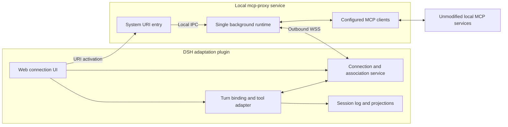
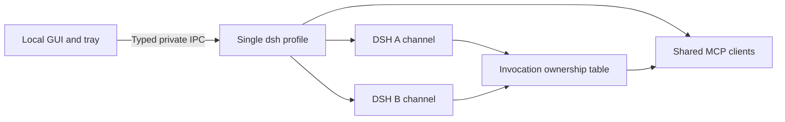
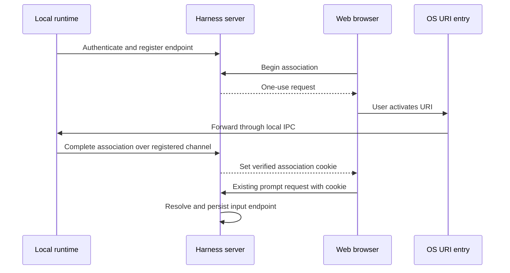
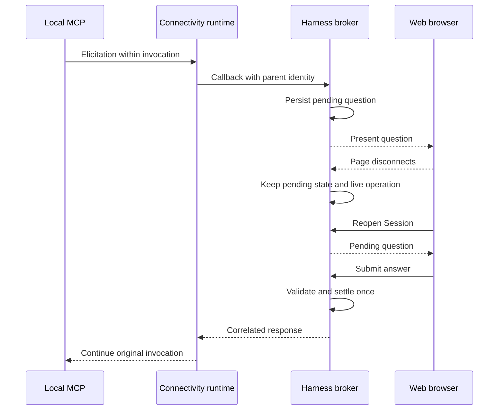

> 历史基线，迁入于 2026-11-07。以下完整保留已确认文本；旧源码链接转为历史路径文字，项目自身指南改为本地链接。旧包名、旧目录、已取代的设计不能用于现行实现。后续开发以[现行需求](../../requirements.md)、[技术方案](../../design.md)和[验收记录](../../acceptance.md)为入口。

# TK-20261102-local-mcp-access — 方案 A

[English](proposal.md) | 中文

## 概要

本地 mcp-proxy 应用与服务器端 DSH 适配插件仍为两个完整交付物。B1—B22 保留既有实施批准。[Windows GUI 与多 DSH 扩展](#desktop-control)覆盖 B23—B28，已于 2026-11-05 获用户批准；设计要求不表示已实现。

## 目录

- [范围与路线](#scope)
- [现有实现](#existing)
- [构成部分](#components)
- [完整交付物与打包](#deliverables)
- [Windows GUI 与多个 DSH 连接](#desktop-control)
- [插件接入](#plugin-integration)
- [本地运行时与安装](#local-runtime)
- [关联与传输](#association)
- [轮次归属与工具](#turn-ownership)
- [结果与失败处理](#results)
- [工具发起的客户端请求](#client-requests)
- [持久化与兼容](#persistence)
- [交付与验证](#validation)
- [需求覆盖](#coverage)
- [设计选择与批准](#approval)

## 范围与路线

本地运行时负责下游 MCP 协商与执行。Harness 负责浏览器关联、消息接收、轮次设备选择、模型可见工具和持久结果。本次不引入账户系统、resources/prompts 代理、跨设备文件同步，也不以远端生成替代本地交付文件创建。

选择本地聚合，是因为已确认范围为工具发现与调用，一个本地所有者可以集中管理工作目录、子进程与下游传输。曾考虑逐服务透明隧道：为每个下游服务复用一个远端 MCP 客户端，但也会把协议会话与重连职责分散到网络两端。该路线不是选定的实施方式。

连通 MCP 与 Harness 之间采用出站、经过认证的 WSS 连接承载有版本的聚合协议，不将此通道称为标准 MCP 传输。连通 MCP 通过 Harness 适配器提供本地 MCP 工具能力；下游服务继续使用原协议，无须修改代码。

## 现有实现

| 现有负责模块 | 证据及影响 |
|---|---|
| MCP 客户端 (`historical: ../../packages/mcp/mcp-client/src/index.ts`) | 配置 stdio 或 Streamable HTTP，并在作用域内注册工具。当前传输不提供本需求所需的反向连接。 |
| 工具适配器 (`historical: ../../packages/mcp/mcp-client/src/tools.ts`) | 已有稳定命名和内容、图片投影，但拒绝任务式执行并把错误缩减为文本。公开辅助接口不足时，由新插件拥有完整适配器，本方案不修改现有客户端。 |
| 会话命令 (`historical: ../../packages/api/session-controller/src/commands.ts`) | 接收请求已有请求 ID，队列编辑保留消息身份。通过插件自有事件将已接收输入关联到设备，不修改请求或消息来源类型。 |
| agent 准备流程 (`historical: ../../packages/core/agent-loop/src/agent.ts`)与收件箱 (`historical: ../../packages/core/agent-loop/src/inbox.ts`) | `turn/start` 先于领取输入，同步的 `agent/inbox/claimed` 先于提示词组装。现有入口允许在首次模型请求前从缓存目录完成绑定，无须新增循环钩子。 |
| Connection (`historical: ../../packages/client/connection/src/index.ts`) 与 Gateway (`historical: ../../packages/api/gateway/src/index.ts`) | 负责已认证 Web 请求及 Remote 流。关联 API 复用这些服务；连通程序流量使用独立升级路由与生命周期。 |
| 应用启动规则 (`historical: ../architecture.zh.md`) | 受支持的 Node 应用通过 `dsh` profile 进入。连通程序使用 profile，不新增包级可执行入口。 |
| 用户问题 (`historical: ../../packages/interaction/user-questions/src/types.ts`) | 定义选项、自由文本问题及回答者瀑布链，并不等于任意 MCP 表单 schema 或持久续接保证。复用兼容界面组件，不能假定只靠该服务就满足 elicitation。 |

## 构成部分

以下为两个完整交付物的内部模块划分。本地服务包含本地运行时及其安装、启动组合；DSH 适配插件包含服务端、agent、API、Web 及其启用组合；共享协议库作为两端依赖。

| 拟定负责模块 | 职责 |
|---|---|
| `packages/mcp/mcp-proxy` | 带品牌的连接端、连接代际、目录、关联、调用 ID；传输校验；共享服务定义与错误。不包含文件系统、浏览器或模型策略。 |
| `packages/mcp/mcp-proxy-local` | 唯一本地运行时、下游客户端、工具目录代际、本地配置、roots、回调关联、调用结算与出站连接。 |
| `packages/mcp/mcp-proxy-host` | 连通程序接入、连接端登记、关联事务、目录缓存、调用和回调路由、持久 elicitation 状态及过期处理。 |
| `packages/mcp/mcp-proxy-agent` | 按轮次绑定、作用域工具注册、执行器校验、模型上下文、sampling 执行，以及会话事件与投影。 |
| `packages/api/mcp-proxy-controller` | 插件自有的已认证 Fetch 路由设置浏览器关联 cookie；通过现有 Remote 服务提供类型化状态与 elicitation 回答方法。 |
| `packages/client/ui-mcp-proxy` | 本地化的连接入口、状态、错误、消息提交关联及 elicitation 交互；浏览器存储不拥有路由授权。 |
| 连通程序 bundle/profile 与平台安装程序 | 通过 `dsh` 组合本地运行时；将 URI 处理、机器级所有权资源和本地 IPC 安装为同一产品。具体包归并由实现阶段决定。 |

## 完整交付物与打包

产品提供两个部署入口。内部 workspace 包是实现单元；共享 npm 库或一组源码模块均不构成完整产品。

| 交付物 | 拟定组合负责方 | 打包与启用 |
|---|---|---|
| 本地 mcp-proxy 服务 | `apps/mcp-proxy` 分发目录，通过交付的 `mcp-proxy` profile 组合 `@deepseek-ai/dsh-mcp-proxy-app` | 一起打包 Node、真实 dsh CLI、选定的运行时依赖、配置加载、身份存储、单实例、出站连接、URI 注册与 IPC。Windows 用户接收一个 EXE，由程序将内部运行时自动释放到已校验的用户缓存，将配置、工作目录和状态独立保存；无需另装 Node 或单独管理辅助程序。 |
| DSH 适配插件 | `packages/bundle/mcp-proxy-server`，发布名为 `@deepseek-ai/dsh-mcp-proxy-server` | 声明 dsh.bundle.patch，打包服务端、agent、API 和 Web 插件及依赖、客户端产物。通过一套有文档的安装、启用入口挂载完整适配；内部包名不成为独立部署步骤。 |

共享 packages/mcp/mcp-proxy 库是两个交付物的依赖，不是公开安装入口。本地服务是名为 mcp-proxy 的产品；DSH bundle 是其适配插件。[本地分发指南](../../../packages/mcp-proxy/README.md) 负责打包与本地命令；[服务端插件指南](../../../packages/dsh-plugin/README.md) 负责服务端配置。发布验收使用这些产物。

版本化本地配置负责[桌面管理](#desktop-control)定义的共享下游服务、工作目录与已登记 DSH 条目。服务端插件负责公开源、配对／设备接入、路由与资源预算。下游秘密保留本地。预配置单服务器地址与部署凭据保留为显式旧模式兼容输入。

旧模式本地配置读取器接受严格 JSON 字段 `server.origin`、`server.credentialRef`、`directory`、`identityFile` 和 `services`。目录与身份文件路径相对于配置文件解析，下游相对路径相对于本地目录解析。读取配置不启动 MCP，也不创建身份材料。本地应用 bundle 组装读取器、托管凭据提供方、单实例和出站运行时。运行条目负责经过验证的生命周期及资源限制；启动条目负责前台启动、`--start`、`--stop`、关联与平台安装模式。后台启动等待自身 PID 与目录确认，保留调用目录的环境优先级，在所有权转移前取消时清理自有进程范围。诊断使用固定失败阶段，不输出原始秘密。

分别交付本地安装、配置、启动、停止、卸载说明，以及服务端插件打包、安装、配置、启用、禁用、卸载说明，并提供一套联合测试流程。服务端说明须写明启动 DSH 本身的前提；本功能交付适配插件，不另造 DSH 核心服务。本地诊断区分配置、下游启动、服务端准入与 URI 注册失败；服务端诊断区分插件加载、关联与调用失败，均不暴露秘密。

文档流程从启动 DSH 及其适配插件开始，安装、配置、启动本地服务，在尚无会话时观察端点登记，通过 Web 连接本机，创建或重开会话，再调用本地工具并核对实际交付文件。还须覆盖页面重开、设备切换、断线、重启与自有资源清理。测试使用构建、打包后的入口；Web 会话回归 (`historical: ../../apps/web/tests/mcp-proxy/README.zh.md`) 比较实际会话与独立本地文件期望。原生桌面与浏览器验收独立于 HTTP 客户端回归。

## Windows GUI 与多个 DSH 连接

B23—B28 已于 2026-11-05 获用户批准，B1—B22 保留既有批准。GUI 仍通过同一个 Windows 单 EXE 及独立交付的 DSH 插件提供，macOS/Linux 桌面交付继续暂缓。本节负责新的桌面生命周期、多服务器配置与配对设计。其他章节描述的单服务器配置与部署秘密接入属于兼容路径，不用于首次地址确认的 GUI 流程。

### 路线与归属

推荐一个后台 dsh profile 维护共享本地 MCP 池，为每个 DSH 建立独立认证通道。曾考虑每个 DSH 分别运行 worker 与 MCP 池，但会重复启动 stdio 服务并增加共享生命周期复杂度。将运行时嵌入渲染进程会绕过受支持的 profile 启动器并暴露凭据，因此排除。用户已选择多个服务器地址、共享 MCP 列表及 Web 发起连接；共享池是作者推荐的实现方式。

`apps/mcp-proxy` 负责永久缓存中的 Electron 主进程、本地渲染器、preload 和托盘。主进程管理真实打包 dsh profile，不执行 agent 或 MCP 操作。profile 负责机器级唯一性、配置、凭据、连接通道、MCP 子进程和调用路由。Electron 二次启动锁只复用窗口，不能替代机器级服务所有权。再次普通启动显示已有 GUI；URI 启动将激活请求转交同一个所有者。

GUI 加载打包的本地资源，启用上下文隔离和沙箱，关闭 Node 集成。窄 preload 只暴露状态订阅与经过校验的管理操作。主进程校验 IPC 发送方；渲染器接收脱敏状态和配置视图，不接收可复用 DSH 凭据、身份密钥或任意文件、进程访问能力。MCP 表单允许输入下游环境变量和请求头，保存后遮盖这些值。界面文本由语言字典管理。窗口与托盘菜单使用同一份运行时状态快照。

首次交互启动在应用自有位置初始化服务器和 MCP 均为空的 profile，安装自有 URI 入口并显示 GUI。控制服务允许在没有已接入 DSH 或已配置 MCP 时保持可用。只有新的受管位置才初始化缺失配置；无效既有文件须报错并保留。旧 `--config` 选择其既有 profile 及经过校验的迁移路径。URI 安装失败须显示并提供重试入口，不能报告浏览器连接就绪。

拟定默认位置为 `%LOCALAPPDATA%/CurrentAgent/mcp-proxy/data/settings.json`、同级 `dsh` profile 主目录，以及 Electron 解析的用户文档目录下的 `mcp-proxy-workspace`。仅为新受管配置创建该工作目录，并在 GUI 展示解析后的路径。显式旧配置保留原目录和身份路径。首次 GUI 启动前不要求准备 JSON 或命令行；服务器／MCP 列表为空表示运行但未连接，不属于启动失败。

部署专用构建可为规范 HTTPS 地址携带经过校验的公开 CA 预设。可执行程序从已校验载荷读取预设，在启动 profile 前应用到运行用户的配置，并保留明确的信任、身份和断开选择。新增预设地址在 Web 激活前保持未连接。浏览器激活不能提供证书。用户仅运行可执行程序并使用 Web 连接操作，环境准备不要求另行执行脚本或注册表命令。

### GUI 与托盘行为

连接页逐项展示规范 HTTPS 地址、实时状态、安全错误信息和独立断开按钮。收到目录确认后才能标记已连接。Web 激活自动兑换并登记新地址，不再显示 GUI 确认；失败明确展示，不转到其他 DSH。不增加手工输入 DSH 地址的表单。

本地 MCP 页展示稳定别名、传输类型与可用状态，提供增加和删除。增加操作校验现有 stdio／Streamable HTTP／SSE 字段：命令及参数或 URL、可选环境变量和请求头、cwd 与 roots。校验和协商完成后才发布服务；失败保持活动列表不变，并显示安全诊断。删除前说明对全部 DSH 及受影响调用的影响。工作目录继续通过本地配置修改；本次 GUI 不增加下游 MCP 自动下载或包安装功能。

关闭窗口隐藏；左键点击托盘显示并聚焦窗口。托盘右键菜单列出地址及其真实状态，提供显示 GUI 的入口和退出。退出无需二次确认，直接拒绝新请求、取消全部调用和回调、关闭通道、等待自有 stdio 子进程退出、释放 IPC 与托盘资源，再结束应用。不停止外部托管的 HTTP/SSE MCP 服务。CLI 安装、移除、启动和停止继续支持；默认交互启动打开 GUI，显式后台启动保留托盘但不打开窗口。

### 配置、信任与首次配对

使用版本化配置，共享一份 `services` 列表，并增加 `servers` 列表。每个服务器条目包含带品牌的本地连接 ID、规范 HTTPS 地址、启用／手动断开意图及其持久设备身份引用；可选自定义 CA 路径保留本地。身份和信任在应用重启后保留，活动 socket、调用归属和待处理激活不持久恢复。将原未版本化 `server` 条目校验复制为一个旧模式服务器条目，通过原子发布完成迁移，保留备份；不静默重写无效配置。配对和管理写操作串行处理，应用变更前重新读取最新已提交状态。

版本化 URI 携带规范 HTTPS 地址和不透明短期票据，不携带账户／部署凭据、MCP 命令或工具参数。校验 URI、验证 HTTPS 且不跟随跨源重定向后，自动兑换票据并连接。目的端 TLS 与设备证明不证明唤起操作系统 URI 的网站身份；自动连接策略下，激活本身是本地授权事件。只有兑换成功后才持久保存服务器条目。手动断开持久保存禁用意图，并使更早的待处理激活失效，直到后续新的 DSH 显式激活。

经过既有鉴权的 DSH Web begin 路由创建绑定发起浏览器事务的一次性票据。激活后，连通程序创建或加载每个地址独立的 Ed25519 设备身份，通过校验 TLS 的 HTTPS 兑换票据，持有证明覆盖地址、票据随机数与公钥。插件原子绑定票据消费、公钥登记与既有浏览器事务。通道接入确认后，只有该浏览器取得关联 cookie；打开 URI 不代表成功。持久化失败、票据过期、重放或拒绝均不产生受信任连接。票据寿命、待处理票据／激活数量及请求大小均为经过校验的配置预算。 票据有效性在登记锁内、原子发布前再次校验；在该提交点已经接受的事务，不因响应稍后超过期限而误报失败。

登记的设备公钥与撤销状态保存在插件拥有的服务端持久存储中，独立于 Session。重连先通过新的、绑定来源的挑战证明私钥持有权，再接收目录。声明连接端 ID 本身不构成认证。本地私有身份通过既有受保护凭据提供方保存，不向桌面渲染器提供密钥。部署秘密接入仅保留给显式配置的旧条目；既有未版本化 URI 只能指向其预配置的单服务器条目。服务器缺少新配对能力时显示需要升级，不静默退回无认证连接。不改造账户登录或通用 DSH 核心鉴权。

### 共享客户端与 DSH 路由隔离

运行时以本地 DSH 连接 ID 管理连接表，每条活动记录拥有已验证来源、连接端身份、代际、socket、通道及目录确认。执行不依赖可变的当前服务器。每个接收的调用生成新的本地调用 ID，并创建不可变归属记录，包含 DSH 连接 ID、已认证代际、远端调用 ID、固定目录版本、MCP 别名与客户端代际。GUI 切换展示条目不改变该归属。

远端请求按完整的 DSH 连接／代际／远端 ID 元组索引，不能仅使用远端调用 ID。接收、进入 MCP 队列前及真正派发前均校验归属。下游请求保持原始工具参数，不向参数或 MCP 请求元数据注入 DSH 标识。使用唯一本地调用 ID 关联池内回调。结果、取消与 sampling／elicitation 只能通过记录的所有者路由，交付前再次核对同一连接代际。已清空代际的迟到返回丢弃，或仅为原调用方结算为未知，不能附着到替代通道。旧协议任务 ID、回调缓存及请求 ID 去重使用同样的归属作用域。测试明确让两个 DSH 重用 ID，并反转完成顺序。

同一 MCP 服务跨全部 DSH 通道保持串行调用所有权，不同 MCP 服务相互独立。断开通道只关闭其调用归属和回调，不关闭共享 MCP 池。如果取消必须淘汰共享 MCP 客户端才能隔离迟到回调，须先完成该客户端的取消清理再恢复；其他 DSH 的排队调用等待恢复，已经接收的调用不重放。MCP 启动和恢复时从继承环境排除全部 DSH 部署／设备凭据引用的并集。

增加服务须校验并向每条启用通道发布完整不可变目录。删除先阻止该别名的新调用，原子持久化移除，再取消受影响的排队／运行调用，等待被移除的自有客户端退出；无关服务继续可用。已有轮次保留日志中的工具定义，调用已删除定义时明确失败。本地通道扩展为保留有数量上限的目录版本，与服务端版本化目录表匹配；新轮次使用已确认的替换目录，无须拆除无关通道。某个 DSH 发布失败时，该连接明确显示目录未同步，在确认前不能用新目录开始轮次。别名重用不得隐式改变已接收调用的客户端代际。

每个目录版本还须将服务别名绑定到不可复用的服务实例标识，在聚合元数据中携带并计入目录版本计算。同别名即使重加相同工具定义，也必须产生新的实例标识和目录版本。校验覆盖旧轮次稍后才发起的调用，不仅覆盖已接收调用。删除立即使全部旧版本失去对该实例的访问能力。数量受限的目录保留机制回收映射后，相关请求按不可用拒绝，不能通过当前别名表解析未知或已淘汰版本。不向下游工具定义或参数注入实例标识。

### 实现与验收

实现涉及桌面组装、本地配置／控制／运行时／客户端归属、必要的共享通道类型以及既有 DSH Host／API／Web 插件。保留下游 MCP 实现、核心 agent 循环及通用 Session API。新增模型可见路由与目录决定仍可通过插件自有会话事件重建；不重写已发布日志代际或已提交样例掩盖不兼容。说明配置／协议兼容方式，并同步所有消费者、受影响的 TypeScript／Python 投影及本地化 UI。

验收覆盖两个真实独立 DSH 服务同时连接同一个安装后的 Windows EXE、共享一个 stdio 子进程、重复调用／回调／任务 ID、乱序及迟到返回、独立断开重连、首次地址无应用确认自动激活、票据过期重放、插件重启和持久设备身份、应用重启后的手动断开意图。增删测试覆盖发现失败回滚、全通道目录发布、固定旧轮次、执行中删除及无关服务。验证托盘／窗口／二次启动／退出行为、普通 Chrome／Edge URI 唤起、真实本地读写、无外部 Node 打包、模型可见无密钥快照以及真实模型桌面／Web 演示。每项测试拥有临时目录、端口、IPC 与进程清理。实现时同步受影响的 README 与 AGENTS。

## 插件接入

通过显式启用的 bundle/profile overlay 挂载服务端、agent、API 和 UI 插件。服务、路由、工具定义、提示词贡献、投影和界面条目均通过既有公开 API 与 `ctx.effect()`、`ctx.on()` 释放器注册。新增插件包清单、依赖接线、生成目录及类型登记、测试和文档属于本次范围；修改核心循环、`SessionPromptRequest`、通用会话接收流程、共享 MCP 客户端实现或基础输入组件不属于本方案。不猴子补丁服务方法，也不替换全局 fetch。

| 既有扩展点 | 插件用途 |
|---|---|
| `connection.fetch.register` 与 Web 服务器升级路由注册 | 在既有认证、TLS 组合下提供关联端点与连通通道。 |
| `connection/request` 瀑布链 | 解析浏览器关联 cookie，建立当前请求的接收上下文，然后调用 `next()` 委托未修改的 Web API。 |
| `agent/created` 与 `agent/inbox/inserted` | 安装作用域监听器；用插件自有会话事件记录实际接收的消息、请求身份和已验证设备。 |
| `session/event` 中的 `turn/start`，随后是 `agent/inbox/claimed` | 从公开收件箱捕获预期发起消息，在该消息被领取时同步绑定并注册缓存工具。 |
| `system-prompt/assemble`、`agent/pre-step` 与工具执行器 | 模型执行前拒绝不完整或不一致的插件准备，每次调用都核对已记录路由；不在 `agent/pre-step` 中过晚切换 schema。 |
| 工具、提示词、会话事件及投影、Remote 和语言字典注册表 | 发布并持久化插件自有行为，不改变核心职责。 |
| 既有会话输入、状态插槽及带键的会话渲染器 | 添加连接控件、状态与 elicitation 界面，不替换基础输入组件的提交流程。 |

卸载时停止接收工作，结算或取消拥有的待处理工作，等待全部结束，再释放注册项。普通未绑定会话在没有插件时仍可使用。含插件历史的会话保留仓库必需读取规则：不兼容读者不能为了宣称卸载透明而静默丢弃执行事实。通过真实组合测试固定事件顺序假设；假设不成立时须报告扩展点缺口并另行决定，不能隐含授权修改核心代码。

## 本地运行时与安装

### Windows 单文件可执行程序

B22 将面向用户的便携目录替换为单个 `mcp-proxy.exe`。采用仓库锁定的 Electron 与 electron-builder 便携目标。现有完整 dsh 目录作为中间依赖闭包；最终 EXE 内置 Electron 和该闭包，不附带独立 Node 可执行文件。主进程校验永久运行缓存，并通过 Electron Node 模式启动打包 CLI；用户无需安装 Node 或独立解压工具。所有 agent 执行仍通过真实打包 `dsh` CLI 的固定 `mcp-proxy` profile 启动。

运行文件释放到 `%LOCALAPPDATA%/CurrentAgent/mcp-proxy/runtimes/<payload-sha256>`。每次便携启动使用独立临时解压目录，已校验的永久副本通过原子重命名发布；并发发布的失败方核对成功方的完整副本，只移除自己的暂存目录。校验归档成员路径，拒绝链接及越出自有暂存目录的路径，并在原子发布完整缓存前核对清单中的文件哈希。对不完整、被替换或损坏的缓存明确拒绝执行。修复或升级时不删除仍承载运行中服务的缓存。

保留显式旧式 CLI 操作，以及[桌面控制](#desktop-control)定义的 GUI 生命周期。参数不经命令 shell 转发，保留退出状态、调用目录和关闭所有权。配置、凭据及安装身份、日志和用户工作文件保存在版本缓存之外。本次不新增自动更新服务或 Windows SCM 系统服务。

不同载荷版本使用稳定的 profile 与状态目录。URI 安装复用自有原生转发入口和所有权记录，记录 GUI 或旧式 Node 启动模式并指向永久运行缓存，不依赖用户将最初下载的 EXE 保留在原位置。协议须在实际 Windows 桌面用户的执行环境安装并验证；测试或隔离执行环境内的注册查询成功，不能证明普通桌面浏览器可见。

验收从复制到全新目录的单个 EXE 开始，旁边不放 Node 可执行文件或依赖树。覆盖首次与缓存启动、并发释放、无效归档路径与缓存损坏、含空格路径、已有配置及身份保留、后台启停及子进程退出、普通浏览器 URI 关联和自有资源卸载。既运行针对释放后运行时的双制品 Web 回归，也验证安装后的单 EXE 流程；内部释放测试不能单独完成 B22。

安装程序提供运行时与 `dsh` 连通 profile，注册系统 URI 处理器，并配置机器级单实例资源。URI 唤起入口短暂运行，将请求交给现有运行时，不启动第二个提供服务的连通进程。没有可用运行时时，Web 显示不可用并提供启动、重试提示。重复普通启动时报告或复用现有所有者，不抢占其所有权。

机器唯一性须跨工作目录、profile 和操作系统登录会话成立。每用户 Electron 锁或项目目录内的锁不满足 B3。采用机器级命名空间内、进程退出后由内核释放的所有权资源；位置由安装程序保护，不使用陈旧 PID 超时抢占。Windows 通过固定命名管道的首实例内核独占保证唯一性，不需要独立命名互斥量；对应 libuv 的[首实例绑定](https://github.com/libuv/libuv/blob/v1.52.1/src/win/pipe.c#L725)。跨登录会话排他性和管道访问权限须做 Windows 安装后验收，不能根据同用户测试推断。暂缓的 macOS/Linux 设计使用安装程序配置的共享锁文件与内核锁；提供服务的运行时和下游 MCP 进程以所属普通操作系统用户运行。第二个操作系统用户不能绕过单实例，也不能借用第一个用户的本地 IPC 权限。

平台入口分别使用 Windows URI 注册、接收 URL 唤起的 macOS 应用包，以及带协议处理关联的 Linux 桌面入口。Windows 受保护命名管道和 macOS/Linux Unix 域套接字将入口连接到所有者，均不使用固定 TCP 监听端口。安装程序校验注册并报告失败；卸载只移除本安装拥有的资源。Windows 打包和二次启动须在真实机器验收，不能由协议资料推定成功。macOS/Linux 应用包、桌面入口和 Unix IPC 依照 B17 暂作后续平台设计。

旧模式本地配置解析服务端来源、部署级连通凭据、工作目录和具名下游 MCP 条目。命令、参数、环境变量与 HTTP 凭据保留在本地；只有必要工具元数据、使用说明、调用数据及结果进入聚合通道。子进程先清除继承环境中的凭据，再应用显式配置。无效配置须明确报错，不静默忽略服务。

下游协商、发现分页、schema 校验、取消及支持的任务式执行复用锁定版本的官方 SDK。旧 SSE 使用兼容官方 SDK 传输的独立适配器并设置明确限制；选择包和版本前检查实际安装 SDK 的导出。不能把 Streamable HTTP 的事件流当作旧 HTTP＋SSE 传输。三种传输分别测试。连通程序不能实现的下游能力不得宣告支持。

建立以连接端 ID、连接代际和目录修订标识的不可变工具目录。每项保留配置别名、原始工具名、原始定义、注解和使用所需说明。完整替换校验通过后才能发布。执行中轮次保留已选目录，更新仅作为后续轮次候选；旧定义已无法调用时明确失败，不静默调用已改变的定义。

## 关联与传输

显式旧模式条目使用预配置部署凭据认证服务端，并证明持久安装身份。新 GUI 管理的地址采用[桌面管理](#desktop-control)定义的浏览器授权设备登记及每地址独立身份。两种方式均须在接收目录前验证新的持有证明与规范来源，均不引入用户账户系统。

对于旧模式预配置条目，浏览器通过插件自有的已认证 Fetch 路由申请短时关联事务。用户点击打开注册 URI，仅携带不透明关联请求。本地运行时只接受针对已配置服务器的请求，通过已认证 WSS 通道完成校验。服务器原子消费请求，将结果绑定到发起浏览器会话与事务，并通过该浏览器的关联完成响应设置不透明关联 cookie。cookie 名称与路径区分部署，启用 Secure、HttpOnly 及适当 SameSite 设置，不增加会话提交字段。URI 接收方不能据此选择新服务器或执行工具。Web 只有收到服务器确认才显示成功，不能将 URI 已打开当作成功。

句柄由服务器校验、绑定来源、可撤销且短时有效；关联仍有效时，通过现有已验证浏览器关联续期。过期、退出登录、切换部署、未知连接端或浏览器身份被清除后须重新关联。浏览器存储仅是便利缓存。登记与关联确定连接路由，不提供用户之间的会话隔离。本次不得关闭既有启动令牌与 cookie 保护；域名登录改造另行处理。

| 消息类别 | 必须具备的语义 |
|---|---|
| 登记与存活 | 版本协商、经过认证的连接端身份、新连接代际、有界心跳与离线检测。 |
| 目录发布 | 带修订号的完整不可变目录、校验确认及明确错误；不部分发布。 |
| 调用 | 唯一调用 ID、连接端与代际和目录、服务别名、原始工具名、参数、截止时间及取消关联。 |
| 客户端请求与响应 | sampling/elicitation 回调 ID、父调用、连接端及代际、已校验请求或响应和明确终态；roots 在本地根据配置回答。 |
| 结果与取消 | 成功、MCP 错误、传输失败或结果未知之一的终态；取消确认不等于证明副作用未发生。 |
| 关联 | 有效期受限、一次性的校验请求及绑定浏览器的完成确认；独立于会话创建。 |

通过既有 Web 服务器挂载连通升级路由，共用部署 TLS 入口。采用维护中的 WebSocket 和校验依赖。帧与结果大小、并发、心跳、重连退避、关联有效期和调用截止时间均作为已校验 Cordis 配置。缓冲或分发前拒绝不兼容版本和超限消息。重连恢复传输可用性，不重发未结算工具调用。

## 轮次归属与工具

保持 `SessionPromptRequest`、其客户端调用方和 `user-rpc` 不变。服务端插件的已认证 `connection/request` 中间件解析关联 cookie，在有明确生命周期的 AsyncLocalStorage 上下文内委托原提交过程。作用域内 `agent/inbox/inserted` 监听器取得实际消息 ID 和既有请求 ID，在原驱动唤醒前同步追加插件自有输入绑定事件。只记录不含秘密的连接端描述，不记录 cookie。只有属于当前存活 Web 请求的接收操作可以使用该上下文；委托结束即关闭，防止继承上下文的异步工作借用浏览器权限。没有 cookie 时不授予本地访问，cookie 无效则明确失败。幂等请求重试不改写已有绑定。队列编辑和重排保留消息身份及绑定，被移除输入不能授权另一条消息。

关联中间件仅参与普通 Web 会话消息接收。关联创建及续期、状态查询和其他 RPC 保持原有委托，避免过期关联阻止重新关联。队列编辑及后台操作不能仅因经过同一 HTTP 服务就取得新的浏览器授权。

在既有 `turn/start` 观察点，agent 插件同步读取公开收件箱，捕获 next-turn 项；没有时捕获首个 next-step 项。此回调只保存状态并使上一轮存活绑定失效，不能在被观察事件发布期间再次追加会话事件。对应消息的既有 `agent/inbox/claimed` 通知在收件箱修改完成后、组装前发生，插件在此同步校验持久输入绑定、固定就绪缓存目录、追加自身轮次绑定事件并注册作用域工具。这些同步观察者内不进行网络查询或等待异步准备。该流程覆盖空闲引导，不因混合批次的首项而选错消息。发起消息缺失或改变、事件追加失败或注册失败时，准备状态保持无效，由组装及 pre-step 守卫在模型调用前拒绝，不能依赖会被容纳的观察者异常停止循环。

目录获取与校验由服务端插件在消息接收、轮次准备之前完成，为同步选择提供不可变就绪缓存。无本地授权时不提供本地工具，明确选择但不可用的连接端使本地准备明确失败。崩溃导致收件箱项缺少完整插件绑定时，恢复后不授予本地访问，也不根据当前浏览器重建权限。后续步骤以已记录轮次绑定为准。中途引导不能切换执行设备，另一电脑可以发起后续排队轮次；当前轮次引导沿用原绑定，插件界面标明该设备。轮次内工作继承绑定，无已验证发起描述的独立后续轮次不隐式取得本地访问。

为轮次固定目录修订和执行回调。既有公开 MCP 适配器能保留所需行为时才复用；额外投影由连通插件通过公开 ToolRuntime、附件与官方 SDK API 实现。保留既有服务限定命名语义，不私自导入源码，也不修改共享 MCP 客户端。全局与作用域别名冲突明确失败，不覆盖其他工具。每个执行器转发前独立核对当前轮次绑定、连接端身份和目录代际；模型可见过滤不能替代授权检查。另一设备的工具变化不能改变执行中轮次的 schema 或回调。

服务端会话工作目录仍是服务端路径。本地工作目录是独立执行元数据，不替换服务端文件系统提供方。将两者区别作为已记录的模型上下文，使 agent 用本地 MCP 工具交付文件，用服务端工具处理临时数据。任意 MCP 保留自身目录与权限语义；连通程序不改写参数，也不承诺限制其文件访问范围。

## 结果与失败处理

连通程序通过聚合信封返回协议完整的工具结果，包括内容顺序、结构化内容、元数据和错误标识。既有共享适配器不能表达的行为由连通插件自有结果适配器提供；不修改共享客户端，也不将结构化 MCP 错误静默缩减为文本。Native 模型投影仍受模型模态约束；不支持的内容块给出明确诊断，规范执行结果保留原始允许内容。支持的图片复用持久附件存储，保留必要回放数据，不将凭据写入事件。

必须使用任务式执行的工具在本地通过官方 SDK 的任务生命周期运行，以同一调用 ID 返回结算后的工具结果；创建任务不等于工具成功。任务进度、结果获取、取消及终态错误保持关联，不重新发起原工具操作。没有支持的处理器时，能力协商不得宣告相应客户端回调能力。resources 与 prompts 仍不在本次范围。

Q29 已将 sampling、elicitation、roots 确认为 B18—B20。它们是工具执行必须完成的兼容工作，与已排除的 resources/prompts 不同。下文明确处理器和验收场景，不能以缺少处理器作为本范围的完成状态。

| 情况 | 必须采取的行为 |
|---|---|
| 分发前不可用 | 不发送操作，返回不可用，不选择其他设备。 |
| 操作可能已分发后断线或超时 | 仅结算一次为结果未知，保留调用身份，不自动重试；迟到回复不能替换终态。 |
| 同一存活代际收到重复调用帧 | 不重复执行，记录仍保留时返回已知状态或结果；记录保留不授权进程重启后重放。 |
| MCP 返回错误 | 保留错误状态与详情，不报告成功。 |
| 浏览器关闭 | 保持服务端拥有的轮次及本地 WSS 调用；页面 AbortSignal 不得拥有已接收任务的生命周期。 |
| 本地或服务器重启 | 恢复身份及持久历史，必要时将中断调用标为结果未知，不根据日志重新制造外部副作用；新调用须有存活且已校验的连接。 |

通过 `ctx.effect()`、`ctx.on()` 管理释放：停止接收工作，中止待处理操作，等待拥有的子进程和回调结束，再释放所有权。只关闭由连通程序启动的子进程，已运行的外部 HTTP MCP 服务仍由外部管理。操作超时与进程退出分别表达，不能用浏览器是否在线判断本地运行时健康状况。

## 工具发起的客户端请求

本地 SDK 适配协商后的协议修订，包括旧式服务端请求和新版带内 input-required 续接。连通程序分配带品牌的回调 ID，将 sampling、elicitation 关联到原始调用、服务、连接端和连接代际。服务端处理前验证父操作仍在等待。响应只返回原操作；重连或在另一电脑打开会话不改变接收方。SDK 协议续接须保留续接上下文，不能重新提交初始工具操作。同一存活操作收到重复回调 ID 时复用已结算响应，不重复调用模型或询问用户。

sampling 在服务端通过现有模型服务执行，使用接收回调时取得的当前会话模型配置。MCP 请求的模型偏好不能选择另一提供方或覆盖部署凭据。传入已校验的 sampling 消息及支持的生成参数，不自动附加整个会话历史或其他 MCP 的上下文。这是属于原调用的模型请求，不是新 agent 轮次：不能等待被阻塞轮次结束，也不把 sampling 输出递归交给 agent 工具注册表执行。持久化实际接收的模型输入、选定模型、响应或错误及父调用关联，使模型可见输入与结果可重建。应用已配置的并发、token 和时间预算；父调用取消时也取消未完成 sampling。

elicitation 使用服务端拥有的持久请求管理器及面向 Web 的会话投影。发布问题前记录回调身份、父调用、协商的请求模式、允许的表单或 URL 数据、截止时间和等待状态。按已校验 MCP schema 和现有本地化界面组件渲染表单；URL 模式由用户明确打开并按协议完成，不由服务器抓取 URL 或自动执行工具。接受、拒绝和取消保留为不同协议结果。回答 API 校验答案并原子结算等待请求，多个标签页不能提交两个生效答案。在另一电脑打开会话可展示或回答同一问题，但不能重新绑定原工具的执行设备。

关闭页面仅移除观察者，待回答请求在重开后仍可见，并能继续原存活调用。人工等待具有单独配置的有效期，不误判为网络空闲超时；父操作和下游服务仍可能有实际截止时间。过期、明确取消、下游终止或存活续接丢失时，将问题标为不可继续并记录原因。进程重启后保留历史，但不能宣称已失效的 MCP 续接仍能恢复，也不能重发原工具。答案已接受但送达不确定时如实记录，不静默交给新调用。URL 模式流程中的认证令牌不得进入会话事件。

roots 由本地运行时按该下游服务显式配置的目录回答，表示为正确编码的本地文件 URI，可附显示名称。不能取自服务端工作目录、浏览器或其他服务配置，也不作为文件系统安全机制。服务初始化阶段需要的 roots 请求，即使尚无会话，也在本地处理。有效目录配置固定到对应下游和目录代际，配置替换不能改变执行中调用的 roots。下一配置生效后才能发出支持的 roots 变更通知。有效本地目录上下文进入模型时须记录，不暴露其他本地配置。

### elicitation 续接

## 持久化与兼容

按会话、消息和既有请求身份保存插件自有输入绑定事件，使排队工作在页面关闭和进程恢复后不会被另一浏览器重新绑定。核心消息来源类型不变。持久化不含秘密的轮次绑定与调用结算事件，包括连接端、目录摘要、调用 ID 和已知或未知结果。事件载荷及归约器由插件拥有，属于必须交付的内容，不能只有临时映射。收件箱插入和绑定是两条记录，中断后缺少绑定须拒绝本地访问，不能猜测权限。

回调记录还覆盖 sampling 输入、模型和结果，以及 elicitation 请求、回答、送达、取消与过期。待回答投影从持久记录重建；恢复记录不等于创建存活的下游续接。持久化前执行 schema 校验与数据最小化。回放只展示已记录回调，不运行 sampling、打开 elicitation URL 或自动回答存活 MCP。

模型可见工具 schema、说明、本地与服务端目录上下文及结果必须能从会话日志重建。现有请求头、系统与上下文事件、工具调用及结果、附件记录已表达的信息直接复用，仅为尚未记录的事实增加事件。注册 Web 状态与历史投影，确保回放不重新连接设备或执行工具。关联句柄和连接凭据留在连接自身状态，不从对话记录重建。

新增插件会话事件需要持久化类型变更确认，以及仓库事件登记、生成流程和 TypeScript、Python 预期输出检查。复用既有可扩展投影机制，本方案不向核心输入类型增加字段，也不修改 SDK 执行语义。遵循必需读取规则，确有结构变更时使用相邻迁移；不把执行事实一概设为可忽略，不覆盖已发布代际。普通未绑定会话仍可读取并保持原有行为。fork 历史保留旧执行事实，新轮次从自己的输入绑定，不继承存活连接权限。

## 交付与验证

在同一功能内按可审阅阶段实现：共享协议与本地运行时；平台安装、URI 关联；Harness 连接端服务；输入与轮次集成；Web 界面及结果投影；Windows 安装后产品验收。每阶段附带自身测试和文档，两端始终共同承担联合验收。不新增第二个公开可执行入口，不修改用户登录项目，不改变范围外既有 MCP 设置行为。

验收必须从两个实际打包交付物及其文档开始，分别验证本地安装、配置、启停、卸载，以及 DSH 插件安装、配置、启用、禁用、卸载。任何单独内部模块通过测试，都不表示这两个产品已完成。

| 测试层次 | 必需证据 |
|---|---|
| 单元与协议 | 无效帧、过期及重复关联请求、错误浏览器或服务器关联、重复调用 ID、目录冲突、截止时间和单次结算。 |
| 插件接入与释放 | 通过真实 profile 挂载、卸载和热重载，验证路由、工具、界面、监听器、IPC 和连接无泄漏；核对核心会话请求及来源类型不变，请求权限不泄漏，观察者不重入会话追加，无效准备在首次模型调用前失败。 |
| 真实组合集成 | 通过 `dsh` profile 启动服务器与连通程序，覆盖 stdio、Streamable HTTP、旧 SSE、富结果、MCP 错误、任务式执行、断线及子进程清理。 |
| 客户端能力 | 在协商支持的协议修订下运行依赖 sampling、表单及 URL elicitation、roots 的工具；验证父调用关联、模型选择、有界递归、重复回调、无效答案、拒绝与取消、页面重开、截止时间、重启、迟到送达及会话创建前的 roots。 |
| 轮次与持久化 | 两设备同别名同工具、两端排队消息、空闲与执行中的引导、混合队列批次、同请求重试、旧会话重开、fork、重启、目录更新、不重放调用；核对首次模型请求的工具 schema 与实际路由一致。 |
| 无密钥快照与 SDK | 录制关联、本地工具成功及错误、设备切换、未知结果的用户和模型流程；TypeScript、Python 预期输出覆盖改变的日志及输入表示。 |
| 浏览器与平台 | Windows 本地客户端与普通安装 Chrome/Edge；URI 注册、拒绝或缺失处理器、重复启动、机器唯一性、页面关闭重开及实际本地文件副作用。 |
| 产品界面证据 | 实现界面时，从真实 Web 服务器和模型流程录制规定的 GIF；模拟成功页面不能替代真实关联和调用。 |

实现完成前执行相关包测试、快照和 SDK 检查、生成 schema 与目录检查、文档检查，以及仓库流程选择的推送前检查。单实例及跨进程测试使用独立临时资源；验证已安装 URI 入口和实际文件，不只检查返回消息。更新插件 README、AGENTS 指令、插件组合说明及双语文档。仓库级既有检查失败单独报告，不视为本功能通过。

## 需求覆盖

| 需求 | 实现与验收负责项 |
|---|---|
| B1 | Harness Web 与服务端；真实组合 Web 流程。 |
| B2 | 打包的本地 mcp-proxy 服务、配置与启动入口、下游 SDK 适配器，以及使用未经修改 MCP 的安装后产品测试。 |
| B3 | 机器级内核所有权与安装程序；并发和跨登录启动测试。 |
| B4 | 出站认证 WSS；连通程序无 TCP 监听。 |
| B5 | 三种下游传输适配器及真实组合测试。 |
| B6 | 不可变目录、稳定别名、完整结果适配器及必需的任务式执行兼容。 |
| B7 | 作用域内原生工具定义和模型直接调用快照。 |
| B8 | 已安装 URI 处理器、本地 IPC 与绑定浏览器的关联。 |
| B9 | 一次性已验证关联；明确不可用状态；不通过 IP 或名称推断。 |
| B10 | 插件自有持久输入绑定，以及通过现有事件在组装前同步选择。 |
| B11 | 按轮次绑定、固定目录，以及两设备排队与引导测试。 |
| B12 | 已解析本地工作目录及显式 MCP 配置；不改写路径。 |
| B13 | 不同步、不检查一致性；测试准备相同文件。 |
| B14 | 已记录目录上下文和本地工具文件副作用；服务端临时数据测试。 |
| B15 | 调用单次结算、未知结果、不自动重放或替换设备。 |
| B16 | 服务端拥有任务生命周期及页面关闭重开测试。 |
| B17 | 已安装平台与浏览器验收矩阵。 |
| B18 | 由原调用拥有、使用当前会话模型的 sampling；持久化输入结果，不递归创建 agent 轮次。 |
| B19 | 持久 elicitation 请求管理器、本地化 Web 交互，以及重开和回答续接测试。 |
| B20 | 每服务显式本地目录配置、文件 URI 编码及固定 roots 测试。 |
| B21 | 提供统一安装、启用入口的完整 DSH 适配 bundle，复用既有扩展点、保持核心行为不变，并验收禁用、卸载与热重载。 |
| B22 | Windows 单 EXE、已校验缓存运行时、稳定状态及安装后产品验收。 |
| B23 | Electron 窗口／托盘生命周期及安装后退出清理。 |
| B24 | 独立 DSH 通道、状态及持久手动断开意图。 |
| B25 | 共享 MCP 注册表、事务式 GUI 增删及目录确认。 |
| B26 | 按归属取消及定向 MCP 清理，不重放调用。 |
| B27 | Web 自动激活、一次性配对、每地址持久设备认证；手动断开隔离更早的待处理请求。 |
| B28 | 排队、派发、结果、取消与回调全过程的不可变调用归属。 |

## 设计选择与批准

用户已选择本地聚合，在 Q29 确认 sampling、elicitation、roots，并通过 B21 要求 Harness 插件化。WSS 协议、插件包划分、部署凭据、机器级安装资源、关联 cookie、既有事件接入、不可变轮次目录、插件自有输入绑定及回调管理器均为作者提出并供审阅的实现选择。协议字段名、有界配置值、安装工具及兼容旧协议的 SDK 版本留给实现阶段明确验证，不得削弱 B1—B21。

B1—B22 的既有批准继续有效。用户已于 2026-11-05 明确批准 B23—B28 及修订的桌面／多 DSH 配对设计。当前会话负责实现，独立子代理负责审查。Windows 安装后产品验收仍为必要条件，macOS/Linux 本地客户端实现和验收继续暂缓。
