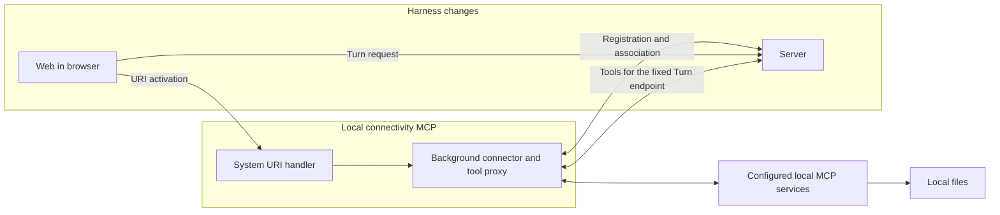

> Historical baseline imported on 2026-11-07. The confirmed text is retained in full; old source links are rendered as historical paths and project guides use local links. Old names, locations and superseded design choices are not current implementation instructions. Continue from the [current requirements](../../requirements.md), [design](../../design.md) and [acceptance record](../../acceptance.md).

# TK-20261102-local-mcp-access

English | [中文](requirement.zh.md)

## Summary

Confirmed requirements for accessing local MCP tools from a server-hosted agent through the Web. This document defines acceptance behavior; it does not claim that the behavior is implemented or that the cross-platform flow has been tested.

## Contents

- [User request](#user-request)
- [Components and responsibilities](#components-and-responsibilities)
- [Confirmed behavior](#confirmed-behavior)
- [Interaction overview](#interaction-overview)
- [Joint acceptance](#joint-acceptance)
- [Non-goals](#non-goals)
- [Unresolved](#unresolved)
- [Confirmation record](#confirmation-record)

## User request

> 当前 harness 准备部署在服务器端，作为一个 agent 服务，用户通过访问 web 功能实现 agent 操作。预期可以接入用户本地运行的 mcp ，用户本地mcp会操作用户本地文件。

## Components and responsibilities

This requirement delivers two complete, separately deployable products: the local `mcp-proxy` service and the DSH adaptation plugin. They are accepted together; internal packages or a test-assembled connection do not replace either product. The responsibilities below preserve B1–B21.

| Complete deliverable | Installation and operation | Required contents |
|---|---|---|
| Local `mcp-proxy` service | Install on the user computer, configure its DSH connection and downstream MCPs, then start/stop the background service. | Runtime, configuration loading, installation identity, outbound connection, downstream adapters, machine singleton, URI handling, local IPC, diagnostics, and installation/configuration/startup documentation. |
| DSH adaptation plugin | Package and install into the server DSH deployment, then enable/disable through one documented plugin composition. | Host, agent, API and Web integration, dependencies, configuration, lifecycle cleanup, and packaging/installation/enablement documentation. |

| Component | Responsibility | Behaviors |
|---|---|---|
| Local connectivity MCP | Enforce one process per computer, load local MCP configuration, connect through the three supported transports, and apply working-directory configuration. | B2–B5, B12 |
| Local connectivity MCP | Register and handle the system URI scheme, communicate with the server in the background, and proxy local tool discovery, execution, results, and errors. | B4, B6, B8–B9, B14–B16 |
| Harness server | Accept and track connection endpoint registrations independently of Sessions, verify browser-to-endpoint association, and report endpoint availability. | B4, B8–B10, B15 |
| Harness server | Expose the selected endpoint's tools to the agent, distinguish same-name tools, fix the endpoint for each Turn, and route calls and results without changing devices during execution. | B6–B7, B10–B11, B15 |
| Harness Web | Provide the connect-this-computer action, initiate URI activation, display association success or unavailability, and associate each initiating Turn request with its local endpoint for both new and reopened Sessions. | B8–B11 |
| Harness Web and server | Keep an executing task independent of the page lifetime, expose progress and results when the Session is reopened, and distinguish server-side temporary files from locally created and edited deliverables. | B14–B16 |
| Local connectivity MCP | Correlate tool-initiated sampling and elicitation with their originating invocation, return their responses, and answer roots from explicitly configured local directories. | B18–B20 |
| Harness Web and server | Run sampling with the Session model configuration and display elicitation requests, retaining the wait across page closure and returning the user's response. | B18–B19 |

`mcp-proxy` names the user-facing local connectivity MCP service. The DSH adaptation plugin is the server-side deliverable that supports it. `@deepseek-ai/dsh-mcp-proxy` is an internal shared library; its package name does not make it an installable local service or the complete DSH plugin. Internal provider and UI packages may retain the `mcp-proxy` family names.

The local MCP services configured behind the connectivity MCP are existing dependencies, not a third component to modify. Cross-device file consistency remains the assumption in B13, and the two delivered components are accepted together on the platforms in B17. This division does not add user isolation or login changes.

## Confirmed behavior

- B1. Harness runs on a server, and users operate the agent through the Web.
- B2. Deliver `mcp-proxy` as an installable, configurable, runnable local background service that connects to unmodified local MCP services through local configuration. Users do not separately install or start an independent helper program. Local MCP denotes a service available to other local agents, not a user identity or ownership category.
- B3. Each computer runs at most one connectivity MCP instance; the service enforces process uniqueness. One instance can connect to multiple local MCP services.
- B4. The connectivity MCP initiates its connection to the server. Users do not configure a public address or expose a local inbound port for server access.
- B5. Local MCP connections support stdio, Streamable HTTP, and legacy HTTP plus SSE transports. Local configuration supplies the command or address.
- B6. The connectivity MCP proxies tool discovery and invocation, preserving tool descriptions, input/output definitions, returned content, and errors. Stable service aliases from local configuration distinguish tools with the same name.
- B7. The agent invokes the exposed tools directly, without specifying a device identifier or invoking a generic forwarding tool.
- B8. Installation or initialization registers an operating-system URI scheme. Users click the Web action to connect this computer and permit the browser to open the local application; association then completes without entering an address, port, or pairing code. The protocol-handling entry is included with the connectivity MCP.
- B9. Local association does not depend on a fixed local listening port or infer the device from LAN addresses or MCP names. Failed association is shown as unavailable and does not select another computer.
- B10. Connection endpoint registration is independent of Session creation. For both newly created and reopened Sessions, each Turn uses the computer that submits its initiating request, and that endpoint remains fixed during execution.
- B11. A subsequent Turn in the same Session may use another computer and its tool list. Opening a page or switching Sessions does not change the endpoint of an executing Turn.
- B12. The connectivity MCP accepts a configured working directory and sets it when starting local MCP subprocesses. MCP-specific directory parameters and connections to existing services use local configuration. The connectivity MCP does not rewrite paths in tool arguments or treat the working directory as a file-access permission limit.
- B13. When switching computers, files under the corresponding working directories are assumed to be consistent. This task does not synchronize or verify that consistency.
- B14. Creation and editing of files delivered to the user take place locally through MCP. Temporary files used during processing may reside on the server. Authorized local content may be sent to the remote agent and model for processing.
- B15. A disconnected invocation reports failure or an unknown outcome explicitly. It is not automatically resent, redirected to another device, or reported as successful when its outcome is unknown.
- B16. Closing the Web page does not stop the current task. Execution continues while the local background process and server connection remain available; reopening the Session exposes progress and results.
- B17. This delivery supports the Windows local client with ordinarily installed Chrome or Edge browsers. macOS and Linux local-client implementation and acceptance are deferred; the server is still validated in its deployment environment.
- B18. Support sampling requested by local MCP tools using the current Session's model configuration, and return the model response to the requesting local MCP.
- B19. Support elicitation requested by local MCP tools: display the request in the Web, retain the pending wait when the page closes, and allow the user to continue responding after reopening it.
- B20. Support roots requested by local MCP services, returning the directories explicitly configured locally.
- B21. Package the Harness-side functionality as one complete DSH adaptation plugin deliverable with a documented installation, configuration and enable/disable entry. Its internal Cordis plugins are mountable and disposable, using existing service, event, tool, and Web extension points. Do not place MCP-specific behavior in the core agent loop, generic Session controller, or base Web components; disabling the plugins restores their existing behavior.
- B22. Deliver the Windows local client as one Electron `mcp-proxy.exe` containing the runtime and all execution dependencies; users do not separately install Node or maintain an unpacked program directory. Automatic extraction to a user cache is allowed. Configuration, installation identity, diagnostics and user deliverables remain external. The executable provides the documented configuration, start, stop and URI installation/removal operations; the DSH server plugin remains a separate deliverable.

- B23. The Windows Electron client provides a configuration GUI. Closing its window hides it to the tray without stopping connections or MCPs; clicking the tray icon shows the GUI. The tray context menu lists DSH connection statuses and provides Exit. Exit requires no second confirmation and disconnects all DSH connections, cancels affected calls and stops owned MCP subprocesses before the application exits.
- B24. One machine-wide connector can connect to multiple DSH HTTPS origins simultaneously. The GUI displays each origin and its connection state and allows independent manual disconnection. Disconnecting one DSH does not disconnect others. Manual disconnection suppresses automatic reconnection until a new explicit connection action from that DSH Web.
- B25. The GUI lists local MCP services and supports adding and deleting them. All DSH connections share the same local MCP list; changes apply to all connections. The connectivity MCP remains an aggregator, and file operations belong to downstream MCP services.
- B26. Manual DSH disconnection immediately cancels its affected calls; deleting a local MCP immediately cancels calls using that MCP across all DSH connections. The GUI explains the impact before execution. Other connections and MCP services continue. Unknown external effects remain unknown, and cancelled or uncertain operations are not replayed.
- B27. Each DSH Web initiates activation. The local application automatically redeems the one-use ticket and connects, including first use of a new HTTPS origin, without an application allow/deny dialog or manual server credentials. Registered connections automatically reconnect after transport failure or application restart. Manual disconnection suppresses reconnection until that DSH explicitly activates again. Existing DSH/browser authentication, TLS verification and source-bound device proofs remain in force; browser/OS launch prompts are not suppressed.

- B28. Every forwarded local MCP invocation is bound to its originating DSH connection and generation. Queueing, execution, cancellation, callbacks and results retain that binding. Identical invocation IDs from different DSH deployments cannot collide; results return only to the original DSH. Missing, stale or mismatched ownership rejects the operation instead of selecting another connection. This is internal routing metadata and does not change downstream tool arguments.

## Interaction overview

The diagram groups the two components by delivery responsibility and summarizes B4 and B8–B11. URI activation associates the browser with its local connection endpoint; it does not replace user authentication.

## Joint acceptance

Acceptance starts from the two packaged deliverables: install and configure the local service, install and enable the DSH adaptation plugin, start both through their documented entries, then exercise the Web and server-hosted agent. Verify stop/uninstall for the local product and disable/uninstall for the DSH plugin, including owned-resource cleanup. A library test or server-side simulated connection alone does not demonstrate completion.

- Start the connectivity MCP before creating a Session, associate it from the Web through URI activation without entering a port or pairing code, and invoke a discovered local tool through the agent (B4–B10).
- On two computers with same-name local tools, submit successive Turns in the same Session from different browsers. Each Turn uses the initiating computer's tools; opening the Session elsewhere does not redirect an executing Turn (B6, B10–B11).
- Create or edit a deliverable through a local tool under the configured working-directory behavior, while allowing processing-only temporary files on the server and assuming the cross-device consistency stated in B13 (B12–B14).
- Interrupt the connector's server connection during an invocation and verify that the outcome is reported as failed or unknown without automatic resend, device substitution, or false success (B15).
- Close the Web page while a task runs, keep the local background connection available, and reopen the Session to inspect progress and results (B16).
- Invoke a local tool that requests sampling and verify that its model request uses the current Session configuration and its response reaches the originating tool (B18).
- Let a local tool request user information, close and reopen the Web page while it waits, then answer and verify that the original invocation continues without executing the tool again (B19).
- Query roots from a local MCP and verify that the response contains the explicitly configured local directories rather than server working directories (B20).
- Enable the Harness plugins to run the integrated flow, then unload them and verify removal of their routes, tools, UI, listeners, and live connection resources; ordinary unbound Sessions retain existing behavior (B21).

Exercise the supported local MCP transports in B5 and the operating-system/browser combinations in B17 across this acceptance scope.

- Run two distinct DSH deployments against one installed Windows EXE and shared local MCP. Exercise duplicate IDs and out-of-order results/callbacks, proving each response and cancellation remains with its originating DSH (B24, B28).
- Validate GUI MCP add/delete, failure rollback, deletion during calls, same-alias replacement and unaffected services; check close-to-tray, tray status, second launch and complete Exit cleanup (B23, B25–B26).
- Validate automatic first-origin ticket redemption with no application confirmation, duplicate/expired activation rejection, TLS failure without insecure fallback, and manual-disconnect intent across restart and late pairing responses (B27).

## Non-goals

- User differentiation, login isolation, or domain-entry authentication changes.
- MCP resources or prompts proxying; B6 covers tool discovery and invocation.
- Cross-device file synchronization or consistency verification.
- Safari, Firefox, or Flatpak/Snap browser acceptance in the initial scope.
- Changes to unrelated DSH features outside the two authorized deliverables. Implementation of both deliverables is in scope.

## Unresolved

None.

## Confirmation record

On 2026-11-05, the user explicitly replaced the initial GUI origin-confirmation choice: DSH activation must connect automatically while preserving manual disconnection. Updated B27 supersedes the earlier first-origin allow/deny decision; no additional design approval is needed for this authorized change.

The user additionally required explicit originating-DSH ownership for forwarded requests and confirmed internal routing validation without changing downstream tool arguments. B28 records this requirement.

On 2026-11-05, the user requested the GUI, tray and MCP management, clarified that multiple connections mean multiple DSH service addresses, selected a shared local MCP list and Web-initiated connections, and confirmed immediate cancellation plus first-origin approval with subsequent automatic reconnection. These answers confirm B23–B27; approval of their implementation design is separate from the earlier B1–B22 approval.

On 2026-11-02, the user confirmed the complete B1–B17 summary and authorized creation of this requirements document. The source is the original request and the subsequent answers in this chat; the behavior numbers preserve that confirmed summary.

The user subsequently clarified that the connectivity MCP and its supporting Harness changes are two parts of this single requirement and requested the missing descriptions. The component responsibilities and joint acceptance sections express that clarification; B1–B17 remain unchanged.

In Q29, the user confirmed sampling, elicitation, and roots support with the recommended model, Web-wait, and local-directory behavior. B18–B20 record this addition without renumbering earlier behaviors; the implementation proposal remains subject to separate approval.

The user subsequently required plugin-based Harness changes. B21 records that constraint; the proposal must use existing extension points rather than introducing core MCP behavior.

| Behaviors | Confirmation basis |
|---|---|
| B1–B2 | Original request, Q8, and the Q9 clarification defining local MCP without user differentiation |
| B3 | Q24: one connectivity MCP per computer, enforced by the service |
| B4–B7 | Q10, Q13, Q27, Q28, and the final summary |
| B8–B9 | Q22 and the final summary; system URI activation is the selected association mechanism |
| B10–B11 | Q20 and the final summary: selection is fixed per Turn, not permanently per Session |
| B12–B14 | Q17, Q14, Q5–Q6, and the final summary |
| B15–B16 | Q25–Q26 and the final summary |
| B17 | Q23 and the final summary |
| B18–B20 | Q29: affirmative confirmation of the three recommended client capabilities |
| B21 | Explicit request to implement Harness-side changes through plugins |
| B2, B21 and joint acceptance | Explicit clarification: a runnable local mcp-proxy service and a packaged DSH adaptation plugin are the two complete deliverables |

Official documentation was consulted for URI handling on [Windows](https://learn.microsoft.com/en-us/windows/apps/develop/launch/launch-default-app), [macOS](https://developer.apple.com/documentation/coreservices/launch_services), and [Linux desktops](https://specifications.freedesktop.org/shared-mime-info/latest-single/). This establishes platform support for the mechanism, not successful execution of this project's connector. Implementation acceptance must exercise the B8–B11 flow on the B17 platforms.
