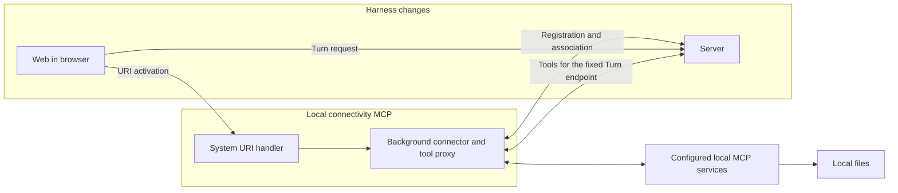

> 历史基线，迁入于 2026-11-07。以下完整保留已确认文本；旧源码链接转为历史路径文字，项目自身指南改为本地链接。旧包名、旧目录、已取代的设计不能用于现行实现。后续开发以[现行需求](../../requirements.md)、[技术方案](../../design.md)和[验收记录](../../acceptance.md)为入口。

# TK-20261102-local-mcp-access

[English](requirement.md) | 中文

## 概要

本文记录通过 Web 使用服务器端 agent（智能体）调用本地 MCP 工具的已确认需求，定义验收行为，不表示功能已经实现或跨平台流程已经实测通过。

## 目录

- [用户原话](#user-request)
- [需求构成与职责](#components-and-responsibilities)
- [已确认行为](#confirmed-behavior)
- [交互概览](#interaction-overview)
- [联合验收](#joint-acceptance)
- [非目标](#non-goals)
- [未决](#unresolved)
- [确认记录](#confirmation-record)

## 用户原话

> 当前 harness 准备部署在服务器端，作为一个 agent 服务，用户通过访问 web 功能实现 agent 操作。预期可以接入用户本地运行的 mcp ，用户本地mcp会操作用户本地文件。

## 需求构成与职责

本需求交付两个完整、可分别部署的产品：本地 `mcp-proxy` 服务与 DSH 适配插件。两者联合验收；内部包或测试代码组装的连接不能替代任何一个产品。以下职责划分保留 B1—B21。

| 完整交付物 | 安装与运行 | 必须包含的内容 |
|---|---|---|
| 本地 `mcp-proxy` 服务 | 安装到用户电脑，配置 DSH 连接与下游 MCP，再启动、停止后台服务。 | 运行时、配置加载、安装身份、出站连接、下游适配、机器单实例、URI 处理、本地 IPC、诊断，以及安装、配置、启动文档。 |
| DSH 适配插件 | 打包并安装到服务器 DSH 部署，通过一个有文档的插件组合启用、禁用。 | 服务端、agent、API 与 Web 集成、依赖、配置、生命周期清理，以及打包、安装、启用文档。 |

| 构成部分 | 职责 | 对应行为 |
|---|---|---|
| 本地连通 MCP | 保证每台电脑进程唯一，加载本地 MCP 配置，通过三种已确认的传输方式接入服务，并应用工作目录配置。 | B2—B5、B12 |
| 本地连通 MCP | 注册并处理系统 URI 协议，在后台与服务器通信，代理本地工具发现、执行、结果及错误。 | B4、B6、B8—B9、B14—B16 |
| Harness 服务端 | 接收并维护独立于会话的连接端登记，校验浏览器与连接端的关联，并提供连接端可用状态。 | B4、B8—B10、B15 |
| Harness 服务端 | 向 agent 提供所选连接端的工具，区分同名工具，按轮次固定连接端，转发调用及结果，执行期间不更换设备。 | B6—B7、B10—B11、B15 |
| Harness Web | 提供连接本机入口，发起 URI 唤起，展示关联成功或不可用状态；对新建及重新打开的会话，将每轮发起请求关联到本机连接端。 | B8—B11 |
| Harness Web 与服务端 | 使正在执行的任务不依赖页面存续，重新打开会话后展示进度和结果，并区分服务端临时文件与本地创建、编辑的交付文件。 | B14—B16 |
| 本地连通 MCP | 将工具发起的 sampling、elicitation 关联到原始调用并回传响应，根据本地显式配置的目录回答 roots。 | B18—B20 |
| Harness Web 与服务端 | 使用会话模型配置执行 sampling，展示 elicitation 请求，在页面关闭后保留等待并回传用户回答。 | B18—B19 |

`mcp-proxy` 是面向用户的本地连通 MCP 服务名称。DSH 适配插件是支持该服务的服务器端交付物。`@deepseek-ai/dsh-mcp-proxy` 是内部共享库；包名不表示它本身就是可安装的本地服务或完整 DSH 插件。内部提供方与 UI 包可继续沿用 `mcp-proxy` 命名系列。

连通 MCP 后方配置接入的本地 MCP 是现有依赖，不是需要改造的第三个交付部分。跨设备文件一致性仍采用 B13 的假设，两端按 B17 的平台范围联合验收。此职责划分不增加用户隔离或登录改造。

## 已确认行为

- B1. Harness 部署在服务器，用户通过 Web 操作 agent。
- B2. 将 `mcp-proxy` 交付为可安装、可配置、可启动的本地后台服务，通过本地配置接入未经修改的本地 MCP 服务。用户无需另外安装、启动独立辅助程序。本地 MCP 指其他本地 agent 可直接使用的服务，不表示用户身份或归属分类。
- B3. 每台电脑至多运行一个连通 MCP 实例，由服务保证进程唯一。一个实例可接入多个本地 MCP 服务。
- B4. 连通 MCP 主动连接服务器，不要求用户配置公网地址或开放供服务器访问的本地入站端口。
- B5. 本地 MCP 接入支持 stdio、Streamable HTTP、旧 HTTP＋SSE（Server-Sent Events）三种传输方式，通过本地配置指定命令或地址。
- B6. 连通 MCP 代理工具发现与调用，保留工具描述、输入输出定义、返回内容和错误。使用本地配置中的稳定服务别名区分同名工具。
- B7. agent 直接调用代理后的工具，无须自行指定设备编号或调用通用转发工具。
- B8. 安装或初始化时注册操作系统 URI 协议。用户在 Web 点击连接本机，允许浏览器打开本地应用后自动完成关联，无须输入地址、端口或配对码。协议处理入口包含在连通 MCP 的交付物中。
- B9. 本机关联不依赖固定本地监听端口，也不根据局域网地址或 MCP 名称猜测设备。关联失败时明确显示不可用，不改用其他电脑。
- B10. 连接端登记独立于会话创建。对于新建或重新打开的会话，每轮任务使用发起该轮请求的电脑，并在执行期间固定该连接端。
- B11. 同一会话允许后续轮次更换电脑，并使用新连接端的工具清单。打开页面或切换会话不改变正在执行轮次的连接端。
- B12. 连通 MCP 可配置工作目录，启动本地 MCP 子进程时设置该目录。需要专用目录参数或连接已有服务时，通过本地配置指定。连通 MCP 不自动改写工具参数中的路径，也不将工作目录视为文件访问权限限制。
- B13. 更换电脑时，假定对应工作目录下的文件一致。本次不负责同步或校验一致性。
- B14. 交付用户的文件在本地通过 MCP 创建、编辑。处理过程中的临时文件允许存放远端。授权读取的本地内容可发送给远端 agent 和模型处理。
- B15. 调用期间连接中断时，明确返回失败或结果未知。不自动重发该调用，不转到其他设备，不将未知结果标记为成功。
- B16. 关闭 Web 页面不终止当前任务。本地后台进程与服务器连接正常时继续执行，重新打开会话后可查看进度和结果。
- B17. 本次交付支持 Windows 本地客户端，以及普通安装的 Chrome 或 Edge 浏览器。macOS、Linux 本地客户端的实现和验收暂缓；服务端仍在其部署环境验证。
- B18. 支持本地 MCP 工具发起 sampling，使用当前会话的模型配置执行，并将模型响应返回发起请求的本地 MCP。
- B19. 支持本地 MCP 工具发起 elicitation，由 Web 展示请求；页面关闭时保留等待，重新打开后允许用户继续回答。
- B20. 支持本地 MCP 服务请求 roots，返回本地显式配置的目录。
- B21. Harness 侧功能打包为一个完整的 DSH 适配插件交付物，提供有文档的安装、配置及启用、禁用入口；其内部 Cordis 插件可挂载、可释放，使用现有服务、事件、工具及 Web 扩展点接入。不得将 MCP 专用行为写入核心 agent 循环、通用会话控制器或基础 Web 组件；禁用插件后恢复其原有行为。
- B22. Windows 本地客户端以单个 Electron `mcp-proxy.exe` 交付，内置运行时及全部执行依赖；用户无需另装 Node 或维护解压后的程序目录。允许自动释放到用户缓存目录。配置、安装身份、诊断和用户交付文件独立保存。EXE 提供有文档的配置、启动、停止及 URI 安装、移除操作；DSH 服务端插件仍独立交付。

- B23. Windows Electron 客户端提供配置 GUI。关闭窗口隐藏到托盘，不停止连接或 MCP；点击托盘图标显示 GUI。托盘右键菜单列出 DSH 连接状态及“退出”。退出无需二次确认，直接断开全部 DSH 连接，取消受影响调用，停止自有 MCP 子进程后结束应用。
- B24. 一个机器级唯一的连通 MCP 可同时连接多个 DSH HTTPS 地址。GUI 分别展示地址、连接状态，并允许独立手动断开。断开一个 DSH 不影响其他连接。手动断开后不自动重连，直到该 DSH Web 再次显式发起连接。
- B25. GUI 展示本地 MCP 列表，支持增加和删除。所有 DSH 连接共用一份本地 MCP 列表，变更对所有连接生效。连通 MCP 仍负责聚合代理，文件操作由下游 MCP 执行。
- B26. 手动断开 DSH 时立即取消该连接的受影响调用；删除本地 MCP 时立即取消所有 DSH 中使用该 MCP 的调用。GUI 在执行前说明影响。其他连接和 MCP 服务继续运行。外部副作用未知时仍标记未知，不重放取消或结果未知的操作。
- B27. 各 DSH Web 发起激活后，本地应用自动兑换一次性票据并连接，首次使用新 HTTPS 地址也不显示应用内允许／拒绝弹窗，不要求手工配置服务器凭据。已登记连接在网络故障或应用重启后自动重连；手动断开后不重连，直到该 DSH 再次显式激活。保留 DSH／浏览器既有鉴权、TLS 校验及来源绑定设备证明，不屏蔽浏览器或操作系统唤起提示。

- B28. 每次转发本地 MCP 调用均固定其来源 DSH 连接及连接代际。排队、执行、取消、回调和结果保留该归属。不同 DSH 使用相同调用 ID 时不得冲突，结果只返回原始 DSH。归属缺失、过期或不匹配时拒绝操作，不选择其他连接。来源信息仅用于内部路由，不修改下游工具参数。

## 交互概览

下图按交付职责划分两个构成部分，并概括 B4 与 B8—B11。URI 唤起用于将浏览器关联到本机连接端，不替代用户鉴权。

## 联合验收

验收从两个打包交付物开始：安装并配置本地服务，安装并启用 DSH 适配插件，通过文档规定的入口启动两端，再验证 Web 与服务器端 agent 流程。还须验证本地产品的停止、卸载，以及 DSH 插件的禁用、卸载和自有资源清理。只有库测试或服务端模拟连接，不能证明本需求完成。

- 先启动连通 MCP，再创建会话；从 Web 通过 URI 唤起完成本机关联，无须输入端口或配对码，并由 agent 调用发现的本地工具（B4—B10）。
- 两台电脑提供同名本地工具，在不同浏览器中向同一会话发起前后两轮任务。每轮使用发起电脑的工具，在另一台电脑打开会话不改变执行中轮次的调用去向（B6、B10—B11）。
- 按已确认的工作目录行为，通过本地工具创建或编辑交付文件，同时允许服务端使用仅用于处理的临时文件，并采用 B13 的跨设备文件一致性假设（B12—B14）。
- 在调用期间中断连通 MCP 与服务器的连接，确认返回失败或结果未知，不自动重发、替换设备或错误报告成功（B15）。
- 任务执行中关闭 Web 页面，保持本地后台连接可用，再次打开会话查看进度和结果（B16）。
- 调用会请求 sampling 的本地工具，确认模型请求采用当前会话配置，响应返回原始工具（B18）。
- 本地工具请求用户补充信息后，在等待期间关闭并重开 Web，回答后确认原调用继续，不重新执行工具（B19）。
- 本地 MCP 查询 roots，确认返回本地显式配置的目录，而不是服务端工作目录（B20）。
- 启用 Harness 插件运行完整流程，再卸载插件，确认其路由、工具、界面、监听器和存活连接资源均被移除，普通未绑定会话保持原有行为（B21）。

上述验收范围须覆盖 B5 的本地 MCP 传输方式和 B17 的操作系统、浏览器组合。

- 以两个独立 DSH 部署连接同一个安装后的 Windows EXE 及共享本地 MCP，覆盖重复 ID 和乱序结果／回调，验证每个结果与取消始终归属原 DSH（B24、B28）。
- 验证 GUI MCP 增删、失败回滚、执行中删除、同别名替换与无关服务，检查关闭隐藏到托盘、托盘状态、二次启动及完整退出清理（B23、B25—B26）。
- 验证首次地址自动兑换票据且无应用内确认、重复／过期激活拒绝、TLS 失败不降级，以及重启和迟到配对响应下的手动断开意图（B27）。

## 非目标

- 用户区分、登录隔离或域名入口鉴权改造。
- MCP resources 或 prompts 代理；B6 覆盖工具发现与调用。
- 跨设备文件同步或一致性校验。
- 首期对 Safari、Firefox 或 Flatpak/Snap 浏览器进行验收。
- 修改两个已授权交付物之外的无关 DSH 功能。两个交付物的产品实现均在本次范围内。

## 未决

无。

## 确认记录

2026-11-05，用户明确替换此前首次地址确认选择：DSH 激活时须自动连接，同时允许手动断开。修订 B27 覆盖先前的首次允许／拒绝决定；本次变更已由该指令授权。

用户进一步要求转发请求时明确来源 DSH，并确认采用内部路由校验、不修改下游工具参数。B28 记录该要求。

2026-11-05，用户提出 GUI、托盘和 MCP 管理，明确多连接指多个 DSH 服务地址，选择共用本地 MCP 列表及 Web 发起连接，并确认立即取消受影响调用、首次确认地址及后续自动重连。这些回答确认 B23—B27；其实现方案须单独批准，不沿用 B1—B22 的既有批准。

2026-11-02，用户确认完整的 B1—B17 汇总，并授权创建本需求文档。需求来源为本次对话的用户原话与后续回答；行为编号保留已确认汇总中的编号。

用户随后明确连通 MCP 与 Harness 针对连通 MCP 的改造是同一需求的两个构成部分，并要求补充缺少描述。“需求构成与职责”和“联合验收”章节落实该澄清，B1—B17 保持不变。

用户在 Q29 确认纳入 sampling、elicitation 和 roots，并采用推荐的会话模型、Web 等待及本地目录行为。B18—B20 记录此次补充，不重排已有编号；实现方案仍须单独批准。

用户随后要求 Harness 端改动通过插件实现。B21 记录该约束，方案须复用现有扩展点，不引入核心 MCP 专用行为。

| 行为 | 确认依据 |
|---|---|
| B1—B2 | 用户原话、Q8，以及 Q9 对本地 MCP 不表示用户区分的澄清 |
| B3 | Q24：每台电脑一个连通 MCP，由服务保证进程唯一 |
| B4—B7 | Q10、Q13、Q27、Q28，以及最终汇总 |
| B8—B9 | Q22 与最终汇总；采用系统 URI 唤起完成关联 |
| B10—B11 | Q20 与最终汇总：按轮次固定连接端，不永久绑定会话 |
| B12—B14 | Q17、Q14、Q5—Q6，以及最终汇总 |
| B15—B16 | Q25—Q26 与最终汇总 |
| B17 | Q23 与最终汇总 |
| B18—B20 | Q29：明确接受三类客户端能力及推荐处理方式 |
| B21 | 用户明确要求 Harness 端改动使用插件方式进行 |
| B2、B21 与联合验收 | 用户明确澄清：可运行的本地 mcp-proxy 服务和打包的 DSH 适配插件是两个完整交付物 |

已查阅 [Windows](https://learn.microsoft.com/en-us/windows/apps/develop/launch/launch-default-app)、[macOS](https://developer.apple.com/documentation/coreservices/launch_services) 和 [Linux 桌面](https://specifications.freedesktop.org/shared-mime-info/latest-single/)的 URI 处理官方资料。这些资料确认平台支持该机制，不代表本项目连通程序已经运行通过。实现验收须在 B17 平台上执行 B8—B11 流程。
