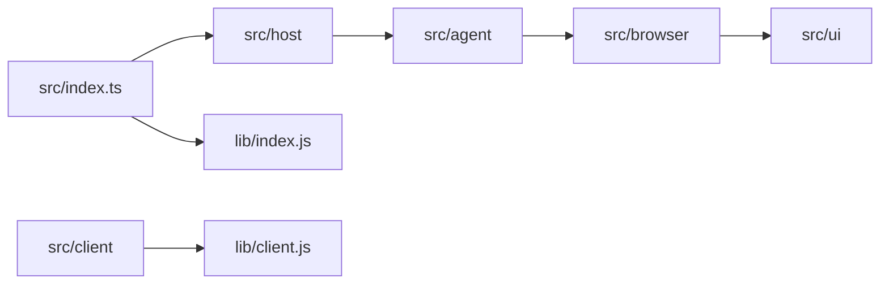

# DSH 插件普通源码结构

用户批准将插件内部组件改为普通源码、相对路径直接调用，保持功能与生命周期；当前未提交的旧包名兼容退休/文档清理一并提交，暂缓项不变。

- 移除服务端 modules/ 布局、组件自包导入、子路径导出及组件独立编译配置；测试按职责移至 tests/。
- 直接引用组件对象并用父作用域拥有的 Cordis fiber 顺序挂载，等待激活后再继续；晚失败先回滚所有已建组件，父级释放等待清理，重启重新按原顺序挂载。
- 保留一个 DSH 父级 Loader 入口及浏览器发现元数据；组件不再注册 Loader 子入口。服务端与浏览器代码独立 bundle，保留原预算/TLS/路由/取消行为。
- 组件重复许可证与通知由父包完整文本覆盖，UI 自动化约束合并至父 AGENTS。无内部 npm 包或版本。
- 本机重构期间旧目录链接归档曾影响协议源码和本地依赖：源码已从保留归档恢复，与 Git 基线无差异；公共依赖按冻结锁文件离线恢复，随后重新执行完整验证。此问题未通过修改业务或测试断言规避。

对应提交的原生/浏览器 CI 才是产物验证依据；Intel DMG、其他系统完整 GUI、真实模型、多设备、跨用户、历史及发行范围继续按 acceptance 保留。
