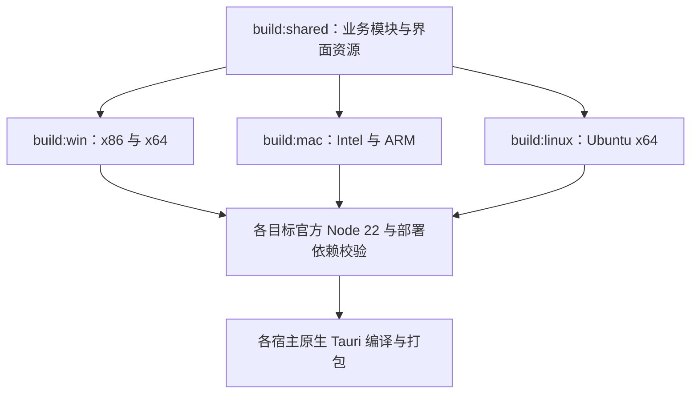

# Tauri 与跨平台构建迁移

## 已确认目标

- T1：pnpm >=10，不再下载或强制切换到某个 pnpm 精确版本；依赖仍由 lockfile 固定。
- T2：以 Tauri 替换 Electron 桌面层；保留 Node/DSH 业务核心，界面、配对、调用归属、安全与退出语义不变。
- T3：统一 Node 22；发现必须使用 Node 24 的功能时先列出具体原因，请用户确认。当前锁定官方 Node 22.23.5，各目标校验 SHA256。
- T4：以 Node.js 编排构建、验证、初始化与证书生成，不引入或保留未经确认的 PowerShell 依赖。
- T5：复用根 package.json 管理公开脚本和 npm 依赖；Cargo.toml/Cargo.lock 管理 Rust 依赖。
- T6：Windows 提供 build:win:32、build:win:64、build:win；改为安装包，可在首次安装时自动安装缺失的 WebView2。
- T7：macOS 提供 build:mac:intel、build:mac:arm、build:mac；Linux 提供 build:linux，以 Ubuntu x64 为目标。
- T8：删除顶层 build。新增 build:shared；每次平台聚合构建只执行一次共享阶段，目标相关运行时与原生打包分别执行。

用户已明确：不采用跨系统远程 build 编排，不保留多个 Node 主版本，不再要求 Windows 单 EXE 便携分发。
这些变更取代旧 B17 的仅 Windows 交付边界以及 B22/B23 的 Electron/单 EXE 技术限定；对应业务行为继续保留。

## 保持的行为与验证边界

保留配置格式、身份、目录、MCP 服务管理、DSH 配对和 TLS 校验；关闭窗口只隐藏，托盘退出必须等待自有服务和子进程结束。
URI 安装/卸载继续验证所有者，不覆盖未知入口；单实例、IPC 权限、调用不重放与产物内容校验继续验证。
Windows 保留原有应用数据位置；已有其他安装拥有 URI 时仍拒绝接管。

共享产物不得含宿主专属 Node 或 native addon；各架构的 Node、原生依赖、Rust 二进制必须与目标匹配。
不能用 x86 界面加 x64 Node 声称支持 32 位 Windows，也不能以脚本存在或交叉编译成功替代真实平台验收。
Windows、macOS、Ubuntu 的实际构建、原生产物与 GUI 验证结果分别记录，迁移过程中不沿用 Electron 的历史通过结论。

## 当前执行状态

- 已完成用户选项确认、Tauri/Rust 桌面与 Node 监督进程、五目标构建计划、共享缓存/依赖部署复用与 Node.js 验证入口。
- Node 22 默认测试已验证；Windows x86/x64 安装包已生成，两种架构各五项原生产物用例通过。
- 已复现并修正 Windows verbatim 入口路径、x86 Job/上游 ABI 尺寸与 CRT 句柄宽度，以及 Tauri 安装包类型标记导致的程序绑定差异。
- pnpm 10.0/11 的冻结补丁元数据兼容验证通过；兼容镜像与 postinstall 不改变锁定依赖或既有四事件补丁。
- Windows x86/x64 实际安装、完整程序/运行时校验、CLI、卸载和 URI 保留均通过；各五项原生产物用例零跳过。
- 本地分层结果及构建哈希见[本轮证据](../evidence/tauri-local-2026-11-16.json)。该记录是提交前工作区证据，不覆盖旧 Electron commit。
- 本机浏览器预检发现已有 URI owner，安全拒绝；不卸载或接管既有安装。Tauri Chrome/Edge/托盘在干净 CI 中继续验证。
- 首轮 CI 已执行：pnpm 10/11/12、共享检查、Ubuntu 编译/提取安装包通过；Windows 的 PATH/MSYS tar 与 macOS DMG 清理中间 `.app` 已修正，并补充回归。
- POSIX 原生产物用例暴露身份夹具的默认 0644 权限不满足 DSH 凭据安全检查，改为 0600；真实产品用例继续验证，安全检查不变。
- pnpm 11.28 的无关 workspace hoist 及嵌套开发依赖复制已复现并修正；macOS Intel 另遇 DMG 布局脚本卸载超时，改为保留 Tauri app 并直接创建只读 DMG。
- 独立复审发现的监督进程崩溃退出和普通 NSIS 卸载 URI 清理已补齐；`7bd8040` CI 已验证 Unix 清理及两种 Windows 安装包的注册后普通卸载。
- `7bd8040` 的 Ubuntu 与 macOS ARM 原生任务已完整通过，包含真实进程清理、安装包校验和三项 profile 用例；`72d79bc` 再次通过两目标。
- 权限探测的 EPERM 被当作进程退出已通过失败测试复现，现仅 ESRCH 证明退出，其余错误保持失败并允许重试。
- Windows GUI 空白已在私有调试构建复现：绝对 frontendDist 盘符被解析为 URL，文件导航被正常拒绝。改为相对嵌入目录后已验证本地自然启动，后续 CI 结果如下。
- `72d79bc` 已通过 Windows x86/x64 各五项产物用例、真实安装/注册后普通卸载、两架构完整 Chrome/Edge GUI/托盘矩阵及各自冷启动清理。
- Intel DMG 三次路径均在镜像收尾失败，提权未解决；用户决定保留 DMG，记录并跳过当前宿主，换 Mac 后再测。详见[暂缓记录](../evidence/mac-intel-dmg-deferred-2026-11-16.md)。默认 CI 明示跳过，手工 runner 输入可恢复验证；移除无效提权选项。
- 正在跟进新提交的各平台原生与 Windows 浏览器 CI；尚未正式发布。真实模型、跨用户、多设备及全部故障矩阵不因迁移通过而关闭。
