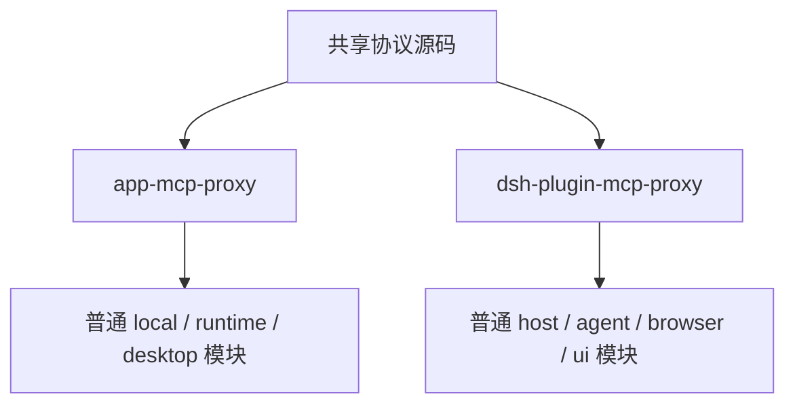

# 两个交付包的收敛

2026-11-18 后续变更：用户确认取消旧包名自动迁移，当前仅支持两个父包名称。下文旧 profile 迁移属于 2026-11-17 的实现记录，现行操作见 development.md；身份和配置仍保留，包引用须手工更新。

用户确认：仅保留 DSH 插件与 MCP Proxy 应用两个包，业务行为不变；现有未提交改动一并交付，Intel DMG 等暂缓及 A1—A7 未验证范围保持不变。

- pnpm 只匹配 packages/*；七个内部 package.json 已移除，类型检查配置仍可按源码职责拆分。
- 父包提供组件子路径，tsdown 将内部实现/共享协议打入父包 lib，并生成声明；插件只 pack 一次，不嵌套内部 npm 包。
- DSH 浏览器元数据与模块 ID 在插件父包登记一次，子组件维持 Loader 生命周期与回滚；应用父包提供 runtime/startup/desktop 入口。
- 应用的随包 DSH 安装根必须声明本地应用包，保证 profile 的子路径解析可用。原生产物回归已复现缺少声明时的 ERR_MODULE_NOT_FOUND，修复后须重建、复验。
- 原安装目录、服务/URI 所有权、身份和业务配置保留；旧 runtime profile 仅迁移已知 bundle/dependency 引用，冲突身份拒绝。
- 先前的顶层包名调整、logs/verify 迁移、合并 LICENSE 及脚本收敛一起保留。公共依赖自身的许可证与通知不替换。

验证按对应提交的 CI 和 .artifacts/ci 报告确认，不继承旧提交绿灯。Windows x86 为 WoW64 验证；真实模型、多设备、跨用户、历史恢复、Mac/Linux GUI、签名发行及 Intel DMG 仍按验收清单保留。
