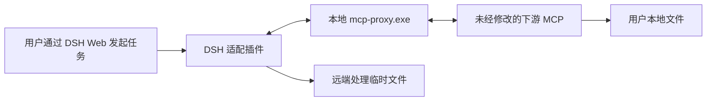

# 已确认需求

本文是独立项目的现行需求入口。B1—B28 保留原有确认编号及原文；文档迁移不表示这些需求已经全部验收。独立化要求见 M1—M3，实现支持范围见下方能力表，验收状态见[验收记录](acceptance.md)。历史依据及其适用顺序见[历史基线](history/README.md)。

## 两个交付物

| 交付物 | 负责内容 | 不负责内容 |
| --- | --- | --- |
| Windows `mcp-proxy.exe` | Electron GUI、托盘、自动启动本地服务、URI 注册、单实例、共享 MCP 列表、多 DSH 出站连接及严格路由 | 内置文件工具、替下游安装 Node/Python 等运行环境、同步用户文件 |
| `@j-show/dsh-plugin-mcp-proxy` 插件归档及安装器 | DSH 接入、设备配对、浏览器关联、轮次绑定、工具及回调适配、Web UI、兼容检查 | 新账户系统、模型提供方配置、替代 DSH 核心服务 |

下游 MCP 是用户已有或另行安装的依赖，无须为本项目修改代码。连接应用不是通用文件服务器；写入与读取由下游 MCP 工具实现。内部私有模块随交付物打包，不是第三种需要用户分别安装的产品。

## 原有已确认行为

- B1. Harness 部署在服务器，用户通过 Web 操作 agent。
- B2. 将 `mcp-proxy` 交付为可安装、可配置、可启动的本地后台服务，通过本地配置接入未经修改的本地 MCP 服务。用户无需另外安装、启动独立辅助程序。本地 MCP 指其他本地 agent 可直接使用的服务，不表示用户身份或归属分类。
- B3. 每台电脑至多运行一个连通 MCP 实例，由服务保证进程唯一。一个实例可接入多个本地 MCP 服务。
- B4. 连通 MCP 主动连接服务器，不要求用户配置公网地址或开放供服务器访问的本地入站端口。
- B5. 本地 MCP 接入支持 stdio、Streamable HTTP、旧 HTTP＋SSE（Server-Sent Events）三种传输方式，通过本地配置指定命令或地址。
- B6. 连通 MCP 代理工具发现与调用，保留工具描述、输入输出定义、返回内容和错误。使用本地配置中的稳定服务别名区分同名工具。
- B7. agent 直接调用代理后的工具，无须自行指定设备编号或调用通用转发工具。
- B8. 安装或初始化时注册操作系统 URI 协议。用户在 Web 点击连接本机，允许浏览器打开本地应用后自动完成关联，无须输入地址、端口或配对码。协议处理入口包含在连通 MCP 的交付物中。
- B9. 本机关联不依赖固定本地监听端口，也不根据局域网地址或 MCP 名称猜测设备。关联失败时明确显示不可用，不改用其他电脑。
- B10. 连接端登记独立于会话创建。对于新建或重新打开的会话，每轮任务使用发起该轮请求的电脑，并在执行期间固定该连接端。
- B11. 同一会话允许后续轮次更换电脑，并使用新连接端的工具清单。打开页面或切换会话不改变正在执行轮次的连接端。
- B12. 连通 MCP 可配置工作目录，启动本地 MCP 子进程时设置该目录。需要专用目录参数或连接已有服务时，通过本地配置指定。连通 MCP 不自动改写工具参数中的路径，也不将工作目录视为文件访问权限限制。
- B13. 更换电脑时，假定对应工作目录下的文件一致。本次不负责同步或校验一致性。
- B14. 交付用户的文件在本地通过 MCP 创建、编辑。处理过程中的临时文件允许存放远端。授权读取的本地内容可发送给远端 agent 和模型处理。
- B15. 调用期间连接中断时，明确返回失败或结果未知。不自动重发该调用，不转到其他设备，不将未知结果标记为成功。
- B16. 关闭 Web 页面不终止当前任务。本地后台进程与服务器连接正常时继续执行，重新打开会话后可查看进度和结果。
- B17. 本次交付支持 Windows 本地客户端，以及普通安装的 Chrome 或 Edge 浏览器。macOS、Linux 本地客户端的实现和验收暂缓；服务端仍在其部署环境验证。
- B18. 支持本地 MCP 工具发起 sampling，使用当前会话的模型配置执行，并将模型响应返回发起请求的本地 MCP。
- B19. 支持本地 MCP 工具发起 elicitation，由 Web 展示请求；页面关闭时保留等待，重新打开后允许用户继续回答。
- B20. 支持本地 MCP 服务请求 roots，返回本地显式配置的目录。
- B21. Harness 侧功能打包为一个完整的 DSH 适配插件交付物，提供有文档的安装、配置及启用、禁用入口；其内部 Cordis 插件可挂载、可释放，使用现有服务、事件、工具及 Web 扩展点接入。不得将 MCP 专用行为写入核心 agent 循环、通用会话控制器或基础 Web 组件；禁用插件后恢复其原有行为。
- B22. Windows 本地客户端以单个 Electron `mcp-proxy.exe` 交付，内置运行时及全部执行依赖；用户无需另装 Node 或维护解压后的程序目录。允许自动释放到用户缓存目录。配置、安装身份、诊断和用户交付文件独立保存。EXE 提供有文档的配置、启动、停止及 URI 安装、移除操作；DSH 服务端插件仍独立交付。
- B23. Windows Electron 客户端提供配置 GUI。关闭窗口隐藏到托盘，不停止连接或 MCP；点击托盘图标显示 GUI。托盘右键菜单列出 DSH 连接状态及“退出”。退出无需二次确认，直接断开全部 DSH 连接，取消受影响调用，停止自有 MCP 子进程后结束应用。
- B24. 一个机器级唯一的连通 MCP 可同时连接多个 DSH HTTPS 地址。GUI 分别展示地址、连接状态，并允许独立手动断开。断开一个 DSH 不影响其他连接。手动断开后不自动重连，直到该 DSH Web 再次显式发起连接。
- B25. GUI 展示本地 MCP 列表，支持增加和删除。所有 DSH 连接共用一份本地 MCP 列表，变更对所有连接生效。连通 MCP 仍负责聚合代理，文件操作由下游 MCP 执行。
- B26. 手动断开 DSH 时立即取消该连接的受影响调用；删除本地 MCP 时立即取消所有 DSH 中使用该 MCP 的调用。GUI 在执行前说明影响。其他连接和 MCP 服务继续运行。外部副作用未知时仍标记未知，不重放取消或结果未知的操作。
- B27. 各 DSH Web 发起激活后，本地应用自动兑换一次性票据并连接，首次使用新 HTTPS 地址也不显示应用内允许／拒绝弹窗，不要求手工配置服务器凭据。已登记连接在网络故障或应用重启后自动重连；手动断开后不重连，直到该 DSH 再次显式激活。保留 DSH／浏览器既有鉴权、TLS 校验及来源绑定设备证明，不屏蔽浏览器或操作系统唤起提示。
- B28. 每次转发本地 MCP 调用均固定其来源 DSH 连接及连接代际。排队、执行、取消、回调和结果保留该归属。不同 DSH 使用相同调用 ID 时不得冲突，结果只返回原始 DSH。归属缺失、过期或不匹配时拒绝操作，不选择其他连接。来源信息仅用于内部路由，不修改下游工具参数。

## 独立化补充要求

- M1. 本项目独立开发、安装、测试和打包，不引用消费项目源码、绝对路径、私有导出或部署凭据。实现分别归属 `packages/mcp-proxy` 与 `packages/dsh-plugin`。消费项目只使用固定版本产物。
- M2. 根目录提供 `pnpm build:mcp-proxy` 和 `pnpm build:mcp-plugin`，分别输出到 `release/mcp-proxy/` 与 `release/mcp-plugin/`。Windows 用户仅需要 EXE；开发者构建仍需要项目声明的工具与网络依赖。
- M3. 用户批准为固定 DSH `0.1.6-alpha.2` 附带最小兼容补丁，保留必须读取的会话事件语义。不得以迁移为由把执行绑定事件改为可忽略、绕过未知事件拒绝或静默覆盖其他补丁。未来版本需要重新验证兼容性。

## 能力范围

“任意 MCP”指在下列已支持传输、协议协商及能力范围内接入未经修改的 MCP，不承诺代理 MCP 规范中的全部能力或未来版本。连通应用与 DSH 之间使用项目自有聚合协议，不是可供任意远端 MCP 客户端直接连接的标准 MCP 服务。

| 能力 | 当前实现范围及限制 | 代码依据 |
| --- | --- | --- |
| 下游传输 | stdio、Streamable HTTP、旧 HTTP＋SSE；通过锁定的官方 SDK 协商和兼容适配。不是所有协议修订均已逐一产品验收 | [drivers.ts](../packages/mcp-proxy/modules/local/src/drivers.ts) |
| tools | 发现分页、稳定服务别名、工具调用、输入输出 schema；原始工具扩展信息保留在聚合目录中 | [pool.ts](../packages/mcp-proxy/modules/local/src/pool.ts) |
| 模型可见工具 | 使用 `mcp__<别名>__<工具名>`；非法字符或过长名称规范化并附哈希。传入公共 DSH 适配器的是名称、描述及输入输出 schema，不承诺把所有 annotations、execution、`_meta` 都作为模型字段暴露 | [agent/index.ts](../packages/dsh-plugin/modules/agent/src/index.ts) |
| 工具结果 | 聚合通道保留 content、structuredContent、isError、`_meta` 及允许的 JSON 扩展。DSH/模型展示受公共适配器及模型模态支持限制，不能把原始结果保留理解为所有内容都可直接输入模型 | [protocol.ts](../packages/mcp-proxy/modules/protocol/src/protocol.ts) |
| 任务式工具 | 本地支持需要任务生命周期的旧协议工具，并保持最终结果、取消与原调用关联；现代 input-required 续接保留原始调用，不重新提交初始操作 | [legacy-tasks.ts](../packages/mcp-proxy/modules/local/src/legacy-tasks.ts)、[drivers.ts](../packages/mcp-proxy/modules/local/src/drivers.ts) |
| sampling | 使用接收回调时的会话模型；支持文本与 PNG/JPEG/WebP/GIF 图片输入（图片需要附件服务），返回文本。拒绝 sampling tools/toolChoice，不支持音频输入或任意模型输出；不依据 MCP 偏好更换模型提供方 | [sampling.ts](../packages/dsh-plugin/modules/agent/src/sampling.ts) |
| elicitation | 表单和 URL 模式；表单 UI 支持字符串、数值/整数、布尔、字符串枚举及枚举多选，不是任意嵌套 JSON Schema 编辑器。URL 由用户明确打开，服务器不抓取，历史不保存其认证 URL | [fields](../packages/dsh-plugin/modules/ui/src/client/elicitation-fields.ts)、[elicitation.ts](../packages/dsh-plugin/modules/agent/src/elicitation.ts) |
| roots | 初始化前后均由本地按服务配置回答，转换为文件 URI；不是目录沙箱或权限限制 | [callbacks.ts](../packages/mcp-proxy/modules/local/src/callbacks.ts) |
| 通知及动态目录 | 不提供任意 MCP 通知的透明隧道。配置增删、恢复会重建并确认完整目录；不承诺下游自发 tools/list_changed 或 roots 变更通知的端到端热更新 | [pool.ts](../packages/mcp-proxy/modules/local/src/pool.ts)、[managed-runtime.ts](../packages/mcp-proxy/modules/runtime/src/managed-runtime.ts) |
| 断线及重启 | 恢复身份和新连接可用性；不重放外部调用。页面关闭不终止存活调用；进程重启不恢复已丢失的 socket、调用或人工等待续接 | [design](design.md#持久化与恢复) |

## 非目标及不可推断的保证

- resources、prompts 代理不在原有已确认范围内；也不承诺通用 OAuth 登录向导、任意 MCP 扩展或自定义通知转发。
- 不进行用户间隔离改造、跨设备文件同步、一致性验证、模型选择或既有登录改造。沿用 DSH 的鉴权不等于本插件额外提供多租户隔离。
- 当前仅交付 Windows x64 桌面客户端；macOS/Linux 桌面实现与验收暂缓。仓库中的 POSIX 辅助代码和测试不构成平台交付承诺。
- 不以 `cwd`、roots、GUI 隐藏秘密字段或 TLS 加密推导下游 MCP 的文件权限、可信性或数据不出本机。获授权内容可发给远端 DSH 和模型。
- 不提供 Windows SCM 服务、登录自启、自动更新、代码签名或安装下游依赖。退出应用即停止它拥有的服务；取消不保证外部副作用回滚。

## 需求、实现与验收的适用顺序

开源开发支持的 O1—O7 目标和已批准边界见[开发环境设计](superpowers/specs/2026-11-13-open-source-development-design.md)，操作入口见[开发指南](development.md)。它们补充 M1/A6 的开发交付条件，不替代 B1—B28 的产品验收。

已确认需求和后续明确变更决定目标；当前实现事实由[技术方案](design.md)、[配置指南](configuration.md)及源码说明；缺口留在[验收记录](acceptance.md)，不得通过改写需求掩盖。修改 B/M 编号对应行为时同步更新设计和验收，保持编号稳定。新增能力超出本表时先明确目标及验收标准，再开发。
