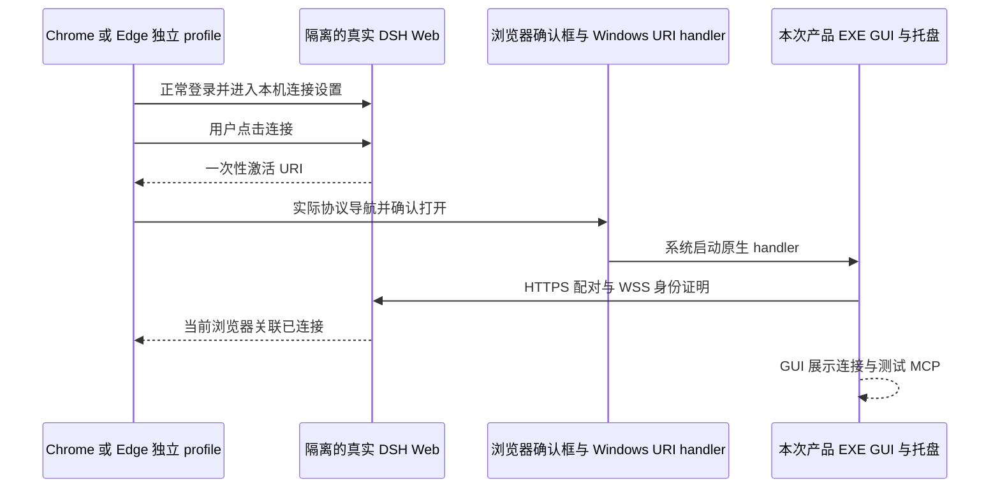

# Chrome/Edge 与 Windows 桌面端到端验收

状态：用户已批准；本地默认回归、类型检查及安全拒绝验证通过，完整矩阵待对应 CI 实际验收。

## 目标与边界

在 Windows Chrome、Edge 上分别验证真实网页手势 → 浏览器协议确认框 → 操作系统 URI handler → 本地应用 → HTTPS 自动配对 → Web/GUI 已连接，并通过 Windows 窗口与托盘验证应用生命周期。关联需求 B3/B8/B9/B23/B27，补充 A7；不替代真实模型、多设备或跨用户验收。

基线为 33379e8。复用现有产物记录、哈希和只读 runtime 清单校验、运行锁、服务位前后检查、私有测试状态及 CI 证据约定。

## 路线

| 路线 | 评价 |
| --- | --- |
| 已选择的 Windows 原生工具链：真实浏览器、CDP 和 Windows UI Automation/Win32 | 本次采用；可覆盖系统协议确认和 Explorer 托盘，不依赖原作者机器插件 |
| headless 浏览器或直接触发 Electron Tray 事件 | 不覆盖真实协议确认/原生托盘，不能作为目标场景的通过证据 |

浏览器 CDP 使用 Node 现有 WebSocket 能力；Windows 操作封装为仓库拥有的 UIA/Win32 测试辅助程序，使用现有 Windows/.NET 工具链编译或执行，不依赖宿主 AI 的私有自动化插件。继续使用现有测试框架，不新增框架依赖。具体文件拆分和内部接口由实施者决定。

## 预检与资源归属

- 必须有 Windows x64、Chrome 和 Edge、可交互输入桌面及真实 Explorer 托盘。预检报告浏览器版本、会话与桌面可用性；缺失时非零退出，不静默跳过或伪造托盘场景。
- 每次运行使用独立浏览器 user-data-dir、DSH home、客户端 home、LOCALAPPDATA、工作目录和测试身份，不读取用户浏览器历史或个人 DSH 配置。
- 进入全局验收运行锁后，检查机器服务位空闲，并要求 `HKCU/Software/Classes/mcp-proxy` 尚未被其他安装占有。当前本机此注册项已存在，因此完整本机场景应安全拒绝；不自动卸载现有安装。可在全新 CI 用户环境执行真实注册验证。
- 创建测试专用 CA 和 localhost 服务器证书；按实际证书指纹临时导入当前用户 Root 存储，保留正常 TLS 校验。退出时仅移除本轮新增且指纹一致的证书，不操作既有证书或关闭浏览器安全提示。
- 实际测试 handler 由已校验的产品 EXE 注册；记录并核验本轮 owner、配置和命令。清理仅通过匹配的所有权入口卸载，遇到归属变化则失败并保留诊断，不删除未知注册项。

## 真实环境

使用同次构建的客户端产物和服务端插件归档。服务端归档先复制到私有固定测试路径并校验哈希，再通过公开 DSH CLI 在独立 profile 安装、启动，沿用现有鉴权、模型配置和 TLS 路线。不调用原消费项目或修改个人安装。

浏览器通过 CDP 导航和读取 DOM，连接操作必须用实际按钮点击/输入事件，不直接调用 controller、拼接配对结果或调用 dev:associate 替代浏览器唤起。原生 UIA 接受协议确认框；确认框只在本轮浏览器窗口中查找，目标按钮须明确对应 mcp-proxy。不抑制确认框、不预设“始终允许”、不使用 ignore-certificate-errors。

## 每个浏览器必须执行的场景

| 场景 | 通过判据 |
| --- | --- |
| 首次连接 | 真实 DSH 设置页面可用，点击连接后出现并确认浏览器协议提示；handler 实际运行，Web 关联 connected，GUI 显示来源及测试 MCP |
| GUI 关闭 | 通过 Windows 关闭窗口动作关闭，原窗口隐藏、GUI 进程和原服务 PID 继续存活；浏览器连接保持 |
| 托盘恢复 | 在 Explorer 通知区域或其溢出区域定位本轮 mcp-proxy 图标，实际点击后原窗口可见；不创建第二个窗口或服务 |
| 二次启动 | 再启动同一产品，复用原 GUI/服务；窗口数量和服务 PID 不增加 |
| 手动断开与重新激活 | 使用 GUI 的真实断开操作验证该来源断开；通过同一浏览器再次点击并确认 URI，完成重新自动连接 |
| 托盘退出 | 实际打开托盘菜单并选择退出；无需二次确认，GUI、服务、自有 MCP 进程和托盘图标均消失，机器服务位释放 |
| 清理 | 正常卸载本轮 handler，移除本轮 CA，关闭本轮浏览器和服务端，验证自有进程退出后删除私有测试目录 |

Chrome 和 Edge 串行执行、各自独立 profile 和关联，不将一个浏览器的成功用于另一个。托盘可见性依据原生窗口/UIA 状态和 PID；禁止 `tray.emit('click')`、直接执行菜单回调或以管理 API 的成功替代原生 UI 动作。

## 失败与回收

每一步设置明确 deadline，失败记录阶段而非无限重试。重复点击一次性 URI 前必须重新读取页面状态，不重放不确定的外部操作。

通过实际创建的子进程/PID 和创建身份追踪清理，不能按进程名结束 Chrome、Edge、Explorer 或其他 mcp-proxy。失败仍检查服务位、进程、URI owner 和证书归属；只清理本轮资源，未知归属保留并使验收失败。私有现场和可能含登录 token 的原始日志不上传。

## CI 与证据

- 在现有 Windows release 流程的构建和五项原生产物测试后执行新入口，严格要求 Chrome/Edge 两组全部执行成功，零静默跳过。
- 首先在当前 GitHub Windows runner 验证交互桌面和托盘条件。若其会话不能支持真实 UI，流水线明确失败；需要选择具备交互桌面的 runner 时，再根据实际失败证据向用户确认基础设施安排，不能替换成模拟测试并声称通过。
- 浏览器版本、构建标识/哈希、逐场景结果、服务 PID 一致性、进程退出、URI 和 CA 清理结果进入脱敏报告。CI 上传报告及经过秘密检查的截图，不上传浏览器 profile、身份、证书私钥或原始登录 URL。
- 本机已有 handler 时先验证预检拒绝及单元回归；真实全流程通过证据由隔离 CI 用户运行提供，不能用本机拒绝或跳过算成功。

## 实施与验收顺序

1. 先为构建选择、注册项/CA 归属、UI 目标选择和失败清理写回归，确认失败再实现。
2. 实现隔离真实 Web、浏览器 CDP、原生 UIA 辅助与逐阶段断言。
3. 保持原五项测试及默认套件，更新 README、AGENTS、开发/验收文档并进行独立代码审查。
4. 本地可执行验证通过后，按本轮授权提交、推送 master；跟进完整 CI。发生失败先定位最小根因，再修复、验证并继续跟进。
5. 完成条件为当前 master 对应完整流水线成功，且报告证明两种浏览器场景和回收均实际执行。原 A 项中未覆盖的真实模型、跨用户、多设备等验收仍保留。
