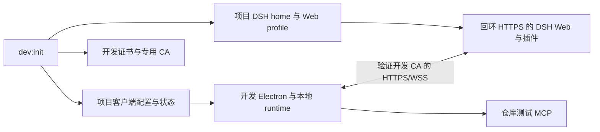

# 开源独立开发环境设计

状态：用户已批准；本地实现与隔离目录验证完成，用户已授权将完整源码提交并推送当前 master。独立代码复审未发现剩余 P1/P2。验证证据见[开发验证记录](../../evidence/development-validation-2026-11-13.json)，提交及推送结果以 Git 历史和远端引用为准。日期：2026-11-13。

## 目的与范围

让新贡献者在 Windows x64 上拉取完整源码后，仅依赖公开工具链和公共包即可安装、构建、测试，并创建可调试的本地两端环境。不依赖原作者的 checkout、缓存、profile、证书或部署账户。

依据：2026-11-13 开源评估、[现行需求](../../requirements.md)的 M1—M3、[验收](../../acceptance.md)的 A6。本设计完整列出实施契约，不依赖本地 .review 报告存在。

用户已选择 Windows 原生隔离方案。以下命令名、目录和测试组织是本设计的工程建议，批准后成为实施依据。

## 已比较的方案

| 方案 | 取舍 | 决定 |
| --- | --- | --- |
| Windows 原生、项目专用状态 | 可调试 Electron、命名管道和 URI，与交付系统一致；需准备 Windows 工具链 | 用户选择 |
| 容器 DSH + 原生 Electron | 服务端较易隔离，但增加 Docker、跨边界 TLS 和网络配置 | 本次不采用 |

不增加新产品、macOS/Linux 桌面支持、自动更新或部署平台。A1—A5/A7 的完整产品验收继续独立记录。本次不会为了无密钥开发关闭产品鉴权、TLS 或机器单实例约束。

## 可验收目标

| 编号 | 完成条件 |
| --- | --- |
| O1 | 完整的 Git 文件快照在新目录内可用 frozen lockfile 安装、build、typecheck、默认 test；不拷贝现有 node_modules/lib/release |
| O2 | 开发预检分别检查基础开发、Windows 打包前提，缺失项给出可操作诊断并非零退出 |
| O3 | 初始化重复执行保留用户配置和密钥；开发数据、证书、日志均在 .artifacts/dev 下，不读取默认用户 DSH home |
| O4 | 可以启动真实公共 DSH Web + 当前插件、本地运行时和 Electron；日志、ready 判据、源码断点和重建步骤明确 |
| O5 | 自动协议/工具检查可无真实模型密钥执行；真实浏览器模型轮次需要的个人配置独立说明 |
| O6 | CI 在 Windows 新 runner 上执行安装、预检、build、typecheck、test、两产物打包，保留验证记录及产物哈希 |
| O7 | README、AGENTS、配置/验收和贡献说明一致，公共用户不需要未提交的本地指南 |

## 开发命令与工具链

- 固定推荐的 Node LTS 版本和 pnpm 11.7.0，保持现有最低支持范围；补 Windows 安装/准备命令。具体推荐 Node 小版本由实施时对公开发行和现有构建锁验证后确定。
- `pnpm dev:doctor`：只读检查 Node、pnpm、必要包和补丁兼容性；`--packaging` 增加 x64、tar、csc、Node LICENSE 等检查。网络下载前提与常见错误进入指南，不静默修改全局设置。
- `pnpm dev:init`：创建项目拥有的配置/状态。初始化不启动 GUI、不注册 URI、不改系统 CA 信任。不覆盖已有秘密；失败明确保留已完成步骤并支持重试。
- `pnpm dev:server`：前台运行真实 DSH CLI 的开发 Web profile，绑定回环网络，使用项目开发 TLS 和既有鉴权。使用已声明的固定公共 DSH 包及仓库内的插件。
- `pnpm dev:desktop`：开发 Electron 构建和前台启动，显式传入项目配置与 DSH_HOME/LOCALAPPDATA。提供主进程、renderer、子运行时断点方式；开发输出开启 sourcemap，发布路径仍使用原设置。
- `pnpm dev:check`：无模型密钥的协议/工具冒烟检查；不把它称为真实模型或普通浏览器验收。
- 停止优先使用前台进程正常退出和现有自有服务停止接口。明确给出 URI 所有权检查、卸载和重置步骤；重置只处理已确认属于本开发环境的状态，不自动杀死未知进程或递归删除用户工作目录。

准确脚本拆分、帮助输出和实现文件名由实施者决定，保持现有 TypeScript、Vitest 和公共 app-boot/CLI API，不新增平行的 DSH 核心启动器。开发初始化不使用原作者已安装的 DSH profile；额外开发依赖若必需必须显式声明并更新锁文件。

## 两端环境与信任

开发初始化生成本机专用 CA/服务器证书和密钥，绝不复用提交的测试证书作为常驻服务身份，不提交生成的私钥。优先使用 Windows 自带可用工具；若需要可安装工具或开发依赖，明确固定来源及版本。浏览器信任由开发者显式操作，文档说明只信任项目开发 CA 及移除方法，不关闭浏览器证书校验。配置 publicOrigin、服务证书 SAN、配对地址和 WSS 地址必须一致。

沿用 DSH 自身的登录和模型设置方式：初始化提供从零配置入口与明确命令，个人模型密钥只保存在开发专用忽略文件/凭据存储中。无密钥的自动验证使用现有可复用 fixtures 和确定性测试提供方，不让模拟提供方进入发布包或代替真实模型验收。

本地固定命名管道仍是机器级单实例。启动前若另一应用占用则拒绝并提示用户自行正常退出。使用开发数据目录不能声称同时提供第二个机器实例。真实 URI 注册必须是显式开发操作，遇到其他所有者不得覆盖；没有注册时支持文档化的调试激活入口，普通浏览器 URI 验收另行执行。

## CI 与协作

新增 pull request/push 的 Windows 基础流水线，使用固定工具链、frozen lockfile，权限只读。普通流程不要求仓库 secret，不发布 npm/GitHub Release，不运行破坏真实用户服务位的产品测试。产物打包包含外部二进制下载失败的明确错误。缓存只加速下载，首次无缓存必须可运行。

记录 commit SHA、Windows/Node/pnpm 版本、各命令退出状态、跳过项与产物 SHA256，保存脱敏报告。普通托管 runner 不承担交互桌面/跨登录/双设备验收；产品测试保留显式 opt-in 入口和前置条件，不新建依赖原作者机器的 self-hosted runner。

新增 CONTRIBUTING.md、SECURITY.md，覆盖贡献路径、最小检查、问题复现材料和秘密处理。安全报告使用仓库实际可用的私密报告渠道；不可用时明确说明联系维护者的方式，不编造邮箱或响应时限。README 中链接开发指南，根/脚本/受影响包 AGENTS 保留必要约束并删除重复描述。配置指南补齐 POST /mcp-proxy/pair。

## 实施与验证顺序

1. 测试先覆盖工具链预检、初始化幂等/边界、配置有效性和进程归属，再实现脚本。
2. 建立真实 Web/profile 和 Electron 开发入口，实测 ready、重启、失败诊断及源码调试路径。
3. 补 CI、贡献/安全文档和需求/验收映射；用本轮实际输出记录结果。
4. 在独立新目录导出本轮完整文件快照，使用独立依赖安装和空开发状态执行 O1—O5 可运行部分。记录文件树指纹；原仓库的 staged 内容保留。临时资源只清理本轮拥有的路径。
5. 独立代码审查、核实反馈并修复；执行受影响检查。若本机服务位或交互浏览器不可用，保留对应未验收项，不以单元测试替代。

远端当前只有 LICENSE。实现和验证完成后仍须正式提交并推送完整项目，才能满足“别人拉取最新 commit”的交付条件；本设计批准不包含自动创建分支、推送或发布。提交/推送在变更具体可审阅后单独处理。

## 验收边界

开源可开发不等于产品全部通过 A1—A7。最终交付必须明确：本轮实现项、自动检查结果、真实联调结果、未验证产品场景、是否已有可拉取提交。对无法在当前环境验证的要求说明阻碍与复现方式，不将其标为完成。
